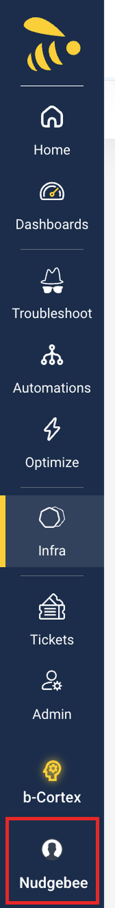
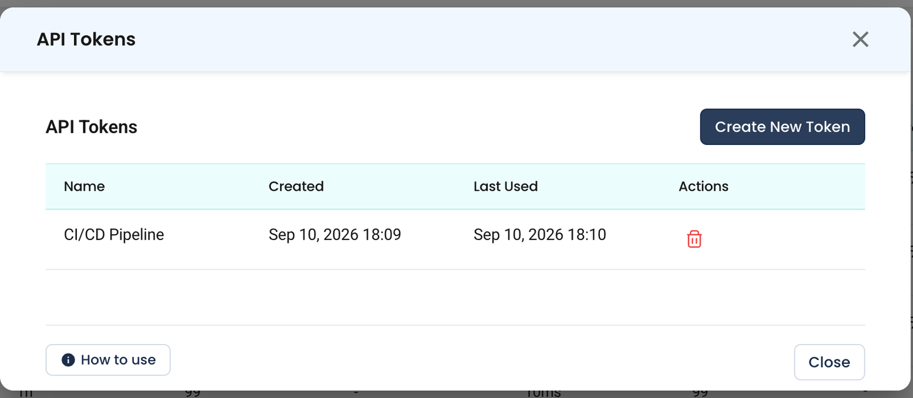
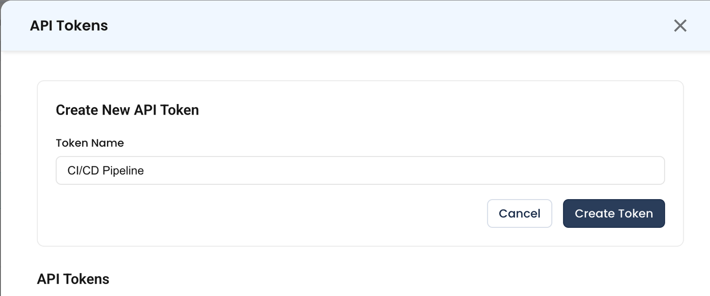
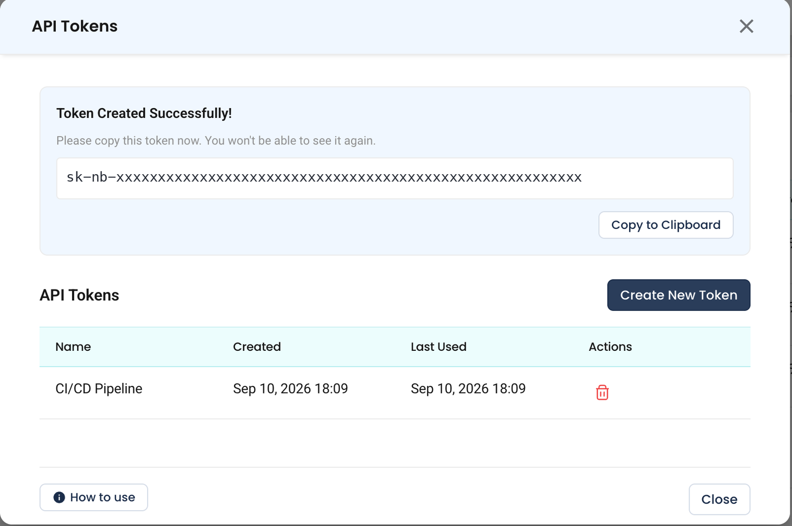

# API Tokens

API Tokens allow you to authenticate with NudgeBee APIs programmatically. You can use them to automate workflows, integrate with external tools, or build custom scripts that interact with NudgeBee.

## Accessing API Tokens

1. Click your avatar at the bottom of the left sidebar to open the user menu.




2. Select **API Tokens** from the menu.




This opens the API Tokens management modal where you can create, view, and delete tokens.

## Creating a Token

1. Click **Create Token**. The **New API token** dialog opens.
2. Pick a **Type**: **Platform** (calls the app API), **AI Gateway** (calls the AI Gateway only) or **All access** (both).
3. Enter a descriptive **Name** for your token (e.g., "CI/CD Pipeline", "Monitoring Script").
4. Choose when it **Expires**: 30 days, 90 days (the default), 365 days, Never, or a custom duration.
5. Optionally narrow its **Access** to specific modules, and for AI Gateway keys set request, token or cost limits.
6. Click **Create**.
7. **Important:** Copy the generated token immediately. You will not be able to see it again after closing the dialog.








The token list displays all your tokens with the following details:

| Column | Description |
|--------|-------------|
| **Name** | The descriptive name you assigned to the token |
| **Type** | Platform, AI Gateway or All access |
| **Created** | Date and time when the token was created |
| **Last used** | Date and time when the token was last used for authentication |
| **Expires** | When the token stops working |
| **Access** | The modules (app API) or models and endpoints (AI Gateway) the token is limited to |
| **Limits** | Request, token or cost limits on AI Gateway calls |
| **This month** | AI Gateway usage so far this month |

Tenant admins also get a **My keys** / **All keys** switch to see every token in the tenant.

## Deleting a Token

1. Click **Revoke** next to the token you want to remove.
2. Confirm the deletion in the dialog that appears.

**Note:** Deleting a token is irreversible. Any scripts or integrations using the deleted token will stop working immediately.

## Using API Tokens

Send the token itself as a Bearer token. There is no exchange step.

```bash
curl https://app.nudgebee.com/api/rpc \
  -i \
  -H 'content-type: application/json' \
  -H "Authorization: Bearer $NB_API_TOKEN" \
  --data '{"jsonrpc":"2.0","id":1,"method":"accounts_list","params":{}}'
```

Replace `$NB_API_TOKEN` with the token you copied when creating it. Set `method` to the action you want and `params` to its arguments. The same Bearer token also works for GraphQL calls to `/api/graphql`.

## Security Best Practices

- **Copy tokens immediately** — tokens are only shown once at creation time.
- **Use descriptive names** — name tokens after their use case so you can identify and manage them easily.
- **Rotate regularly** — revoke old tokens and create new ones periodically.
- **Revoke compromised tokens** — if a token is exposed, revoke it immediately from the API Tokens panel.
- **Never share tokens publicly** — treat API tokens like passwords. Do not commit them to source control or share them in public channels.
- **Use environment variables** — store tokens in environment variables or secret managers rather than hardcoding them in scripts.

## Notes

- Send the token exactly as issued, including its `sk-nb-` prefix.
- The base URL in the `curl` commands should match your NudgeBee environment (e.g., `https://app.nudgebee.com` for production).
- If you are using a self-hosted or on-premise deployment, replace the base URL with your instance's domain.
