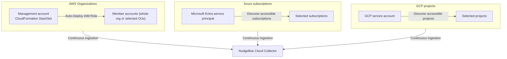

# Cloud Fleet Onboarding (AWS Organizations, Bulk Azure & GCP)

Enterprise organizations typically operate tens or hundreds of cloud accounts across AWS, Azure, and GCP. NudgeBee supports AWS Organization onboarding and lets Azure and GCP users discover the subscriptions or projects accessible to the credentials they provide.

---

## 1. Fleet Onboarding Architecture



---

## 2. AWS Organizations Fleet Onboarding

### How It Works
1. You create a CloudFormation **StackSet** from your AWS **Management Account**, using service-managed permissions.
2. The StackSet provisions the NudgeBee cross-account IAM role in the member accounts you target (your whole organization or selected OUs), including accounts added later.
3. Member accounts register in NudgeBee automatically as the StackSet deploys to each one. StackSets do not deploy to the management account itself; to monitor it, add it separately with **Add AWS Account**.

### Step-by-Step Setup:
1. In NudgeBee, go to **Admin $\rightarrow$ Integrations $\rightarrow$ Kubernetes & Cloud $\rightarrow$ AWS** and click **AWS Organization**.
2. **Set Organization Name**: enter an **Organization Display Name**, choose the **Environment** (Production or Non-production), and click **Next**. NudgeBee generates a verification token and a StackSet template URL.
3. Copy the **Verification Token** (it is shown only once) and the template parameter values.
4. Click **Launch StackSet in AWS** and create the StackSet in your Management Account with the template and parameters shown, targeting your organization or selected OUs.
5. Watch **Organization Status** in NudgeBee; member accounts appear as the StackSet reaches each one.

See [Onboarding an Entire AWS Organization](./AWS.md#onboarding-an-entire-aws-organization) for details.

---

## 3. Bulk Azure Subscriptions Onboarding

### How It Works
NudgeBee lists the subscriptions that the supplied Microsoft Entra service principal can access. The scope at which you grant its roles determines which subscriptions appear.

### Step-by-Step Setup:
1. Go to **Admin $\rightarrow$ Integrations $\rightarrow$ Kubernetes & Cloud $\rightarrow$ Azure** and click **Add Azure Account**.
2. Enter the tenant ID, client ID, and client secret for the service principal.
3. Grant the service principal the required roles at each subscription, or at a parent scope whose permissions are inherited by those subscriptions. For example, at a management-group scope:
   ```bash
   # Assign Reader at the Management Group scope (Reader also grants read access to cost data)
   az role assignment create \
     --assignee "<NUDGEBEE_APP_CLIENT_ID>" \
     --role "Reader" \
     --scope "/providers/Microsoft.Management/managementGroups/<YOUR_ROOT_MG_ID>"
   ```
4. Click **Next**, then **Discover Subscriptions**. NudgeBee lists all discovered subscriptions with check boxes to select which subscriptions to activate.

---

## 4. Bulk GCP Projects Onboarding

### How It Works
NudgeBee lists projects accessible to the supplied Google Cloud service-account key. Granting roles at an organization or folder can make those roles available to descendant projects, subject to your Google Cloud IAM policy.

### Step-by-Step Setup:
1. Go to **Admin $\rightarrow$ Integrations $\rightarrow$ Kubernetes & Cloud $\rightarrow$ GCP** and click **Add GCP Account**.
2. Paste the service-account JSON key and use **Check Permissions**.
3. Grant the required roles at the appropriate project or inherited parent scope:
   - `roles/viewer`
   - `roles/monitoring.viewer`
   - `roles/logging.viewer`
   - `roles/bigquery.dataViewer`
   - `roles/bigquery.jobUser`
   - `roles/recommender.viewer`
   - `roles/serviceusage.serviceUsageConsumer`

   See [GCP](./GCP.md) for what each role is used for.
4. Click **Next**, then **Discover Projects** and select the projects to monitor. You can also enter project IDs manually.

---

## 5. Initial Synchronization Expectations & Timelines

When onboarding a cloud fleet, data populates progressively across three phases (exact durations are approximate and depend on cloud provider export delivery schedules and account fleet size):

| Phase | Typical Duration (Approximate) | What Becomes Available |
| :--- | :--- | :--- |
| **1. Resource Discovery** | Initial discovery sweep (~minutes) | Cloud inventory (VMs, databases, buckets, networking) populates the Knowledge Graph. |
| **2. Spends Ingestion** | Dependent on provider billing export availability | Billing data (AWS CUR / Azure Cost Management / GCP BigQuery) aggregate into cost breakdown charts. |
| **3. Recommendations** | Follows resource and spend processing | Rightsizing, idle waste, and cost optimization algorithms complete analysis. |

---

## 6. Safe Resynchronization & Offboarding

- **Resyncing an Account**: If an account reports stale data or was temporarily offline, open **Agent Health** for that cloud account and click **Sync Now**.
- **Decommissioning an Account**: Remove or disable the account in NudgeBee when it should no longer be queried. Do not rely on cloud-provider deletion alone to change its NudgeBee status.
