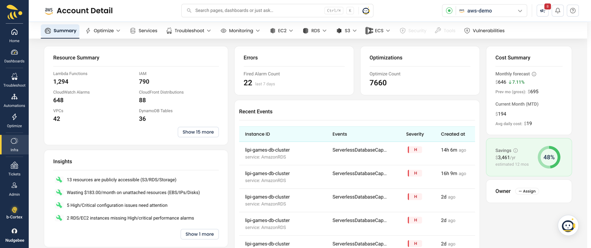

# Cloud Accounts

NudgeBee connects to AWS, Azure, GCP and Cloud Foundry, then shows each account's resources, cost, events, optimizations and logs on one **account detail** page.

## Connect an account

* [AWS](./AWS.md)
* [Azure](./Azure.md)
* [GCP](./GCP.md)
* [Cloud Foundry](./CloudFoundry.md)
* Many accounts at once: [Cloud Fleet Onboarding](./cloud-fleet-onboarding.md)

What NudgeBee collects for each service is listed in **[Supported Cloud Services](./supported-services.md)**.

## Open an account

**Infra → Cloud** opens the cloud account selected in the header account picker, or the first active cloud account if none is selected. Switch accounts with the header picker.

If no cloud account is connected yet, the page shows *Get started with Cloud monitoring*. Users who can manage integrations get a **Connect Cloud Account** button; others see *Need admin permission to connect a cloud account*.

Self-hosted VM accounts have their own page under **Infra → VM**.

## Tabs

| Tab | What it shows | Page |
|---|---|---|
| **Summary** | Resources, insights, errors, optimizations, recent events, cost and the account owner | [Account Summary](./account-summary.md) |
| **Optimize** | Recommendations: **Right Sizing**, **Configuration**, **Security**, **Infra Upgrade**, **Recommendation Resolution** | [Optimize](./optimize.md) |
| **Services** | Every service with resources, cost and recommendations | [Services & Inventory](./services-and-inventory.md) |
| **Troubleshoot** | **Events**, **Triage Rules**, **Alert Tuning** | [Troubleshoot](./troubleshoot-tab.md) |
| **Monitoring** | **Alert Manager**, **Cloud Logs**, **Cloud Metrics**, and **Traces** (GCP only) | [Monitoring](./monitoring.md) |
| Service tabs | One tab per main service, each with **Summary**, **Optimize**, **Events** and **Instances** | [Services & Inventory](./services-and-inventory.md#service-tabs) |

The service tabs depend on the provider:

| Provider | Service tabs |
|---|---|
| AWS | **EC2**, **RDS**, **S3**, **ECS** |
| Azure | **VM**, **SQL Databases**, **Blob Container**, **SQL Managed Instances** |
| GCP | **Compute Engine**, **Cloud SQL**, **Cloud Storage** |
| Cloud Foundry | **Apps**, **Organizations**, **Spaces**, **Routes** — see [Cloud Foundry screens](./CloudFoundry.md#screens) |

Cloud Foundry accounts don't have the **Services**, **Optimize** or **Monitoring** tabs. The **Security** and **Tools** tabs are shown but not available yet for cloud accounts.

Global search (⌘K) uses a few different names: *Threshold Suggestions* opens **Alert Tuning**, and *Metrics* opens **Cloud Metrics**.

## Access and permissions

- **Read access** to an account is enough to view every tab and to create tickets.
- **Write access** is needed for actions that change things: starting or stopping resources, applying a fix, creating an alarm, classifying events and assigning the owner.
- Users with a custom role need the **cloud** module to see **Infra → Cloud**.
- AWS accounts connected in **Read-Only** mode show a banner and can't run changes from NudgeBee — see [Access modes & real-time events](./access-modes-and-real-time-events.md).

## Operations

* **[Access modes & real-time events](./access-modes-and-real-time-events.md)** — Standard vs Read-Only, and connecting EventBridge, Event Grid or GCP real-time alerts.
* **[Cloud Agent Synchronization](./cloud-agent-sync.md)** — sync cycles and **Sync Now**.
* **[Cloud Synchronization & Missing Data Troubleshooting](./troubleshooting.md)** — missing spends, resources and permissions.
