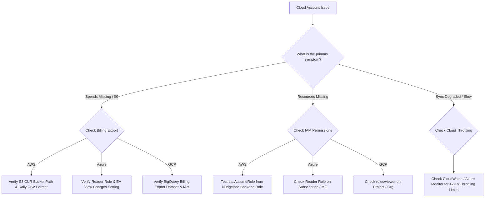

# Cloud Synchronization & Missing Data Troubleshooting

This guide provides targeted troubleshooting steps when cloud accounts in **AWS**, **Azure**, or **GCP** are missing billing data, showing incomplete resource inventories, or failing cross-account synchronization.

---

## 1. Diagnostic Decision Tree for Cloud Synchronization



---

## 2. Troubleshooting Missing Spends & Billing Data

---

### A. AWS Cost & Usage Report (CUR) Missing or Unread
* **Symptom**: Cloud Account details show resources and events, but the Spends chart shows `$0` or `No Spends Data Available`.
* **Root Causes**:
  1. **S3 Bucket Policy**: The S3 bucket storing CUR CSV files lacks read permissions for the NudgeBee Cloud Collector IAM role.
  2. **CUR Compression / Format**: The collector selects **daily CSV (`textORcsv`)** reports and supports GZIP and ZIP-compressed CSV input. Parquet reports are not supported by this ingestion path.
* **Remediation**:
  1. In AWS Billing Console $\rightarrow$ Cost and Usage Reports, ensure report format is **CSV** and time granularity is **Daily**.
  2. Verify that the role configured for the cloud account has `s3:ListBucket` on the report bucket and `s3:GetObject` on its report objects. For cross-account access, review the bucket policy against the actual configured principal rather than copying a fixed NudgeBee role ARN.

---

### B. GCP BigQuery Billing Export Permission Error
* **Symptom**: GCP account sync log displays `bigquery.tables.getData: Access Denied`.
* **Root Cause**: The Service Account has `Viewer` on the GCP project, but lacks the specific `BigQuery Data Viewer` role on the **Billing Export Dataset**.
* **Remediation**:
  In Google Cloud Console $\rightarrow$ BigQuery, locate the `gcp_billing_export_v1_*` dataset and grant `roles/bigquery.dataViewer` to the NudgeBee Service Account email.

---

## 3. Troubleshooting Cross-Account IAM & Role Assumption

### AWS: `sts:AssumeRole` Failed
* **Symptom**: Account status shows `Disconnected` with message `The role cannot be assumed or does not exist`.
* **Root Causes**:
  1. **External ID Mismatch**: If an `ExternalId` condition was specified during onboarding, it must match the account's registered secret in NudgeBee.
  2. **Trust Policy Condition**: The IAM Role's trust policy restricts access to an outdated NudgeBee backend ARN.
* **Verification Command** (run using the same caller identity as the collector; an unrelated administrator identity does not test the collector's trust relationship):
  ```bash
  aws sts assume-role \
    --role-arn "arn:aws:iam::<TARGET_ACCOUNT_ID>:role/NudgeBeeCrossAccountRole" \
    --role-session-name "NudgeBeeTestSession" \
    --external-id "<CONFIGURED_EXTERNAL_ID>" \
    --query 'AssumedRoleUser.Arn' --output text
  ```

Omit `--external-id` only if the configured role does not require one. The query prints the assumed role ARN without printing temporary credentials.

---

## 4. Configuration Issues We See Most Often

| Symptom | Usual cause | What to do |
|---|---|---|
| A new resource doesn't appear | Created after the last daily resource sync | Wait for the next sync or use **Sync Now** — see [section 5](#5-a-resource-is-missing-from-inventory) |
| Resources missing for a whole subscription, project or account | The NudgeBee identity has no read role there | Azure: **Reader** on the subscription or management group. GCP: `roles/viewer` on the project or organization. AWS: the NudgeBee role can be assumed |
| Spends show but resources don't | Billing and inventory use different permissions | Check the inventory role above; billing access alone is not enough |
| Metrics empty for a service | The service has no default metric set | Ask NuBi for the specific metric — see [Supported Cloud Services](./supported-services.md) (**Metrics** column) |
| A recommendation can't be applied | It is guidance-only for that service, or (AWS) the account is in read-only access mode | Apply it in the cloud console; the **Fixes** column lists what NudgeBee can apply |
| AWS events don't arrive | EventBridge isn't connected for the account, or its stack isn't delivering. It forwards EC2, RDS, ECS, Lambda, load balancers, SQS and SNS events plus CloudWatch alarm state changes | Choose **Connect EventBridge** in the account's row menu (**Admin → Integrations → Kubernetes & Cloud → AWS**) and check its **Real-Time Events** status — see [Access Modes & Real-Time Events](./access-modes-and-real-time-events.md). For other services, use CloudWatch alarms |

---

## 5. A Resource Is Missing from Inventory

1. **Is the service supported?** Check [Supported Cloud Services](./supported-services.md). Azure resources are listed by ARM resource type — for example Cosmos DB is `Microsoft.DocumentDB/databaseAccounts`, so search for `DocumentDB` rather than "Cosmos".
2. **Has a resource sync run since it was created?** Resources sync daily. Resources run after the daily spends sync. Use **Sync Now** on the account's agent health page and check **Last Sync** for the **Resources** feature. See [Cloud Agent Synchronization](./cloud-agent-sync.md).
3. **Can NudgeBee read it?** The resource must be in a subscription, project or account the NudgeBee identity can read, in a region where the account has resources.
4. **Is it a service discovered from billing?** A few services (marked ¹ in [Supported Cloud Services](./supported-services.md)) are discovered once they appear in the account's billing data, so a brand-new resource can take until the next billing sync to show.

If it is still missing after a successful resource sync, contact support with the account name, the resource ID and the time of the last sync.

---

## 6. NuBi Documentation Search

Ask NuBi in chat for guided troubleshooting steps:
- *"How do I fix missing AWS CUR billing data in NudgeBee?"*
- *"What IAM permissions are required for GCP BigQuery billing export?"*
