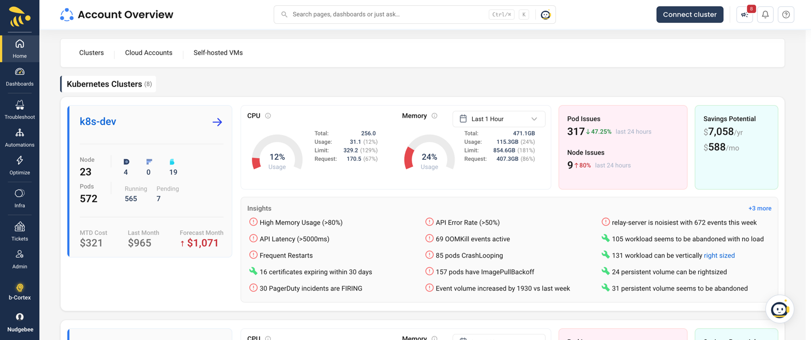

# Kubernetes

Each connected Kubernetes cluster has its own page with six tabs: **Summary**, **Optimize**, **Troubleshoot**, **Apps & Infra**, **Monitoring** and **Security & Tools**. This page explains how to get there, what each tab holds, and why a tab can be missing or grayed out.

:::info
**Prerequisite**: At least one Kubernetes cluster must be connected via the [NudgeBee Agent](../../installation/agent/installation/index.md) or through a [cloud account](../Cloud/AWS.md).
:::

## Getting to a cluster

- **Infra → K8s** in the sidebar opens the cluster selected in the header's account picker (or the one you used last, or the first one). With no cluster connected it goes to **Account Overview**.
- **Account Overview** (sidebar **Overview**) lists every connected account — **Kubernetes Clusters**, **Cloud Accounts** and **Self-hosted VMs** — with a card per cluster showing MTD cost, CPU and memory, pod issues, savings and insights. With nothing connected it offers **Add Cluster** and **Connect Cloud Account**.
- **Global search** (Ctrl/⌘+K) jumps straight to any tab.

## The cluster tabs

| Tab | Sub-tabs | Page |
|---|---|---|
| **Summary** | Cluster Summary, Cost Summary, Utilization | [below](#summary) |
| **Optimize** | Summary, Right Sizing, Auto Scaler, Unused Volumes, Best Practices, Abandoned Apps, PVC Rightsizing, Replica Rightsizing, Spot Recommendations, Recommendation Resolution | [Optimize](./optimize.md), [Auto Scaler](./autoscaler.md) |
| **Troubleshoot** | Summary, Triage Inbox, Events - By Type, Pod Errors, Node Errors, Application Errors, All Events, Anomaly, Triage Rules, Service Criticality | [Troubleshoot](./troubleshoot-tab.md), [Anomaly](./anomaly.md) |
| **Apps & Infra** | Nodes, Applications, Pods, Namespace, Services, PVC, PV, Databases, Queues | [Workloads & Pods](./workloads-and-pods.md) |
| **Monitoring** | Query Log, Log Groups, Query Metrics, Alert Manager, Service Map, Traces, Trace Group, Cross-Zone Communication, SLO, Grafana | [Logs, Traces & Service Map](./logs-traces-service-map.md), [Alert Manager](./alert-manager.md) |
| **Security & Tools** | Image Scan, CIS Scan, Sensitive Logs, Cluster Upgrade, Upgrade Planner, Certificate Issues, Helm Upgrade | [Security & Upgrades](./security-and-upgrades.md) |

### Search names vs tab names

Global search uses slightly different names for some tabs. On the page, look for the tab name:

| Search finds | Tab is called |
|---|---|
| Abandoned Resources | Abandoned Apps |
| Unused Volume | Unused Volumes |
| PV Rightsizing | PVC Rightsizing |
| Spot Recommendation | Spot Recommendations |
| App Errors | Application Errors |
| Namespaces | Namespace |
| DBMS | Databases |
| Queue | Queues |
| Query Logs | Query Log |
| Trace Grouping | Trace Group |
| Cross Zone | Cross-Zone Communication |
| SSL Certificate Issues | Certificate Issues |

## Why a tab is grayed out or missing

- **Custom roles.** Users whose access comes only from a custom role need read access to the matching module: **k8s** for Summary and Apps & Infra, **recommendations** for Optimize, **events** for Troubleshoot, **logs** for Monitoring, **security** for Security & Tools. Some sub-tabs need their own module: Anomaly (**anomalies**), Service Criticality (**workload**), Query Metrics (**metrics**), Alert Manager (**alertmanager**), Service Map, Traces, Trace Group and Cross-Zone (**traces**), SLO (**slo**). A sub-tab you can't open is grayed out; a tab with nothing you can open is disabled. Tenant and account roles see every tab.
- **Write access.** Buttons and row menus that change something (Restart, Scale, Optimize, Create New Alert…) need write access to the account; read-only users see the lists only.
- **Feature switches and data sources.** Some sub-tabs need a tenant feature (Anomaly, Upgrade Planner), Prometheus (PVC and Replica Rightsizing), a trace provider that supports them (Service Map, Trace Group, Cross-Zone) or a detected tool (Auto Scaler, Grafana). Each page below says what.

Empty tables show *No Data Available* (or *All good here!* for recommendations).

## Summary

The **Summary** tab is the cluster's front page:

- **Cluster Summary** — Nodes, Applications and Pods; Potential savings; SLO Status; Insights; **Utilization & Health** counts (Container restarts, Pending pods, Image not found, OOM, Unhealthy Statefulsets); and **Quick Links** to Query Logs, Recent Errors, Query Metrices, View Traces, Service Maps, View Applications, View Pods, Security and more.
- **Cost Summary** and **Utilization** — with a **Frequency** selector; Utilization also shows Events/Errors, *Critical Events - By Type*, *Critical Events - Recent*, *API Errors*, Automation, Optimization rules, Optimizations and Workload right sizing.

If part of the summary can't load (for example you lack access to recommendations), that block is skipped and the rest still shows.

### Watch a Walkthrough

<iframe src="https://www.loom.com/embed/1f9b4652c98c4d5a957ab5a3e8f9f33c?sid=b1378ad1-6e56-43f4-8935-213d197c8f86" frameborder="0" webkitallowfullscreen mozallowfullscreen allowfullscreen style={{position: "absolute", top: 0, left: 0, width: "100%", height: "100%"}}></iframe>

## Related

- [Agent Installation](../../installation/agent/installation/index.md)
- [Agent Health](../../installation/agent/operate/agent-health.md)
- [Access & Users](../user-management.md)
