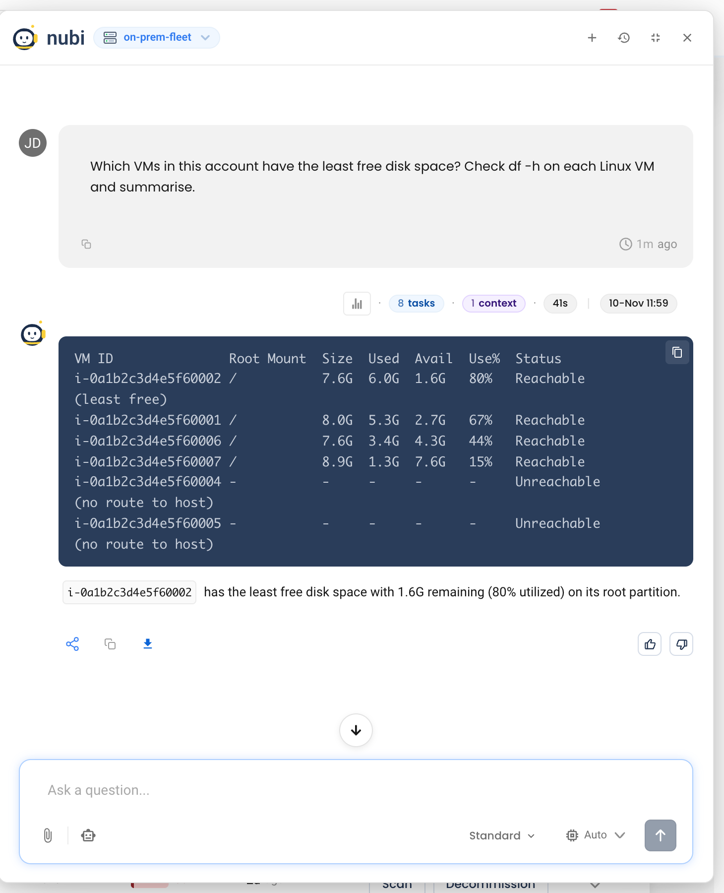

# Investigate VMs with NuBi

With a self-hosted account selected, NuBi answers through the **VM Troubleshooter**. It lists the account's VMs from the inventory and, once `ssh_access` is enabled, runs short shell commands on them over SSH through your proxy agent. It checks the VMs as they are now; it doesn't read history from your metrics or log store.



## Before you start

Commands reach a VM through an SSH datasource that the proxy agent exposes from its [discovery datasource](../../installation/proxy-agent/discovery.md). Add to the agent config:

```yaml
signing_public_key: "<key>"          # top level; Helm: forager.signingPublicKey
datasources:
  - type: discovery
    name: segment-a
    allowed_hosts:
      - 192.0.2.0/24                 # must not be empty
    discovery:
      ssh_access: true
      known_hosts_file: /etc/nudgebee/known_hosts
      # ...pack_public_key, pack_dir as before
```

| Setting | Why |
|---|---|
| `discovery.ssh_access: true` | Exposes the hosts in `allowed_hosts` for commands, using the discovery datasource's SSH user |
| `discovery.known_hosts_file` | Host keys are checked before any command runs |
| `allowed_hosts` (not empty) | Commands can only reach hosts in these ranges |
| `signing_public_key` | The agent only runs commands signed by NuBi. It is set by the install command when your tenant has a signing key; if your install command had no `NB_SIGNING_PUBLIC_KEY`, contact NudgeBee support |

:::warning `known_hosts_file` applies to scans too
The discovery datasource uses the same `known_hosts_file` for package inventory. Once it is set, every scan refuses a host whose key isn't in that file or has changed, and that VM stops being inventoried. Add every host in `allowed_hosts` first, for example:

```bash
ssh-keyscan -t ed25519,rsa 192.0.2.11 192.0.2.12 >> /etc/nudgebee/known_hosts
```

Re-run it for a VM after it is rebuilt.
:::

If a setting is missing, the agent logs *ssh_access not enabled* with *ssh_access requires ...* naming it. Restart the agent after the change; an SSH datasource named `<discovery name>-ssh` then appears in **Agent Health → Proxy Agent → Datasources**.

The VM must be in the account's inventory with an IP inside `allowed_hosts` — NuBi won't connect to an address taken only from your message. An SSH integration added by hand in **Admin → Integrations** isn't used.

## What to ask

Open NuBi from any page with the self-hosted account selected in the header. For example:

- *Which VMs in this account have the least free disk space?*
- *Why is nginx failing on 192.0.2.15?*
- *Check the journal on the redhat VM for errors in the last hour.*
- *Which services are using the most memory on each VM right now?*

From a [vulnerability](./vulnerabilities.md) row, **Ask NuBi** opens the chat with that finding as context.

NuBi keeps each command small and non-interactive — service status, processes, disk, memory, network, and journal or application logs — and runs it once per VM, keeping each machine's result separate. A VM it can't reach is reported as such, not skipped.

## What it can and can't do

- **Reading is automatic.** Commands that only read are run without asking.
- **Changes need your approval.** A command that would change the host — restarting a service, deleting files — or that NuBi can't classify stops with *Run command "..." on VM resource ... using its eligible SSH datasource?* Approval covers that exact command on that VM only. If you decline, NuBi continues without it. See [approvals in the chat](../ai/nubi-chat.md).
- **sudo only when you ask.** Commands run as the discovery datasource's SSH user. If that user can't read the journal or kernel log, NuBi says so instead of retrying with `sudo`; ask for privileged collection explicitly if you want it.
- **Other VM accounts.** Name another self-hosted account in your question to run commands there, if you have read access to it.
- **Code.** When a service on the VM has a [linked repository](./observability.md#metrics), NuBi can read that repository to explain a failure in the service's own code.

## When it can't reach a VM

See [NuBi can't run a command on a VM](./troubleshooting.md#nubi-cant-run-a-command-on-a-vm) in Troubleshooting.

## Related

- [Discovery datasource](../../installation/proxy-agent/discovery.md)
- [What NuBi can do](../ai/nubi.md)
- [Troubleshooting](./troubleshooting.md)
