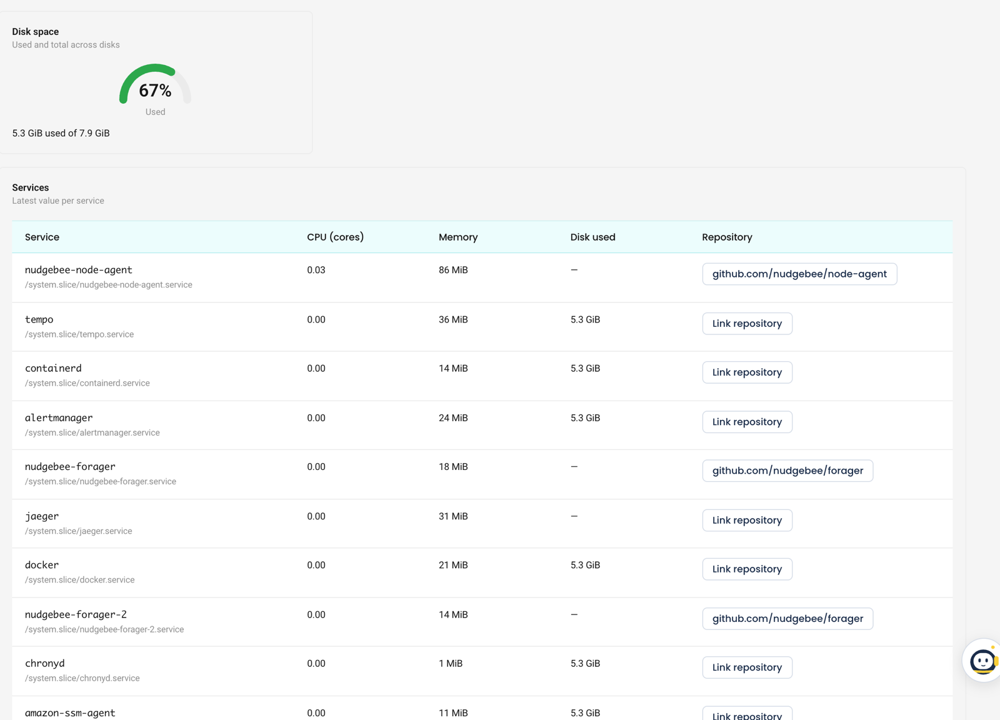
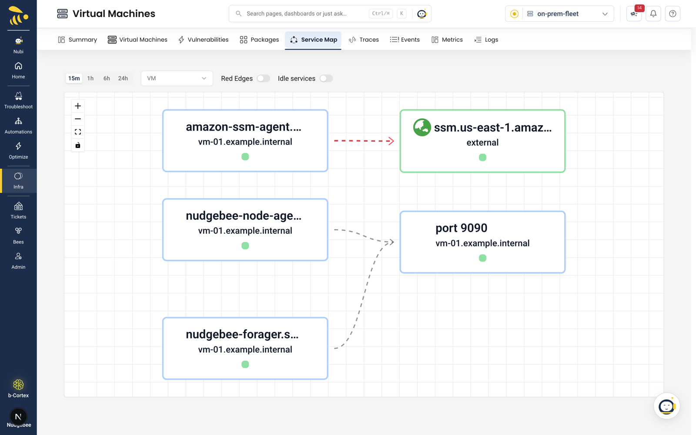
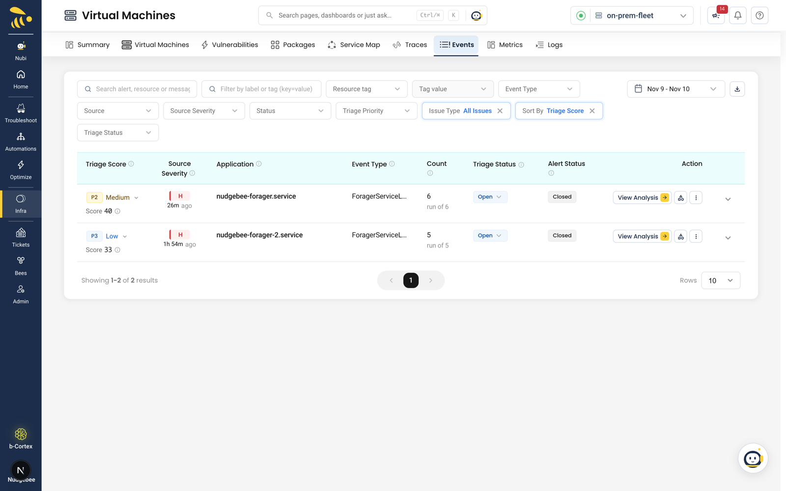
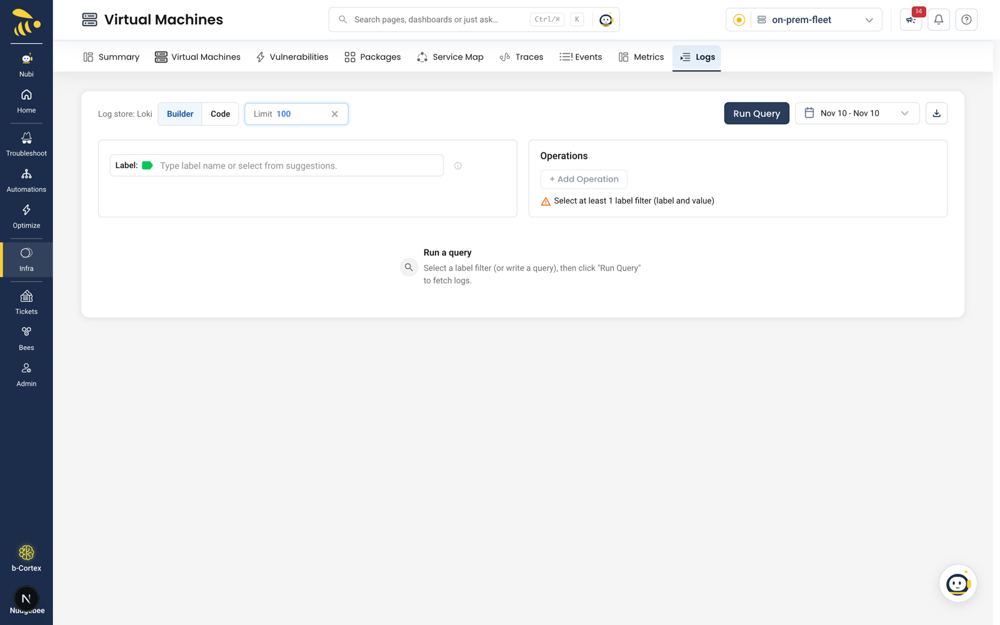

# Observability for self-hosted VMs

The **Metrics**, **Service Map**, **Traces**, **Events** and **Logs** tabs show data from sources you connect to the account. Package inventory and vulnerabilities don't need any of them.

| Tab | Needs |
|---|---|
| **Metrics** | A metrics store (Prometheus, VictoriaMetrics and others) connected to the account, with VMs reporting to it |
| **Service Map** | An enabled **Prometheus** integration linked to the account with connection mode **VM agent** (if there are several, exactly one must be the default metrics provider), with the NudgeBee node agent on each VM. Other store types give no map. |
| **Traces** | A trace store (Jaeger, Tempo, Elasticsearch and others) |
| **Events** | A Prometheus Alertmanager webhook linked to the account |
| **Logs** | A Loki or SigNoz log store set as the account's default log provider, with a log shipper on the VMs writing to it |

A store that only the proxy agent can reach (inside your network) is connected with **connection mode: VM agent**. Make it the account's default metrics or log provider.

## Metrics

Pick a **Virtual machine** (remembered per account) and a date range. Panels: **CPU**, **Memory**, **Disk I/O**, **Disk space**, and **Services** — the latest value per service (CPU, memory, disk used and repository).

Clicking a VM's gauges on the **Virtual Machines** tab opens the same view in a dialog.

**Link repository** on a service connects it to a repository from a connected GitHub or GitLab integration.

Empty states:

- *No metrics source connected* — connect a metrics store (**Open Integrations**).
- *Metrics store unreachable* — the store couldn't be reached.
- *No VM is reporting metrics yet. Install the node agent on a VM and point its metrics at the connected store.*

## Service Map

Calls between services on your VMs — systemd services, containers and processes — and to external hosts. Choose a window (15m, 1h, 6h, 24h), a **VM**, and the **Red Edges** and **Idle services** switches. Calls from hosts without the node agent aren't seen. With nothing in the window: *No calls seen in this window*.

## Traces

The traces list for the account, with the service filter seeded from the service map. Without a trace store: *No trace store connected* (**Open Integrations**).

## Events

Alerts posted to the account's Alertmanager webhook, attached to their VM and grouped like other events. See [Events & Triage Inbox](../troubleshooting/events-and-triage-inbox.md).

## Logs

Query the account's log store from the VM page. The header names the store (*Log store: Loki*). Build a query with **Builder** (pick at least one label filter) or write one in **Code**, choose a **Limit** (50–1000) and a date range, then **Run Query**. Logs are not filtered to a VM automatically — add a label such as the host name. After a run, the executed query is shown above the results.

Empty states:

- *No log store connected* — connect Loki or SigNoz with connection mode **VM agent** if only the proxy agent can reach it, and make it the default log provider (**Connect a log store**).
- *Run a query* — no query has run yet.
- *No log entries* — nothing matched the time range and query.

## Data source status

Once the account has a proxy agent, **Agent Health → Proxy Agent** shows a card each for metrics, logs and alerts. Metrics and Logs show **Connected**, **No data**, **Not connected**, **Unreachable** or **Check failed**; Alerts shows **Receiving alerts**, **No alerts yet**, **Disabled** or **Not connected**. For example, *No log store is connected to this account* means add a Loki integration and make it the default log provider. See [Agent Health](../../installation/agent/operate/agent-health.md#self-hosted-vm-accounts).

## Related

- [Self-hosted VMs](./index.md)
- [Troubleshooting](./troubleshooting.md)
- [Alertmanager webhook](../../integrations/Webhooks/index.md)
