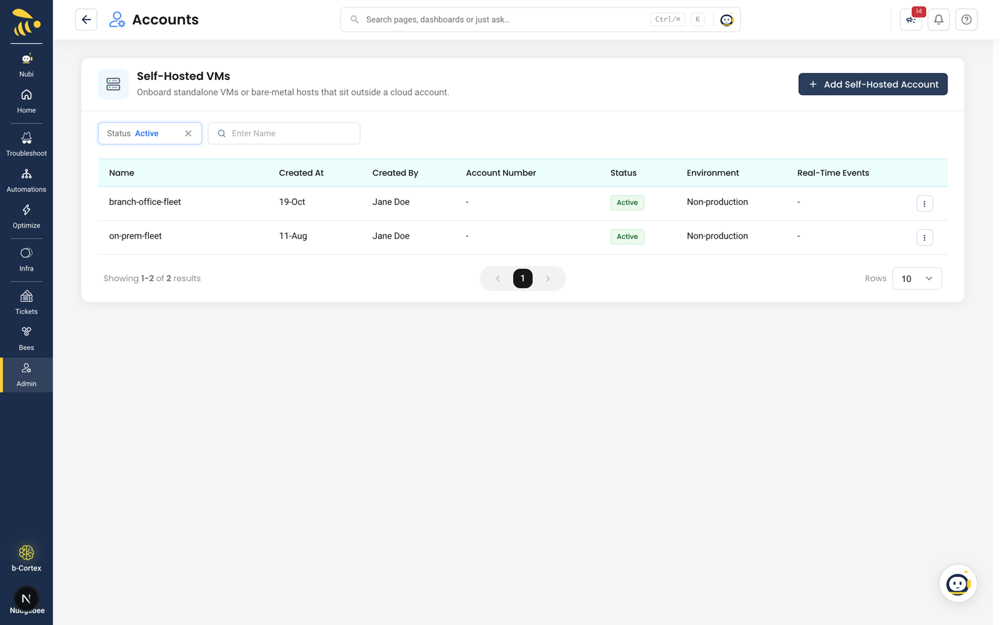
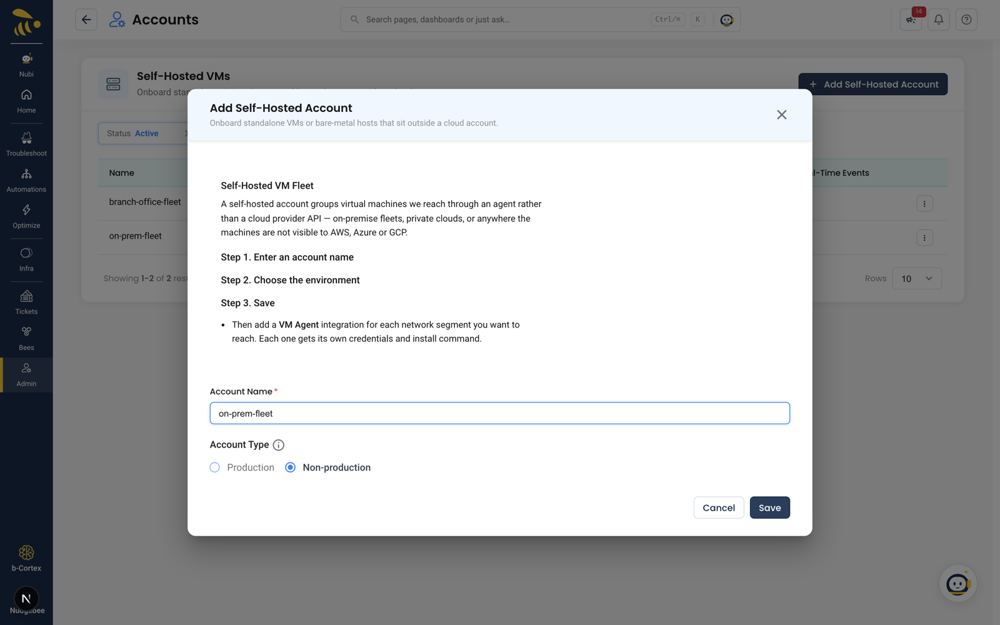
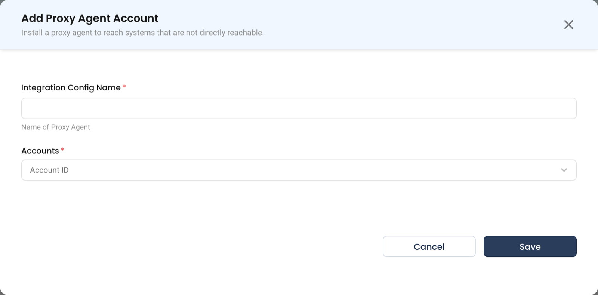
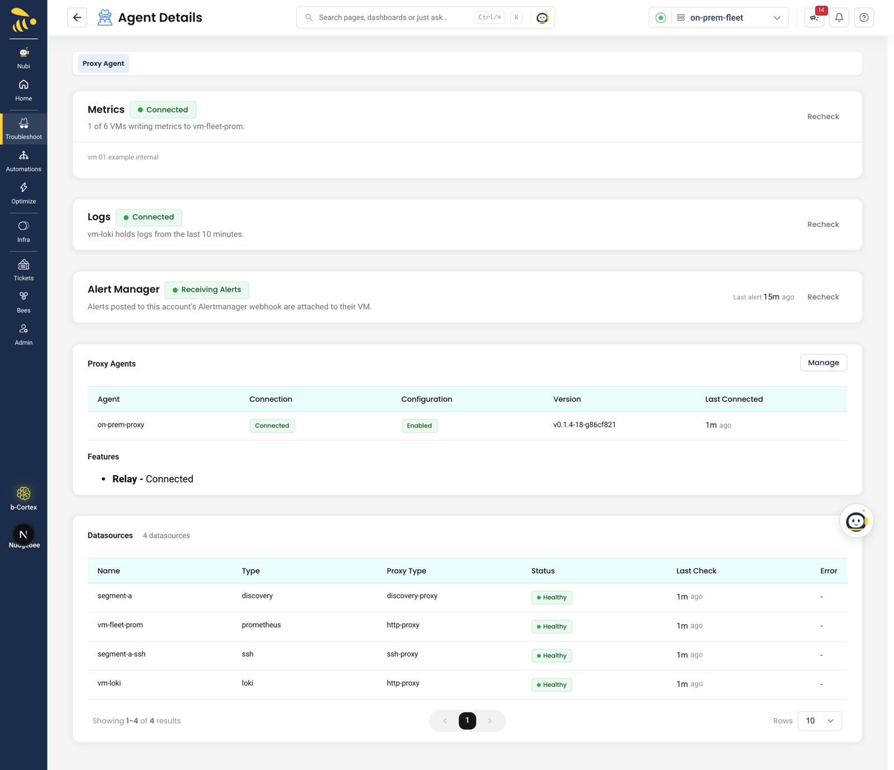

# Set up self-hosted VMs

Connect the VMs on your network to NudgeBee: add a self-hosted account, install the proxy agent on a machine on the same network, and authorize the agent's SSH key on each VM. Nothing else is installed on the VMs.

## 1. Add a self-hosted account



Open **Infra → VM** and click **Add Self-Hosted Account**, or go to **Admin → Integrations → Kubernetes & Cloud → Self-Hosted VMs → Add Self-Hosted Account**.

*Add Self-Hosted Account — Onboard standalone VMs or bare-metal hosts that sit outside a cloud account.*

| Field | What to enter |
|---|---|
| **Account Name** | Letters, numbers, spaces, hyphens and underscores, with no repeated separators — for example `on-prem-fleet` |
| **Account Type** | Production or Non-production |



Click **Save**. No credentials are issued here; a reminder banner stays until a proxy agent connects for the account.

## 2. Add a proxy agent for the account

Go to **Admin → Integrations → Servers → Proxy Agent**, add a proxy agent, give it a name and select the self-hosted account. If you select several accounts, the agent is created on the first one.



The **Proxy Agent Credentials** dialog then shows the **Access Key** and **Access Secret** — *Save these credentials now. The secret will not be shown again.* — and ready-made install commands for **Linux**, **macOS**, **Windows**, **Docker**, **Docker Compose** and **Helm**. The relay URL is already inside the commands, and so is the signing key when one is configured.

Run the command on a machine on the same network as the VMs — it must reach them on the SSH port. The Linux and macOS commands run the install script with `sudo`; keep it when you copy them. The dialog shows *Waiting for the agent to connect from your machine* until the agent connects, then *Agent connected*. If the account already has a connected agent, it shows *This account already has a connected agent*. See [Proxy Agent installation](../../installation/proxy-agent/installation.md) for each method.

## 3. What the Linux and macOS install sets up

On a **new** install, the Linux and macOS install scripts also set up VM discovery for the local network — there is nothing else to configure on the agent. On an upgrade, the existing config file is left untouched: discovery isn't added, and the credentials in it aren't replaced. Windows, Docker and Helm installs don't set up discovery; [add the datasource by hand](#set-up-discovery-by-hand).

The script creates, under the agent's config directory (`/etc/nudgebee` on Linux, `/usr/local/etc/nudgebee` on macOS):

| File | What it is |
|---|---|
| `forager.yaml` | The agent config, with a `discovery` datasource named `local-network` |
| `ssh/id_ed25519`, `ssh/id_ed25519.pub` | A new ed25519 SSH key the agent logs in to the VMs with |
| `known_hosts` | Where the agent records each VM's host key on first contact (`host_key_policy: accept-new`) |
| `packs/linux-inventory-v2.yaml` | The Linux inventory content pack, downloaded from the same release as the binary |

The datasource also has `ssh_access: true`, so NuBi can run commands on the VMs. That needs the signing key (`NB_SIGNING_PUBLIC_KEY`), which the dialog's command already includes; without it the script warns that `ssh_access` stays off.

You can add these optional variables to the install command, next to `NB_ACCESS_KEY`:

| Variable | Default | Meaning |
|---|---|---|
| `NB_DISCOVERY_CIDR` | The subnet of the primary network interface, narrowed to the host's `/24` when it is wider than `/22` | The network to scan. Anything wider than `/22` is refused. |
| `NB_SSH_USER` | The user who ran `sudo`, else `ubuntu` | The login user on the VMs |
| `NB_DISCOVERY_NAME` | `local-network` | The discovery datasource's name |
| `NB_DISCOVERY` | `true` | `false` skips discovery setup |
| `NB_PACK_URL` | The release's `linux-inventory-v2.yaml` | Where to download the content pack from |
| `NB_DOWNLOAD_URL` | GitHub releases | Download the binary and the pack from a mirror with the same path layout as GitHub releases (`<base>/latest/download/<file>`, `<base>/download/<tag>/<file>`). A `file:///path` base works too. |

For example, to scan a different network as user `admin`:

```bash
curl -fsSL <install.sh URL from the dialog> \
  | sudo NB_ACCESS_KEY=<key> NB_ACCESS_SECRET=<secret> NB_RELAY_URL=<relay URL> \
    NB_SIGNING_PUBLIC_KEY=<signing key> \
    NB_DISCOVERY_CIDR=192.168.1.0/24 NB_SSH_USER=admin bash
```

Where the agent runs:

| | Linux | macOS |
|---|---|---|
| Service | systemd service `nudgebee-forager`, running as the `nudgebee` user | root LaunchDaemon `com.nudgebee.forager` |
| Logs | `journalctl -u nudgebee-forager -f` | `/usr/local/var/log/nudgebee-forager.log` |
| Restart | `sudo systemctl restart nudgebee-forager` | `sudo launchctl kickstart -k system/com.nudgebee.forager` |

:::caution Lab and laptop networks, not production
This setup trusts two things on first use. `accept-new` trusts the first host key it sees for each VM, and a pack without `pack_public_key` runs whatever is in `pack_dir`. That is fine for a lab or laptop network. For production, use a curated `known_hosts` file with `host_key_policy: strict` and signed packs with `pack_public_key` — see [Discovery datasource](../../installation/proxy-agent/discovery.md#host-keys).
:::

## 4. Authorize the agent's key on each VM

At the end, the script prints the agent's public key and, for each VM, the command to authorize it:

```bash
ssh-copy-id -f -i /etc/nudgebee/ssh/id_ed25519.pub <user>@<vm-ip>
```

On macOS the key is at `/usr/local/etc/nudgebee/ssh/id_ed25519.pub`. Instead of `ssh-copy-id`, you can append the `.pub` line to `~<user>/.ssh/authorized_keys` on the VM. Use the same user as `NB_SSH_USER`.

## 5. VMs appear

When the agent connects, reconnects or restarts — or a config push from NudgeBee creates or changes a discovery datasource — NudgeBee scans the discovery network within about a minute: it sweeps for hosts, lists those that answer on SSH, and runs the package inventory on any it can log in to. These scans are limited to one every few minutes per account. The daily scan and the **Scan** button on **Infra → VM → Virtual Machines** still work as before; see [How scanning works](./how-scanning-works.md).

- Hosts that answer on the SSH port are listed as VMs, named by IP. Matching them against existing cloud VMs can make this take a few minutes.
- **Packages** and **Vulnerabilities** need a working SSH login (step 4) and a Linux host: the default pack collects `dpkg` and `rpm` data. A macOS or other non-Linux host shows a failed package scan with an `os-release` error, but NuBi commands still work on it.

## 6. Ask NuBi

Open **Ask NudgeBee** with the VM account selected and ask, for example, *show running processes on 192.168.1.20*. NuBi may ask you to confirm a command before it runs it. See [Investigate VMs with NuBi](./investigate-with-nubi.md).

## Local VMs on a laptop

VMs run by UTM, Multipass or Parallels on a Mac usually sit on a host-only network (for example `192.168.64.0/24`), not on your LAN, so the default scan range misses them. Either:

- install with `NB_DISCOVERY_CIDR` set to that subnet, for example `NB_DISCOVERY_CIDR=192.168.64.0/24`; or
- add the subnet to the datasource's `allowed_hosts` in `forager.yaml` and restart the agent.

Find a VM's IP with `multipass list` or in the UTM window; `ifconfig bridge100` shows the Mac's own address on that network, and so its subnet. Multipass and Ubuntu cloud images use the `ubuntu` user, so set `NB_SSH_USER=ubuntu` if you installed as another user.

To use the Mac itself as a target, turn on **Remote Login** (**System Settings → General → Sharing**). From a terminal that doesn't have Full Disk Access, you can instead run:

```bash
sudo launchctl enable system/com.openssh.sshd
sudo launchctl bootstrap system /System/Library/LaunchDaemons/ssh.plist
```

Then add the agent's `.pub` line to `~/.ssh/authorized_keys`. Package inventory doesn't run on macOS, but NuBi commands do.

## Set up discovery by hand

For Windows, Docker and Helm installs, or an agent installed before discovery setup existed, add a **discovery** datasource to the agent's YAML config or Helm values yourself — there is no screen for it in NudgeBee. It needs:

- the network ranges the agent may sweep (`allowed_hosts`);
- an SSH user that exists on the VMs, with its key;
- the Linux inventory content pack, `linux-inventory-v2.yaml`, from the agent's [GitHub release](https://github.com/nudgebee/forager/releases/latest), in `pack_dir`.

See [Discovery datasource](../../installation/proxy-agent/discovery.md) for the full configuration. Once the agent restarts with it, the datasource registers with NudgeBee automatically and the first sweep follows within about a minute.



To let NuBi run commands, set `ssh_access: true` on the discovery datasource — see [Investigate with NuBi](./investigate-with-nubi.md#before-you-start).

## Optional: scan into a different account

VMs found by the discovery datasource appear under the account the proxy agent belongs to, which is what a self-hosted account needs. Only if the agent scans the network of another account do you need to link the datasource to it. That is an API-only setting; see [Which account the VMs appear under](../../installation/proxy-agent/discovery.md#which-account-the-vms-appear-under).

## Optional: connect observability

For the **Metrics**, **Service Map**, **Traces**, **Events** and **Logs** tabs, connect the data sources described in [Observability](./observability.md).

## Related

- [Self-hosted VMs](./index.md)
- [Discovery datasource](../../installation/proxy-agent/discovery.md)
- [Troubleshooting](./troubleshooting.md)
- [Proxy Agent troubleshooting](../../installation/proxy-agent/troubleshooting.md)
