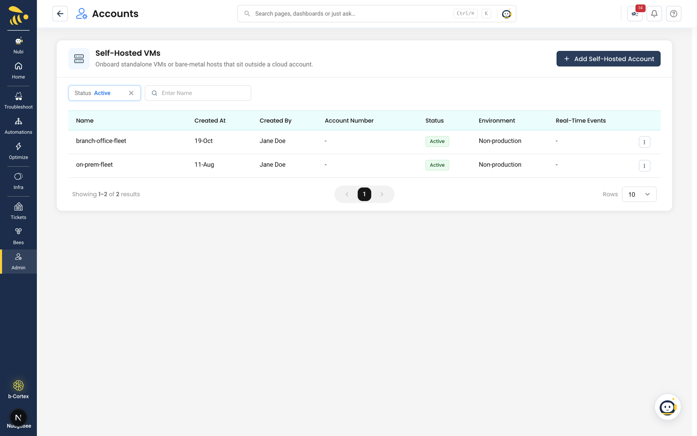
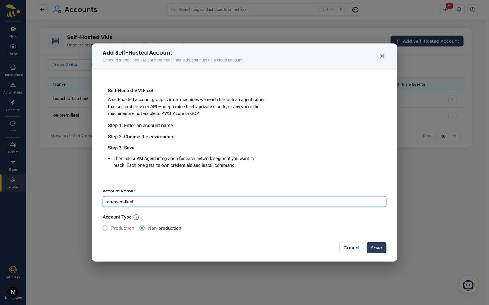
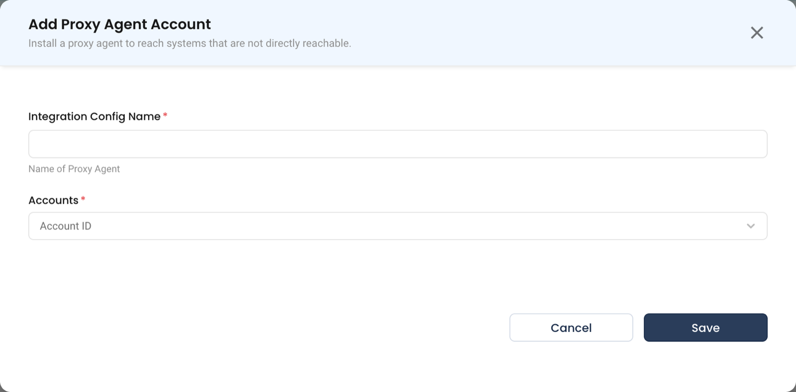
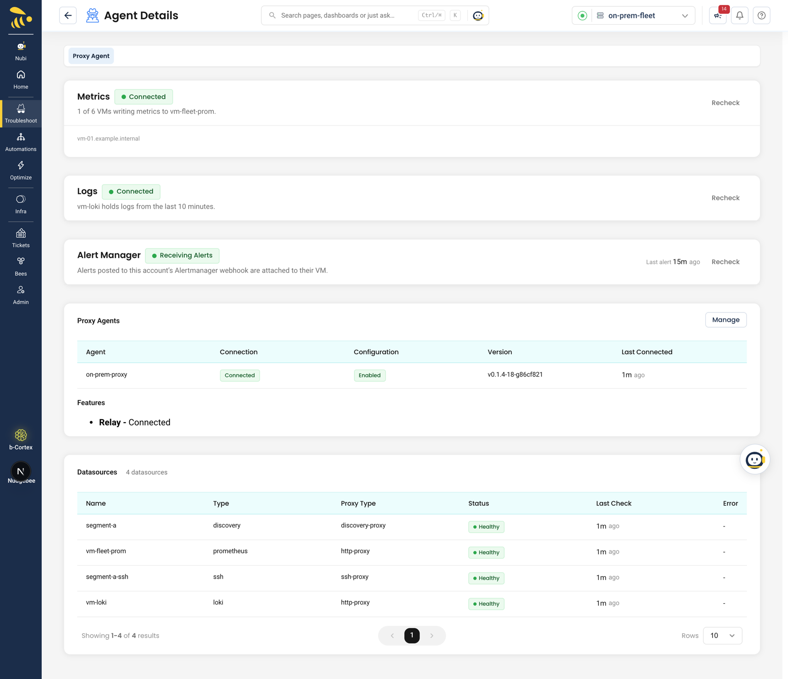

# Set up self-hosted VMs

## 1. Add a self-hosted account

Open **Infra → VM** and click **Add Self-Hosted Account**, or go to **Admin → Integrations → Kubernetes & Cloud → Self-Hosted VMs → Add Self-Hosted Account**.

*Add Self-Hosted Account — Onboard standalone VMs or bare-metal hosts that sit outside a cloud account.*

| Field | What to enter |
|---|---|
| **Account Name** | Letters, numbers, spaces, hyphens and underscores, with no repeated separators — for example `on-prem-fleet` |
| **Account Type** | Production or Non-production |

Click **Save**. No credentials are issued here; a reminder banner stays until a proxy agent connects for the account.

## 2. Add a proxy agent for the account

Go to **Admin → Integrations → Servers → Proxy Agent**, add a proxy agent, give it a name and select the self-hosted account. If you select several accounts, the agent is created on the first one.

The **Proxy Agent Credentials** dialog then shows the **Access Key** and **Access Secret** — *Save these credentials now. The secret will not be shown again.* — and ready-made install commands for **Linux**, **macOS**, **Windows**, **Docker**, **Docker Compose** and **Helm**. The relay URL is already inside the commands, and so is the signing key when one is configured.

Run the command on a machine that can reach the VMs over SSH. The Linux and macOS commands run the install script with `sudo`; keep it when you copy them. The dialog shows *Waiting for the agent to connect from your machine* until the agent connects, then *Agent connected*. If the account already has a connected agent, it shows *This account already has a connected agent*. See [Proxy Agent installation](../../installation/proxy-agent/installation.md) for each method.

## 3. Add a discovery datasource on the proxy agent

The proxy agent finds VMs only through a **discovery** datasource, which you configure on the agent itself (in its YAML config or Helm values) — there is no screen for it in NudgeBee. It needs:

- the network ranges the agent may sweep (`allowed_hosts`);
- a read-only SSH user that exists on the VMs, with its key;
- the signed Linux inventory content pack and its public key. Ask NudgeBee support for these.

See [Discovery datasource](../../installation/proxy-agent/discovery.md) for the full configuration. Once the agent restarts with it, the datasource registers with NudgeBee automatically.

## 4. Scan

VMs appear after the first scan. Scans run automatically once a day; to start one now, open **Infra → VM → Virtual Machines** and click **Scan**. See [How scanning works](./how-scanning-works.md).

## 5. Optional: let NuBi run commands

To let NuBi check VMs live over SSH, set `ssh_access: true` on the discovery datasource — see [Investigate with NuBi](./investigate-with-nubi.md#before-you-start).

## 6. Optional: scan into a different account

VMs found by the discovery datasource appear under the account the proxy agent belongs to, which is what a self-hosted account needs. You only need to link the datasource to another account if the agent scans that account's network. That is an API-only setting; see [Which account the VMs appear under](../../installation/proxy-agent/discovery.md#which-account-the-vms-appear-under).

## 7. Optional: connect observability

For the **Metrics**, **Service Map**, **Traces**, **Events** and **Logs** tabs, connect the data sources described in [Observability](./observability.md).

## Related

- [Self-hosted VMs](./index.md)
- [Discovery datasource](../../installation/proxy-agent/discovery.md)
- [Troubleshooting](./troubleshooting.md)
