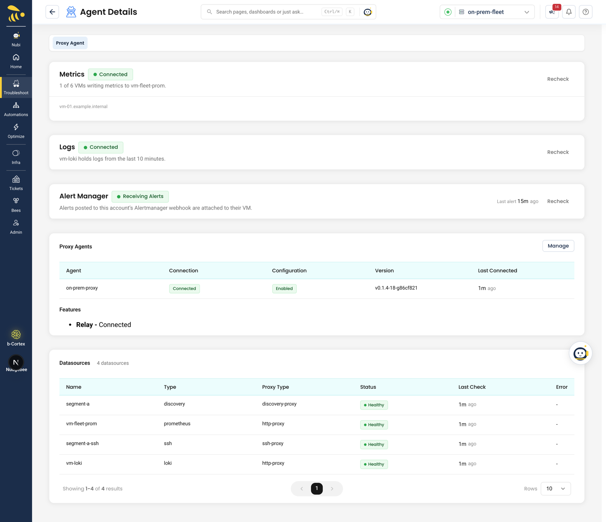
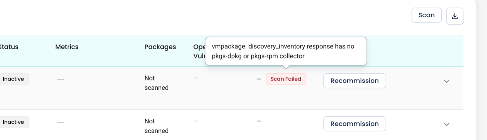

# Troubleshooting self-hosted VMs

## Start here

Most problems show up first in **Agent Health → Proxy Agent** for the account. Check it top to bottom:

1. **Proxy Agents** — the agent is **Connected** and its configuration **Enabled**. If not, go to [On the proxy agent host](#on-the-proxy-agent-host).
2. **Datasources** — the `discovery` datasource is listed and **Healthy**. If it is missing, the agent has no discovery datasource; if it is unhealthy, the **Error** column says why (see [Datasource errors](#datasource-errors)). **Healthy** only means `allowed_hosts` is set — a datasource with no SSH credentials or content pack is still Healthy but lists no VMs.
3. **Metrics**, **Logs**, **Alert Manager** cards — only matter for the observability tabs (see [Metrics, logs and alerts](#metrics-logs-and-alerts)).



Then open **Infra → VM → Virtual Machines**: a red **Scan Failed** label on a row means the last scan of that VM failed — hover it for the reason and look it up in [Scan failed reasons](#scan-failed-reasons).

## Messages on the VM page

| What you see | Why | What to do |
|---|---|---|
| *No virtual machines yet* | No scan has found anything: no proxy agent is connected, or it has no discovery datasource | Check **Agent Health → Proxy Agent**, then add a [discovery datasource](../../installation/proxy-agent/discovery.md) and run **Scan** |
| *No forager discovery datasource is configured for this account* (Scan VM dialog) or *no discovery agent is configured to scan this account* (toolbar Scan) | The proxy agent has no discovery datasource, or it isn't enabled | Configure one on the agent — see [Discovery datasource](../../installation/proxy-agent/discovery.md) |
| *A discovery agent is connected but hasn't yet reported scan targets* | The agent just started, or `allowed_hosts` is empty | Wait a moment and retry, or restart the proxy agent; check `allowed_hosts` |
| A VM you expected is missing | It's outside `allowed_hosts`, powered off, none of ports 22, 3389 or 5985 is open from the agent, or the SSH login or inventory failed (a host is listed only after a successful inventory) | Fix the range, the firewall or the SSH user and key, then **Scan** |
| **Scan Failed** on a VM | No packages were returned, the OS isn't supported, the content pack version is missing, or (per-VM Scan only) the SSH login failed or didn't finish in about 90 seconds | Hover the status for the reason. Check the SSH user and key exist on the VM, and `linux-inventory-v2.yaml` is in `pack_dir` |
| **Packages** shows **Not scanned** | Inventory never completed for that VM | Check SSH access and the content pack, then **Scan** that VM |
| VMs are named by IP address | The agent couldn't read a cloud instance ID from the VM, and discovered VMs can't be linked to a cloud resource from the UI yet | Expected for now |
| *Metrics are not connected* / *No metrics source connected* | No metrics store for the account | See [Observability](./observability.md) |
| *Alertmanager is not connected* | No Alertmanager webhook linked to the account | Add a Prometheus Alertmanager integration and link it to the account |
| *Get started with Proxy Agent monitoring* (Agent Health) | No proxy agent for this account | **Connect VM Agent**, or see [Set up self-hosted VMs](./setup.md), step 2 |
| *No proxy agent installed* (Agent Health) | Health data exists but no proxy agent integration is listed for the account | Check the proxy agent integration in **Admin → Integrations → Servers** |

## Scan failed reasons

Hover **Scan Failed** to see the reason. Proxy agent errors are prefixed with *proxy agent error:*.



| Reason contains | Why | What to do |
|---|---|---|
| `target status "ssh-auth-failed"` | The SSH user or key was rejected | Check the user exists on the VM and the public key is in its `~/.ssh/authorized_keys`; test the login from the agent host (below) |
| `target status "ssh-refused"` | Nothing accepted the SSH connection | `sshd` isn't running, a firewall blocks port 22 from the agent, or fail2ban banned the agent's IP after the sweep |
| `target status "timeout"` | SSH or the inventory commands didn't finish in time | Check latency from the agent host; an overloaded VM can exceed the per-host budget |
| `target status "error"` | Any other SSH or collection failure — including a host key that is missing from, or doesn't match, `known_hosts_file` | Check the proxy agent logs for the host; if `known_hosts_file` is set, add or refresh the VM's key (`ssh-keyscan`) |
| `target is outside this datasource's allowed_cidrs` | The VM's IP isn't in the discovery datasource's `allowed_hosts` | Add the range to `allowed_hosts` and restart the agent |
| `discovery_inventory reported zero packages` | The inventory ran but returned no packages | Check `dpkg-query -W` or `rpm -qa` works for the SSH user on that VM. The previous inventory is kept |
| `has no pkgs-dpkg or pkgs-rpm collector` | The OS has neither `dpkg` nor `rpm` (for example Alpine) | Not supported yet |
| `vuln-matcher has no data for <os> <version>` | Packages were collected, but there is no vulnerability data for that OS release | Packages are listed; no findings are created for that VM |
| `pack signature verification failed`, `pack is unsigned` | The content pack in `pack_dir` doesn't match `pack_public_key` | Use the signed pack and the public key that came with it |
| `cannot verify content pack: no pack public key configured` | `pack_public_key` is empty | Set it in the discovery datasource |
| `content pack version 2 not cached and no pack_dir configured`, `content pack version mismatch` | The pack version the scan asked for isn't in `pack_dir` | Put `linux-inventory-v2.yaml` in `pack_dir` — a per-VM **Scan** always asks for version 2 |
| `this datasource has no ssh credentials configured`, `no ssh auth method provided` | The discovery datasource has no SSH user, or no key or password | Add `credentials` to the discovery datasource |
| `not an enabled discovery datasource linked to this account` | The datasource chosen in **Reach through** is disabled or belongs to another account | Pick another datasource, or enable it |
| `scan did not report back` | The scan didn't finish within its 15-minute limit and was marked failed a few minutes later | Usually the agent restarted or lost its connection mid-scan; check it is connected, then scan again |

Hosts that fail during the **daily** or **account** scan are not marked failed — they keep their previous inventory, and a host that never had a successful inventory isn't listed at all. To see why one host is missing, run a per-VM **Scan** if it is listed, or test it from the agent host.

## On the proxy agent host

Run these on the machine (or pod) where the proxy agent runs.

**Is the agent running?**

```bash
# Linux install script (systemd)
sudo systemctl status nudgebee-forager
sudo journalctl -u nudgebee-forager --since "1 hour ago"

# Docker
docker logs --since 1h nudgebee-forager

# Docker Compose
docker compose logs --since 1h forager

# Kubernetes (Helm) — the deployment is named after your Helm release
kubectl -n <namespace> logs deploy/<release> --since=1h
```

**The Linux install command stops with** *This script must be run as root (use sudo)* — the install script writes to `/etc/nudgebee` and creates a systemd service, so it must run as root. Keep the `sudo` from the command the credentials dialog shows:

```bash
curl -fsSL <install.sh URL from the dialog> \
  | sudo NB_ACCESS_KEY=<key> NB_ACCESS_SECRET=<secret> NB_RELAY_URL=<relay URL> bash
```

Re-running the install script doesn't overwrite an existing `/etc/nudgebee/forager.yaml`, so your discovery datasource survives a reinstall. After editing that file, restart the agent: `sudo systemctl restart nudgebee-forager`.

**Can the agent reach NudgeBee?** It needs outbound HTTPS (port 443) to the relay — no inbound ports. See [Proxy Agent troubleshooting](../../installation/proxy-agent/troubleshooting.md#agent-wont-connect) for the connectivity and credential checks.

**Can the agent log in to the VM?** Test with the same user and key the discovery datasource uses:

```bash
ssh -i /etc/nudgebee/ssh/id_ed25519 -o BatchMode=yes nudgebee-ro@<vm-ip> \
  'cat /etc/os-release; (dpkg-query -W 2>/dev/null || rpm -qa) | head -5'
```

The user needs no `sudo`; reading the package list is enough. If this fails, the scan fails the same way.

**Does the network sweep see the VM?** The agent binary can run a sweep on its own, with no relay involved:

```bash
nudgebee-forager sweep --cidr 192.0.2.0/24 --ports 22

# in a container
docker exec nudgebee-forager /app/nudgebee-forager sweep --cidr 192.0.2.0/24 --ports 22
```

A host missing from the output has none of the probed ports open from the agent, or is switched off.

Your IDS may flag the sweep: allowlist the proxy agent's IP before you enable discovery, and expect `sshd` to log *Did not receive identification string* for each probe.

## Datasource errors

The **Datasources** table in **Agent Health → Proxy Agent** shows each datasource the agent reports, with its health.

| Error | What to do |
|---|---|
| `discovery datasource is unconfigured: no allowed_cidrs, and inventory is missing ...` | Set `allowed_hosts`, and for inventory `pack_public_key`, `pack_dir` and SSH credentials — see [Discovery datasource](../../installation/proxy-agent/discovery.md) |
| Connection errors such as `connection refused` or `timeout` | The agent host can't reach that datasource — test it from the agent host; see [Proxy Agent troubleshooting](../../installation/proxy-agent/troubleshooting.md#datasource-shows-unhealthy) |

## Metrics, logs and alerts

The **Metrics**, **Logs** and **Alert Manager** cards in **Agent Health → Proxy Agent** each have a **Recheck** button.

| What you see | Why | What to do |
|---|---|---|
| Metrics **Not connected** | No default metrics provider for the account | Add a Prometheus-compatible integration (connection mode **VM agent** if only the proxy agent can reach it) and make it the default metrics provider |
| Metrics **No data** — *none of this account's N VMs has written to it in the last 10 minutes* | The store is reachable, but no NudgeBee node agent is writing to it | Install the node agent on the VMs and point its metrics endpoint at the store |
| Metrics **Unreachable** / **Check failed** | The store can't be reached through the agent, or several metrics providers exist and none is the default | Check the store URL from the agent host; mark one provider as default |
| *N of M VMs writing metrics* with M larger than N | Some VMs have no node agent, or their IP or host name doesn't match the inventory | Install the node agent there; check the VM's IP in the list matches what it reports |
| `—` in a VM's **Metrics** column | No metrics matched that VM | Click the cell: the dialog lists the reason, for example *no machine matching ... is writing to the metrics store* or *more than one machine in the metrics store matches this VM* |
| Metrics charts but no CPU/RAM gauges and the VM isn't in the **Virtual machine** picker | The VM runs node_exporter, not the NudgeBee node agent | Gauges, the picker, per-service rows and the Service Map need the node agent |
| Logs **No data** | The store is reachable but has no logs from the last 10 minutes | Point your log shipper at the store |
| Alert Manager **No alerts yet** | The webhook is enabled but nothing has posted to it | Point an Alertmanager receiver at the integration's webhook URL |
| Alert Manager **Disabled** | The webhook integration is disabled; alerts sent to it are dropped | Enable it |
| An alert arrives but isn't attached to a VM | Its labels don't identify a VM in the inventory | Send an `instance_id` label with the VM's resource ID, or an `instance` label whose host part is the VM's IP |

## NuBi can't run a command on a VM

NuBi runs commands on a VM through an SSH datasource the proxy agent exposes. Set `discovery.ssh_access: true` on the discovery datasource; the agent refuses to expose it unless `signing_public_key`, `discovery.known_hosts_file` and a non-empty `allowed_hosts` are all set (it logs *ssh_access not enabled* with *ssh_access requires ...* naming the missing one). Setting `known_hosts_file` also turns on host-key checks for scans — see [Investigate with NuBi](./investigate-with-nubi.md#before-you-start). An SSH integration added by hand in **Admin → Integrations** isn't used for this.

| NuBi reports | What to do |
|---|---|
| *no eligible account-linked SSH datasource covers this VM* | Enable `ssh_access` as above, and check the VM's IP is inside `allowed_hosts` |
| *multiple SSH datasources cover this VM* | More than one SSH datasource (on one proxy agent or several) covers the VM's IP; narrow `allowed_hosts` so only one covers it |
| *VM has no verified IP address* | The VM has no IP in its inventory; run a scan |
| *VM account "..." is not connected or you do not have access to it* | Check the account name and that you can read it |
| A command fails with *Permission denied* | The SSH user can't read that file or log; grant read access (for example the `systemd-journal` group) if you want NuBi to see it |

See [Investigate VMs with NuBi](./investigate-with-nubi.md).


## Related

- [Set up self-hosted VMs](./setup.md)
- [How scanning works](./how-scanning-works.md)
- [Investigate VMs with NuBi](./investigate-with-nubi.md)
- [Proxy Agent troubleshooting](../../installation/proxy-agent/troubleshooting.md)
