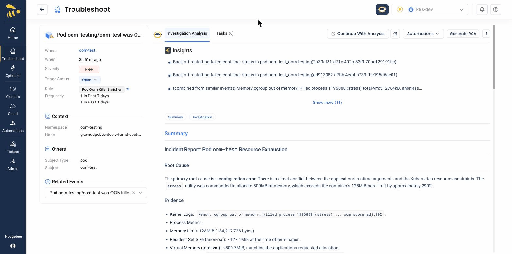

# AI & Pre-built Agents

NudgeBee delivers **Cloud-Ops Intelligence** through **NuBi**, the SRE AI Agent, and a library of 30+ pre-built Cloud-Ops agents. These agents analyze incidents across logs, metrics, traces, and alerts — powered by the [Semantic Knowledge Graph](../knowledge-graph/index.md) — to identify root causes and recommend actions. The result: MTTR reduced from hours to minutes.

NudgeBee's AI capabilities are **pre-packaged but not a black box** — every agent is fully extensible, modular, and controllable, with enterprise guardrails like RBAC, approval workflows, and audit trails.

:::info
**Prerequisite**: An [LLM provider](../../integrations/LLM/) must be connected for AI features to work. Cloud SaaS users get a managed LLM by default. Self-hosted users can use BYOM (Bring Your Own Model) — see [LLM Integrations](../../integrations/LLM/).
:::

:::tip See NuBi in action
Want concrete examples? **[NuBi Use Cases](./use-cases/)** walks through real conversations: the exact questions to ask, how NuBi investigates step by step, and the answers it lands on.
:::

## Pre-built AI Assistants

NuBi hands each question to the assistant for the account it is about. Each assistant knows that platform and calls the specialist agents below:

| AI Assistant | Used for |
|---|---|
| **Kubernetes Troubleshooter** | Kubernetes clusters — pods, workloads, nodes, events, and the services running on them. |
| **AWS Troubleshooter** | AWS accounts. |
| **Azure Troubleshooter** | Azure subscriptions. |
| **GCP Troubleshooter** | Google Cloud projects. |
| **VM Troubleshooter** | Virtual machines and VM fleets. |
| **Datadog Troubleshooter** | Accounts monitored through Datadog. |

## Getting the Most from NuBi

- **[What NuBi Can Do](./nubi.md)** — investigations, product questions with `@nubi`, and where you can talk to NuBi.
- **[Using the Chat](./nubi-chat.md)** — the chat screen: attachments, agents and skills, queued messages, approvals, reading an answer, your conversations.
- **[Improve NuBi's Answers](./improve-accuracy.md)** — account context, Facts vs SOPs, skills and per-agent knowledge.
- **[b-Cortex](./b-cortex.md)** — memory, knowledge bases, re-syncing integrations and marking documents.
- **[Agents & Custom Agents](./custom-agents.md)** — create agents, override a built-in prompt, or add tools.
- **[AI & Tools](./ai-and-tools.md)** — every admin tab for configuring the AI, and who can use each.

## Configuring and Governing AI

- **[AI Gateway](./ai-gateway.md)** — One endpoint in front of every LLM provider, with routing, tier aliases, quotas and per-user cost attribution.
- **[LLM Analyser](./llm-analyser.md)** — Where NudgeBee's own AI spend goes, by conversation, model, agent, tool and user.
- **[Egress Filter](./egress-filter.md)** — Scan what leaves for secrets, PII and PHI, and detect, redact, block, or swap personal data for reversible tokens.
- **[Tools & MCP](./tools-and-mcp.md)** — What the agents are able to do, MCP servers and their approvals, and automations offered to NuBi.
- **[Tool Approvals](./tool-approvals.md)** — Rules that let specific, known-safe commands run without asking.
- **[Budgets & Limits](./budgets-and-limits.md)** — Spend and conversation limits per tenant and account, and model pricing.
- **[Memory Policy](./memory-policy.md)** — The tenant-wide opt-out for each layer of AI memory.
- **[RCA Format](./rca-format.md)** — The Markdown template the AI fills in when it writes a root cause analysis.

## Specialized Agents

Under the hood, NudgeBee's AI assistants use a modular set of specialized agents that you can also invoke directly through the [Workflow Builder](../workflow-builder/):

- **Log Root-Cause Analyzer** — Analyzes application and infrastructure logs to identify errors, patterns, and anomalies.
- **Prometheus Metrics Expert** — Queries Prometheus metrics for performance analysis and anomaly detection.
- **Trace Investigator** — Analyzes distributed traces to identify latency bottlenecks and service dependencies.
- **PostgreSQL Diagnostics** — Inspects PostgreSQL databases for query performance, locks, and connection issues.
- **Ticket Manager** — Searches historical tickets for similar past incidents and resolution patterns.
- **Code Analyzer & Fixer** — Analyzes code changes and correlates them with incidents for change-driven RCA.
- **FinOps Cost Advisor** — Answers cloud cost and spend questions, finds savings and optimization opportunities, tracks budgets, and covers all recommendations.

The **Kubernetes Troubleshooter** (you can also call it **Debugger**) runs `kubectl`, Redis and RabbitMQ commands itself rather than through a separate agent.

### Watch a Walkthrough

<iframe src="https://www.loom.com/embed/eb32ed08d89943308e56c3730645c3df?sid=bc4586d3-ca27-423d-b46d-c1f56526abee" frameborder="0" webkitallowfullscreen mozallowfullscreen allowfullscreen style={{position: "absolute", top: 0, left: 0, width: "100%", height: "100%"}}></iframe>
