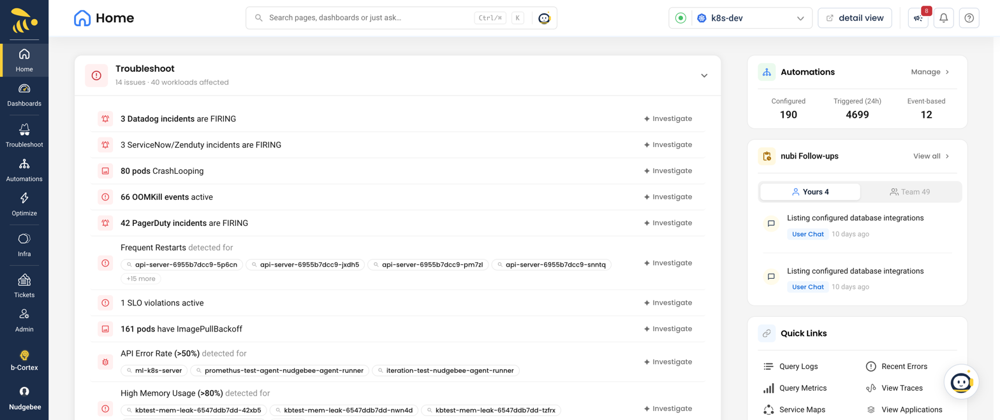

# Home

**Home → Overview → Home**

Home is the starting page for one account: what needs attention, what you can save, and what is running on its own. Pick the account with the account picker in the header — every card on the page is for that account.

The **Home** menu also has:

- **Account Overview** — every connected cluster, cloud account and self-hosted VM fleet on one page. See [Kubernetes](./Kubernetes/index.md).
- **Dashboard List** and **Application Grouping** — see [Custom Dashboards](./dashboards.md) and [Application Grouping](./application-grouping.md).

## Setup progress

Until setup is complete, users who can manage setup see a banner at the top showing what is left to connect. **View connections** opens the connections list, **Not needed…** hides it for good, and **Snooze** hides it for 24 hours.

## Cards

| Card | Shows | Footer |
|---|---|---|
| **Troubleshoot** | Open issues — *N issues · M workloads affected*. On self-hosted VM accounts it appears only while alerts are firing | **View all issues** |
| **Optimize** | The top recommendations, with savings. On a self-hosted VM account it shows vulnerabilities instead. Not shown for Cloud Foundry | **View all recommendations** |
| **Security & Compliance** | Kubernetes only: critical CVEs, certificates that are expiring or expired, and ops issues, each with **Review** | **View security dashboard** |

Each row has an action named for what it is: **Investigate** (troubleshooting and performance), **Secure Now** (security), **Configure** (configuration), **Optimize**, **Upgrade** (infrastructure upgrades) or **View Details**.

On the right:

- **Automations** — **Configured**, **Triggered (24h)** and **Event-based** counts, each clickable, plus **Manage**.
- **VM Fleet** — on self-hosted VM accounts: virtual machines, agents connected and open vulnerabilities.
- **NuBi Follow-ups** — conversations waiting on an answer from you (**Yours**) or your team (**Team**), with **View all**. Hidden when nothing is waiting.
- **Quick Links** — shortcuts for the account type, such as Query Logs, Recent Errors, Query Metrics, View Traces, Service Maps, View Applications, View Pods, Security, Troubleshoot and Optimize. For users with a custom role that lacks the module, the link is shown disabled.

## When a card is empty

What an empty card means depends on how long the account has been connected:

- **In the first 48 hours** the cards say data is still arriving — for example *Just added this account? … Give me about an hour to generate insights.* Optimize recommendations get better after a day to a week of trends, and Security says *All quiet on the security front.* On self-hosted VM accounts, Optimize shows *No Critical or High severity vulnerabilities open on this fleet.* however long the account has been connected.
- **After 48 hours** an empty card is treated as a setup problem — for example *It's quiet… a little too quiet.* or *No scans, certificates, or findings have come through.* Check the account's [Agent Health](../installation/agent/operate/agent-health.md) and integrations.

## Related

- [Kubernetes](./Kubernetes/index.md) — Account Overview and the cluster pages
- [Custom Dashboards](./dashboards.md)
- [Application Grouping](./application-grouping.md)
- [Using the Chat](./ai/nubi-chat.md)
