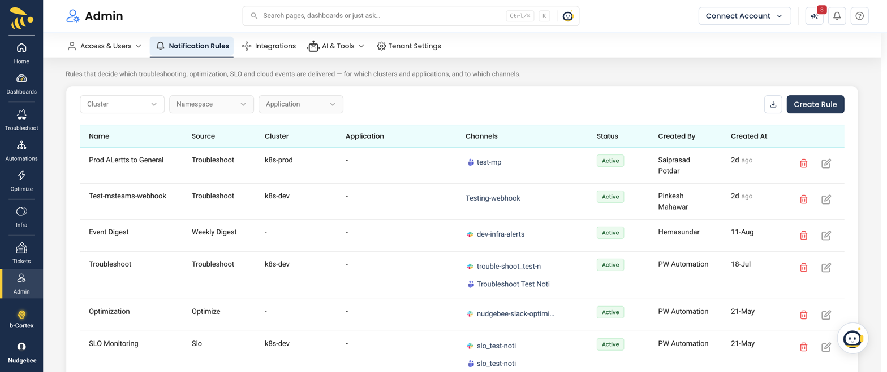

# Notification Rules, Routing & Channel Management

**Admin → Notification Rules**

Decide which NudgeBee notifications go where — alerts, resolved alerts, summaries and digests — and check what was actually delivered. Two tabs: **Rules** and **Delivery history**. Set up a [notification integration](../integrations/Notifications/index.md) and its default channels first.

## Rules

| Column | Meaning |
|---|---|
| **Rule** | The rule's name and a plain-language sentence describing it |
| **Covers** | Which notifications and accounts it matches |
| **Created by** | Who created it |
| **Status** | On, off, or **Paused · Xh left** |

Search rules or filter by type: Troubleshooting, SLO, Cloud spend, Optimization, Automation, Weekly digest, Daily email, AI Gateway budget alerts. Row actions: **Turn on/off**, **Duplicate**, **Delete**.

**Check where it goes** shows where a notification would be delivered, so you can test your rules before an alert arrives.

### Add a rule

**Add rule** offers a blank rule or a starting point: **Stop everything from an account**, **Pause alerts for a while**, **Only get alerts from some accounts**, **Mute automation chatter**. The editor has three parts:

| Part | Options |
|---|---|
| **Which** | Notification types, and optionally **Namespace**, **Application**, **Alert**, **Severity** (**Any** or **High only**) and a description |
| **From** | **All accounts** or **These accounts**, with exceptions |
| **Do** | **Send them** (to chosen channels, **Also send to** email addresses, **Leave out these users**, **Group into one message per hour**) or **Don't send them** — **until I change it**, for **1 hour**, **24 hours**, **7 days**, or until a date. **Resume now** ends a pause early. |

Namespace and application are exact matches — `payments-*` is not a pattern.

[Webhook targets](../integrations/Notifications/webhook_targets.md) for Slack, Microsoft Teams and Google Chat have their own pickers; pick one target of each type per rule. A webhook target is never an app's default channel — it receives only what a rule, or **When no rule matches**, sends to it.

### How rules combine

- **Every matching rule applies.** Rules are not ranked by how specific they are.
- **"Don't send" wins** over every other rule, on every channel including email — even if another rule would send it.
- **Approval requests always go out.** Rules can't select or mute them, and **All types** doesn't include the daily email.
- Avoid overlapping rules with different channels, and remember a broad pause can silence an event a narrower rule would route.

### When no rule matches

The **When no rule matches** row sets what happens to notifications no rule covers: **Send to each app's default channel**, **Send to specific channels**, or **Don't send** — for all notifications, or per type (**Same as all notifications** to inherit).

## Delivery history

**Admin → Notification Rules → Delivery history** — every notification NudgeBee tried to deliver in the last 14 days. Viewing it needs read access to events.

| Column | Meaning |
|---|---|
| **Time** | When it was sent or attempted |
| **What was sent** | The alert, summary, digest or approval |
| **Destination** | The channel, address or webhook |
| **Routed by** | The rule (or default) that sent it there |
| **Status** | **Sent**, **Failed** or **Not sent** |
| **Message** | The delivery result |

Filter by date (**Last 24 hours**, **7 days**, **14 days**), **Platform** (Slack, Microsoft Teams, Google Chat, Discord, Webhook, Email), **Destination**, **Status** and **Type** (Alert, Alert resolved, Hourly summary, Weekly digest, Approval). A panel at the top lists **failing destinations** — those whose latest delivery in the last 24 hours failed.

Open a row for the details: attempts, destination, account, the send ID, and — for anything not delivered — **why it wasn't sent** and **how to fix** it, with a link to the alert.

## Troubleshoot a missing notification

1. Open **Admin → Notification Rules → Delivery history** and filter by the time and type. If the notification is listed, its status and *why it wasn't sent* tell you what happened.
2. If it isn't listed, confirm the event exists in NudgeBee and check its status and priority.
3. Use **Check where it goes** to see which rules match — look for a **Don't send** rule or a pause.
4. Check **When no rule matches** if no rule covers it.
5. Verify the integration's credentials and that the NudgeBee app is in the channel.

For PagerDuty incidents, use the [PagerDuty ticket integration](../integrations/Tickets/pagerduty.md) — it is not the same as a chat-channel rule. See [Alert Pipeline Troubleshooting](./troubleshooting/alert-pipeline-troubleshooting.md) for the full path from alert to notification.
