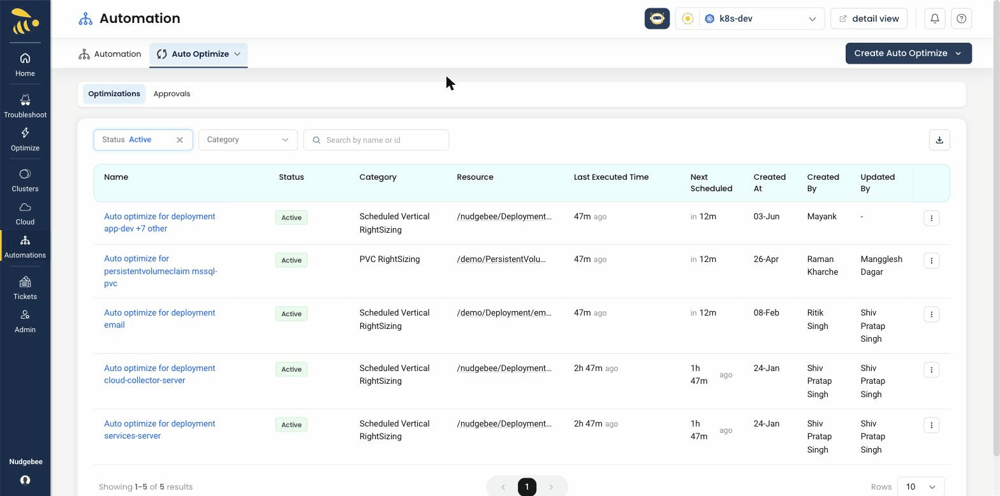

# Auto Optimize

**Optimize → Auto Optimize** applies right-sizing for you, on a schedule or continuously. Rules are set **per Kubernetes cluster** — pick the cluster with the **Account** picker. The tab has two sub-tabs: **Optimizations** (your rules) and **[Approvals](./approvals.md)**.

## What it can do

| Category | What it changes | When it runs |
|---|---|---|
| **Continuous Vertical Right Sizing** (Beta) | CPU and memory requests and limits; the cluster's agent decides the values when it applies them | About every 15 minutes |
| **Scheduled Vertical Right Sizing** | CPU and memory requests and limits, from the recommendation | On your schedule |
| **Horizontal Right Sizing** | Replica count, from an hourly usage forecast | Hourly, ahead of the next hour |
| **PVC Right Sizing** | Grows a volume when it fills past a threshold | Hourly; it only ever grows volumes |

## Create a rule

Choose **Create Auto Optimize** (top right) and a category. You can also start one from a recommendation — **Continuous Auto Optimize** or **Schedule Auto Optimize** in *Resolve this issue* — or from a workload's row menu on the cluster page. Creating a rule needs write access to the cluster.

### Scheduled Vertical Right Sizing

| Field | Meaning |
|---|---|
| **Account**, **Namespace / Application** | The workloads to right-size |
| CPU and memory algorithm and buffer | How the new values are calculated (CPU defaults to **NB Algo**, memory to the maximum, both with no buffer) |
| **Trigger Thresholds** | Only apply a change between **Minimum Change** (default 10%) and **Maximum Change** (default 100%) |
| **Schedule Optimization** | When it runs — see below |
| **End Date** | After this date the rule is disabled |
| **Raise Git Pull Request** | Open a pull request instead of patching (needs the workload's CI or Argo CD annotations); choose the **Repo Name** and **In-place resize policy** |
| **Create Jira Ticket** | Also create a ticket for each change |
| **Dry Run** | *Instead of applying Recommendations, Log changes* |
| **Require approval** | Each run waits for an account editor to approve — see [Approvals](./approvals.md). Not available with Dry Run. |
| **In-place resize (zero-downtime)** | On by default |
| **Notify me on** | Slack, Microsoft Teams, Google Chat or email |

**Setting the schedule:** the time is UTC (*Cron Schedule follow UTC timezone*). Enter the schedule as a **Cron Expression** with five fields, for example `0 2 * * *` for 02:00 every day. Leaving it empty runs the rule every hour.

### Continuous Vertical Right Sizing

Choose the cluster, namespaces and applications, and where to be notified. There's no schedule, dry run or approval — it keeps workloads right-sized as usage changes.

### Horizontal Right Sizing

Choose the cluster and one workload. **Historical Data** shows the last 7 days of CPU, memory and request rate. You can turn on **Require approval** and notifications.

### PVC Right Sizing

Choose the cluster and **Namespace & PVC**, how much to grow by (**Increase Storage Size By**, default 10%) and the usage **Threshold** that triggers it (default 80%). You can turn on **Require approval** and notifications.

### One rule per workload

A workload can have only one active rule of each category, and Scheduled and Continuous Vertical Right Sizing can't both be active on the same workload.

## Manage rules

**Optimizations** lists your rules. Filter by **Account**, **Status** (*Active*, *Disabled*, *Dryrun*, *Draft*), **Category**, or search by name or id.

Columns: **Name**, **Status** (*Waiting for approval* when a run is pending), **Category**, **Resource**, **Last Executed Time**, **Next Scheduled**, **Created At**, **Created By**, **Updated By**.

The **⋮** menu (write access): **Edit**, **Disable** / **Enable**, and **Check Status** for draft rules.

### Stop a rule

Rules can't be deleted — **Disable** stops one. *This will stop the schedule from running. Existing recommendations are not reverted. You can re-enable any time.* Changes it already made stay in place; revert them through your deployment process or Git.

## Run history

Click a rule's name to open it. **Tasks** lists each run's **Resource**, **Recommendation**, **Scheduled Time**, **Status** (*Complete*, *Failed*, *Scheduled*, *Skipped*, *Dryrun*, *Waiting for approval*), **Message** and **PR/Ticket**. **Details** shows the deployment history and CPU, memory and cost trends.

<iframe src="https://www.loom.com/embed/a72cb7a53f92456c8d595fea1769ee08?sid=792de4ea-b231-463d-ab97-32bab72a7c16" frameborder="0" webkitallowfullscreen mozallowfullscreen allowfullscreen style={{position: "absolute", top: 0, left: 0, width: "100%", height: "100%"}}></iframe>

## Related

- [Approvals](./approvals.md)
- [Kubernetes → Optimize](../../../Kubernetes/optimize.md)
- [Optimize overview](../../index.md)
- [Resolutions](../../resolutions.md)
