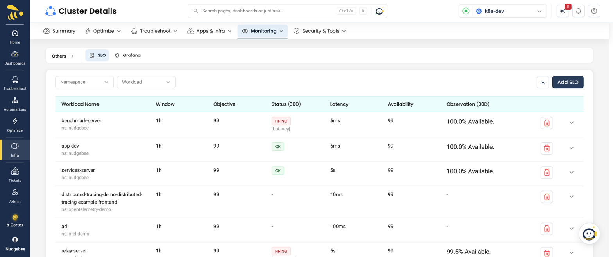

# Service Level Objectives (SLOs)

An SLO sets a reliability target for one workload — how many of its requests must succeed, how many must be fast enough, or how much CPU headroom it should keep. NudgeBee checks it every hour and raises an **SLO violation** event when the workload misses it.

SLOs are set per workload in a Kubernetes cluster: **cluster → Monitoring → SLO** (or search for `SLO` with `Ctrl`/`⌘` + `K`). There is no SLO entry in the sidebar.

:::info Prerequisites
Availability and latency SLOs are measured from the HTTP and gRPC request metrics collected by the NudgeBee [node agent](../installation/agent/operate/node-agent-configs.md), so the agent and its node agent must be running on the cluster.
:::

## The SLO list

| Column | Shows |
|---|---|
| **Workload Name** | The workload |
| **Window** | The evaluation window |
| **Objective** | The target |
| **Status (30D)** | How it has done over the last 30 days |
| **Latency**, **Availability** | Their objectives |
| **Observation (30D)** | What was measured over 30 days |
| **CPU Forecast** | Forecast CPU throttling and saturation |

Filter by **Namespace** and **Workload**. Expand a row for **Latency Traces** and **Availability Traces** — the requests behind the numbers — plus **Report** and **CPU Alerts**.

## Add an SLO

**Add SLO** (needs write access) opens *Create SLO Config*. Pick the **Namespace** and **Workload**, then set any of:

| Objective | You set | Measured as |
|---|---|---|
| **Availability** | **Objective %** — the share of requests that should not fail | Requests that don't return a 5xx, fail, or end with a non-OK gRPC status |
| **Latency** | **Objective %** and a **Threshold** — 5, 10, 25, 50, 100, 125, 500, 1000, 2500, 5000 or 10000 ms | Requests that complete within the threshold |
| **CPU** | **Throttling %** and **Saturation %** | Forecast from the last 3 days of CPU usage. **Check now** runs a forecast; **Remove** deletes the CPU objective. You can save a CPU objective only if the workload has a CPU limit and your metrics provider is supported. |

Request objectives are checked every hour. You don't write queries — NudgeBee measures them from the agent's request metrics. Hours with no traffic show no data.

## When an SLO is missed

For an availability or latency objective, NudgeBee raises an event when the agent's burn-rate check reports the objective being missed. The event is titled *"`name` SLO violation for `workload` in namespace `namespace`"*, with high priority and finding type **SLO**. It appears in [Troubleshoot](./troubleshooting/events-and-triage-inbox.md), is [triaged and scored](./troubleshooting/triage-scoring.md) like any other event, and goes to your [notification channels](./notifications.md). The event closes when the workload recovers. A CPU objective raises **forecast** events instead, when throttling or saturation is forecast to cross your threshold.

## Watch a Walkthrough

<iframe src="https://www.loom.com/embed/ca148fea8f984cdda78b54338c273061?sid=62aae3e6-00e9-4910-a5b2-6d5102be5980" allowFullScreen style={{"position": "absolute", "top": 0, "left": 0, "width": "100%", "height": "100%", "border": 0}}></iframe>

## Related

- [Events & Triage Inbox](./troubleshooting/events-and-triage-inbox.md)
- [Triage Scoring & Priority](./troubleshooting/triage-scoring.md)
- [Notification Rules](./notifications.md)
