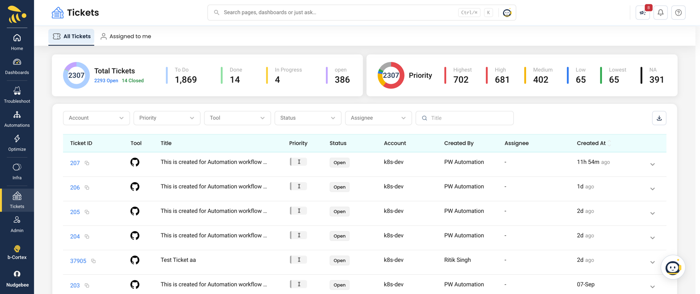

# Tickets

**Tickets → All Tickets** and **Tickets → Assigned to me**

NudgeBee raises tickets in the ticketing tool you already use — from events, recommendations, findings and log errors — and keeps a copy of each one so you can see them all in one place. The ticket itself lives in the external tool; NudgeBee tracks it and keeps its status in sync.

:::info Prerequisite
Connect a [ticketing integration](../integrations/Tickets/index.md) first. Supported tools: [Jira](../integrations/Tickets/jira.md), [GitHub Issues](../integrations/Tickets/github_issues.md), [GitLab Issues](../integrations/Tickets/gitlab.md), [ServiceNow](../integrations/Tickets/servicenow.md), [PagerDuty](../integrations/Tickets/pagerduty.md), [ZenDuty](../integrations/Tickets/zenduty.md) and [Freshdesk](../integrations/Tickets/freshdesk.md).
:::

## The Tickets page

| Tab | Shows |
|---|---|
| **All Tickets** | Every ticket NudgeBee has raised for the accounts you can see |
| **Assigned to me** | Tickets whose assignee is exactly your NudgeBee login email |

**Assigned to me** compares the ticket's assignee with your login email exactly. A ticket assigned to you in the external tool under a different name or username won't appear there — use **All Tickets** and the **Assignee** filter instead.

### Summary cards

- **Total Tickets**, with **N Open** and **N Closed**. A ticket counts as closed when its status is Done, Closed or Resolved; everything else counts as open.
- A status breakdown (To Do, Done, In Progress, open) and a **Priority** breakdown (Highest, High, Medium, Low, Lowest, NA).

Click a slice or a legend item to filter the list by that status or priority.

### Filters and columns

Filters: **Account**, **Priority**, **Tool**, **Status**, **Assignee** (All Tickets only) and a **Title** search that applies when you press Enter. **Clear All** removes every filter, and the download button exports the list.

| Column | Meaning |
|---|---|
| **Ticket ID** | The external ticket's ID — click it to open the ticket in its tool, or copy it |
| **Tool** | Which ticketing tool it lives in |
| **Title**, **Priority**, **Status** | As held in the external tool. A ticket with no priority shows **Critical** |
| **Account** | The NudgeBee account it was raised for |
| **Created By**, **Assignee** | Who raised it and who it's assigned to |
| **Created At** | When it was created (sortable) |

### Ticket details

Expand a row to open **Ticket Details**:

- **Open in** the external tool.
- **Description** — for GitHub, rendered as Markdown with issue references linked.
- **Additional Details** — Ticket Type, Source, Reference ID, Last Updated, Project Key and Account.
- **Comments** — read the thread and add a comment (**Write a comment...**, then **Add Comment**). This works for all seven tools.

### Changing status or assignee

The Tickets page is read-only for status, priority and assignee — change them in the external tool, and NudgeBee picks the change up at the next sync. To change tickets automatically, use the ticket tasks in an [Automation](./workflow-builder/ticket-tasks.md).

## Creating a ticket

**Create Ticket** is offered wherever there is something to act on:

- events and grouped events (row menu and the triage status badge);
- logs, log patterns, sensitive-log findings, and API and log errors;
- Kubernetes recommendations (right-sizing, PVC, spot, unused volumes, abandoned workloads, best practices, CIS, cluster and Helm upgrades, certificates);
- security findings, cloud posture findings and VM vulnerabilities;
- the Optimize pages and cloud recommendations;
- an investigation.

The **Create Ticket** dialog asks for:

| Field | Meaning |
|---|---|
| **Select Ticket Config** | Which connected ticketing integration to use |
| Project | Named for the tool: **Select Jira Project**, **Select Github Repository**, **Select GitLab Project**, **Select Table** (ServiceNow), **Select PagerDuty Service**, **Select ZenDuty Service** or **Select Freshdesk Group** |
| **Select Issue** | The issue type |
| **Priority** / **Urgency** | **Priority** (Jira, Freshdesk) or **Urgency** (PagerDuty, ZenDuty) sets the ticket's priority. For ServiceNow, a read-only **Severity** is set from Impact and Urgency |
| **Subject**, **Description** | Pre-filled from the event or recommendation; edit as needed |

You need read access to the account, or permission to write tickets. On events, grouped events and VM vulnerabilities, the action reads *Create Ticket · requires account access* when you don't have it.

**No duplicates.** If a ticket already exists for the same item in the same ticket integration and project (the project is compared only when one is given), NudgeBee adds a comment to it instead of opening a new one, and tells you *Existing ticket found, Added comment successfully* with a link. If the external tool created the ticket but NudgeBee couldn't record it, you'll see a warning — don't retry, or you'll create a duplicate.

Once an event has a ticket, the triage status badge no longer offers **Create Ticket**.

Tickets can also be raised automatically by [Automations](./workflow-builder/index.md) and by [Auto Optimize](./optimizations/autopilot/auto_optimize/index.md) rules with ticket creation turned on.

## Status sync

NudgeBee checks each open ticket's status, priority and assignee in the external tool **every hour**. There is no webhook — a change in the tool shows up in NudgeBee within an hour. Tickets in a final state (resolved, closed, done, completed, rejected, cancelled, declined) are no longer checked.

### What closing a ticket does

When a ticket raised for a **recommendation** reaches a final state:

| Ticket ends as | The recommendation becomes |
|---|---|
| Resolved, Closed, Done or Completed | **Closed** |
| Rejected, Cancelled or Declined | **Open** again |

Events are not changed — an event's triage status is managed separately. See [Alert State Management](./troubleshooting/alert-state-management.md).

## Related

- [Ticketing integrations](../integrations/Tickets/index.md)
- [Ticket tasks in Automations](./workflow-builder/ticket-tasks.md)
- [Ticket integration troubleshooting](../integrations/Tickets/ticket-integrations-troubleshooting.md)
