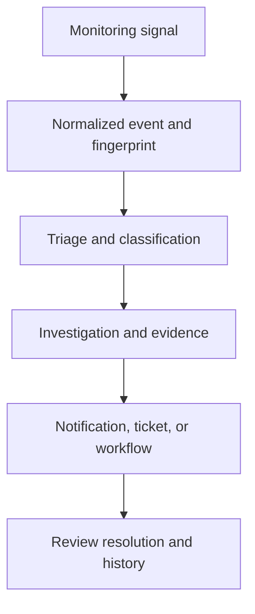

# Understand & Manage the Event Lifecycle

NudgeBee ingests monitoring signals, identifies related occurrences, applies triage rules, and supports investigation and operational response. The exact path depends on the source, configuration, and event classification.

This is an overview, not a guarantee that every event runs all stages or waits for AI analysis before a workflow starts.

## What happens to each event

When an event arrives, NudgeBee runs these steps in order:

1. **Repeats** — match it to earlier firings of the same alert.
2. **[Triage rules](./triage-rules.md)** — suppress, drop, classify or adjust it.
3. **Correlation** — relate it to other recent events.
4. **Grouping** — attach it to an incident on the same resource.
5. **[Scoring](./triage-scoring.md)** — give it a score and P0–P3 priority, then apply scoring rules.

A dropped event stops after step 2.

## Repeats and duplicates

Every event gets a **fingerprint** that identifies the alert it came from; which fields make it up depends on the source. Firings with the same fingerprint on the same account form a **run**:

- A new run starts when the run's first event has the triage status **Resolved**, or when more than **24 hours** pass between firings (measured start to start).
- Within a run, the built-in **System: Auto-mark Duplicates** rule marks every firing after the first as **Duplicate**, so the inbox shows the issue once. It can be turned off per account in [Triage Rules](./triage-rules.md#built-in-and-generated-rules).

## Grouped alerts

Alerts on the **same resource** — and on connected or dependent services — are grouped under one leading alert while they keep arriving within about **15 minutes** of each other (the window renews each time an alert joins). For example, an OOM kill followed by CrashLoopBackOff on one pod. The others score slightly lower, and alerts that fire constantly never become the leader. Use the **Grouped** view on **Events**, or a row's **Grouped Alerts** tab in the [Triage Inbox](./events-and-triage-inbox.md#triage-inbox).

## Classification and triage

The classification types are true positive, false positive, benign positive, and duplicate. Maintenance is a reason for a benign-positive classification. What each one does to the event, and its reason codes, are in [Classify an event](./alert-state-management.md#classify-an-event). Review the classification, reason, scope, and resulting rule before applying it to future matching events.

Rule previews help inspect matches in existing data. They do not predict future event volume. See [Alert State Management](./alert-state-management.md) for snooze, suppression, and NudgeBee status values.

## Investigation and response

An investigation can gather evidence from configured observability sources and connected resources. Available evidence depends on integrations, permissions, and retained data; logs, traces, code, and cloud dependencies are not automatically available for every event.

Event workflows can listen at different lifecycle phases. Use investigation completion when downstream actions require completed analysis, and inspect the actual payload instead of assuming an `rca.summary` field exists.

Notification rules control delivery separately. Ticket creation and updates use the selected integration; a ticket's status is distinct from the event's triage status.

## Resolution and history

Compare the monitoring source status with the NudgeBee triage status. `RESOLVED` is a supported NudgeBee status; `CLOSED` is not a separate NudgeBee triage stage. Inspect subsequent source updates and recurrence rather than assuming a closed event can never change again.

Use available event history and execution records for review. Retention depends on deployment configuration; this guide does not promise permanent storage of all evidence.

## Related

- [Events & Triage Inbox](./events-and-triage-inbox.md)
- [Triage Rules](./triage-rules.md)
- [Triage Scoring & Priority](./triage-scoring.md)
- [Snooze, Suppress & Alert Lifecycle](./alert-state-management.md)
