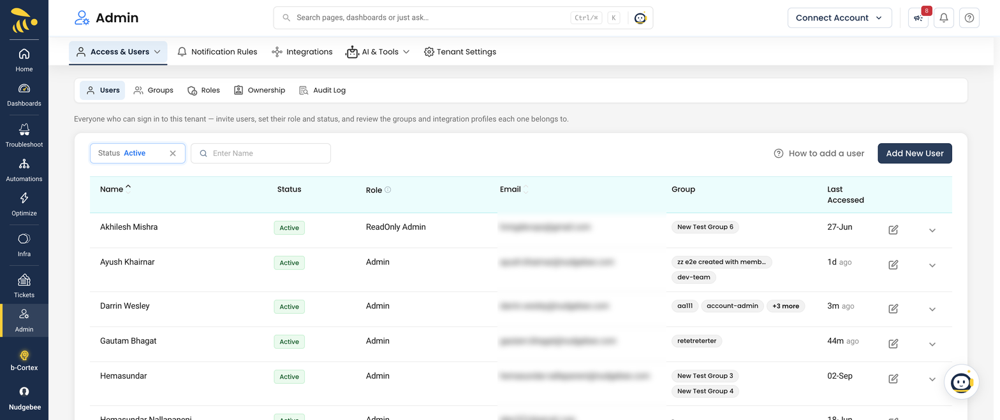

# Access & Users

**Admin → Access & Users**

Who can use NudgeBee and what they can do: **Users**, **Groups**, **Roles**, **Ownership** and the **Audit Log**. A tab is greyed out when your role can't read it; tenant admins (including read-only tenant admins) can open them all.

## Users

| Column | Meaning |
|---|---|
| **Name**, **Email** | The user (sortable) |
| **Status** | Active, Inactive or Suspended |
| **Role** | Built-in and custom roles. A user's effective access can also come from their groups |
| **Group** | Groups the user belongs to |
| **Last Accessed** | When they last used NudgeBee |

Filter by **Status** (Active by default) or by name. Expand a row to see the user's **Groups** and **Integration profiles**.

**Add New User** (needs permission to manage users) opens *Add User*: **First name**, **Last name**, **Work email**, one or more **Roles**, and **Status**:

| Status | Effect |
|---|---|
| **Active** | Can sign in |
| **Inactive** | Cannot sign in; can be reactivated |
| **Suspended** | Sign-in blocked and existing sessions revoked immediately |

You can also add the user to groups and integration profiles. Edit a user from their row (you can't edit yourself). **How to add a user** starts a short guided tour. See [Security](./security.md) for sign-in methods.

## Groups

Give the same roles to many people at once.

| Column | Meaning |
|---|---|
| **Group Name**, **Description** | The group |
| **Total Members** | How many users it has |
| **Owner** | Who manages it |
| **Roles** | Roles its members receive |
| **Created At** | When it was created |

*Add Group* has **Group Info**, **Assign Roles** and **Members**. Roles are assigned on two tabs: **Tenant** (Admin, ReadOnly Admin or a custom role, for the whole tenant) and **Account** (Admin, ReadOnly Admin or a custom role, for chosen accounts).

## Roles

Available in the Enterprise edition when the **Custom roles** feature is on (see [Tenant Settings → Features](./tenant-settings.md#features)).

**Built-in roles** (read-only):

| Role | Access |
|---|---|
| **Tenant Admin** | Everything in the tenant |
| **Tenant Admin (Read-only)** | See everything, change nothing |
| **Account Admin** | Manage the accounts it is assigned to |
| **Account Admin (Read-only)** | See the accounts it is assigned to |
| **K8s Namespace Admin** | Manage the Kubernetes namespaces it is assigned to |
| **K8s Namespace Admin (Read-only)** | See the namespaces it is assigned to |

**Custom roles** add permissions on top of a user's built-in roles; they don't change which data a user can see. **New role** opens the editor: **Name**, **Description**, then permissions per module on three tabs — **Tenant-level**, **Account-level** and **Integrations** — with **Read**, **Write** and **Execute** columns (**Read data**, **Make changes** and **Manage** on the Integrations tab). The list shows each custom role's **Permissions** count and how many **Users** and **Groups** have it. Only tenant admins can create or change roles; users with read access to custom roles can view them.

## Ownership

Rules that assign owners to resources automatically, so alerts and recommendations reach the right team.

| Column | Meaning |
|---|---|
| **Name** | The rule |
| **Match** | Which resources it covers |
| **Account scope** | Accounts it applies to |
| **Owner** | Who owns the matched resources |
| **Enabled** | Switch the rule on or off |

**Add rule** (needs ownership write access): **Name**, **Domain** (**Kubernetes** or **Cloud**), **Match**, **Owner** and **Enabled**, optionally limited to accounts.

| Domain | Match by |
|---|---|
| Kubernetes | Label (`key = value`), Namespace name, Specific workloads |
| Cloud | Tag (`key = value`), Resource type, Region, Specific resources |

## Audit Log

Every change and action in the tenant, by people and by NudgeBee itself.

| Column | Meaning |
|---|---|
| **User** | Who did it (**SYSTEM** for NudgeBee) |
| **Summary** | What happened |
| **Category/Type**, **Action** | The kind of change |
| **Status** | Whether it succeeded |
| **Created At** | When |
| **Target** | What it was done to |

Filter by **Status**, **Category**, **Event Type**, **Action**, **User**, **Cluster**, **Target** and a date range (default: last 24 hours). Expand a row to see the before/after **Diff State** or the **Command** that ran. **Download** exports the filtered list.

### Watch a Walkthrough

<iframe src="https://www.loom.com/embed/fbab917be45249259498023a9bacec9a?sid=02e8947b-ba16-4704-8833-079fe9de8fbc" frameborder="0" webkitallowfullscreen mozallowfullscreen allowfullscreen style={{position: "absolute", top: 0, left: 0, width: "100%", height: "100%"}}></iframe>

## Related

- [Admin](./admin.md)
- [Security](./security.md) — authentication and the role model
- [Tenant Settings](./tenant-settings.md)
