# Workflow Builder

## Overview

The Workflow Builder lets you create, manage, and run automated multi-step processes using a visual drag-and-drop editor. You can chain together tasks like running scripts, querying cloud resources, sending notifications, and more - all without writing code. Workflows can be triggered manually, on a schedule, via webhook, or in response to events.

:::tip Workflows vs Event Playbooks
If you're trying to attach **evidence-collection actions to a specific alert** (logs, metrics, custom queries that the LLM should see when investigating), use an [Event Playbook](../troubleshooting/alerting.md), not a workflow. Workflows are for **post-processing** — taking action *after* an event has been formed and analysed (open a ticket, page someone, scale a deployment, send a Slack thread). See [Event Playbooks vs Workflows](../troubleshooting/event-playbooks-vs-workflows.md) for the full breakdown.
:::

  <video width="100%" controls style={{position: "absolute", top: 0, left: 0, width: "100%", height: "100%"}}>
    <source src={require("../video/NudgeBee Cloud AIOps Automation - Cluster Health Example.mp4").default} type="video/mp4" />
  </video>

## Why Use the Workflow Builder

- **Automate infrastructure operations** - Build repeatable processes for common tasks like health checks, scaling, and incident response
- **Visual orchestration** - Design workflows on a canvas by connecting task nodes, so you can see the full process at a glance
- **Flexible triggers** - Run workflows on demand, on a schedule, through HTTP webhooks, or automatically when events occur
- **AI-assisted creation** - Describe what you want in plain language and let NuBi AI generate a workflow for you
- **Test safely** - Use dry runs to validate your workflow without affecting any real systems

## Key Concepts

- **Workflow** - An automated process made up of triggers and tasks. Each workflow has a name, status, optional tags, and a visual graph that defines the execution flow.
- **Trigger** - The starting point of a workflow that defines how and when it runs. A workflow can have multiple triggers. Types include Manual, Schedule, Webhook, and Event.
- **Task** - A single step in a workflow that performs an operation (also called an "Action" or "Node" in the interface). Tasks are connected to form a sequence of steps. Each task has a type, configurable parameters, and can reference outputs from earlier tasks.
- **Node** - The visual representation of a trigger or task on the canvas. You can drag, connect, and configure nodes.
- **Connection** - A line between two nodes that defines the execution order. Connections flow from one node to the next.
- **Execution** - A single run of a workflow. Each execution has a status, start/end time, and per-task results.
- **Dry Run** - A test execution with a dry-run flag. Only tasks that honor the flag skip side effects; other tasks can make real changes. See [Dry Run & Validation](./workflow-dry-run-validation.md).
- **Template Expression** - Dynamic values using `{{ }}` syntax that reference inputs, outputs from previous tasks, or shared configurations. For example, `{{ Tasks['fetch_logs'].output.logs }}` or `{{ Configs.key_name }}`. See [Template expressions](#using-template-expressions--variables).
- **Config** - A shared value managed centrally in the Configuration Manager. Configs of type **Config** are read with `{{ Configs.key_name }}`; configs of type **Secret** with `{{ Secrets.key_name }}`.
- **Status** - The state of a workflow version: **Active** (runs on its triggers), **Inactive** (doesn't run) or **Paused** (triggers suspended). There is no separate draft status: unpublished edits are a draft that you **Save draft** and then publish. See [Workflow Versioning](./workflow-versioning.md).

:::tip
Workflows are version-controlled: save drafts freely, publish immutable named versions, and point production at a chosen Live version. See [Workflow Versioning](./workflow-versioning.md).
:::

## Getting Started

### Accessing the Workflow Builder

1. Click **Automations** in the left navigation sidebar
2. The page has three tabs: **Automations** (the list of automations across your accounts), **Executions** (runs across all automations — see [Executions dashboard](#executions-dashboard)) and **Task Runner** (run a single task on its own; needs permission to run or edit automations)

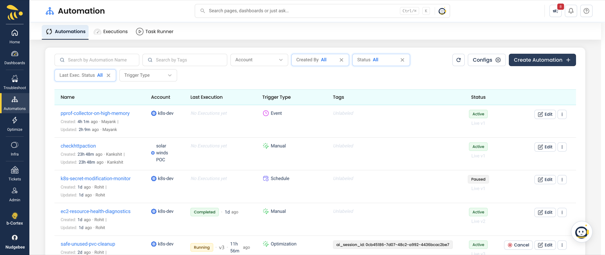

### Creating Your First Workflow

1. On the workflow listing page, click **Create Automation** in the top-right corner

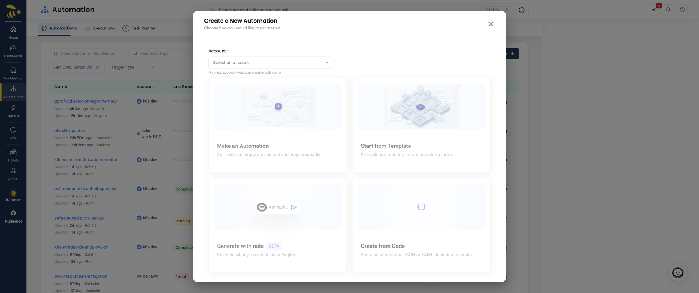

2. In the modal that appears, pick the **Account** the automation will run in, then choose how to start:
   - **Make an Automation** — an empty canvas
   - **Start from Template** — pick from pre-built templates, filtered by category (Incident Management, Kubernetes, Monitoring, Deployment, Security, Cloud Cost, Automation)
   - **Generate with NuBi** (Beta) — describe what you want in plain language
   - **Create from Code** — paste a workflow definition as JSON or YAML

   The steps below follow **Make an Automation**.
3. The Workflow Editor opens with an empty canvas and a prompt: "Add Your Workflow Trigger Node"
4. Select a trigger type - for your first workflow, choose **Manual Trigger** so you can run it on demand
5. A trigger node appears on the canvas
6. Click the trigger node to configure it. In the sidebar that opens, you can optionally define input parameters as JSON
7. Click **Add Action** in the bottom toolbar to add a task
8. Browse or search the task categories, then click the task you want (for example, **Run Script** under **Scripting**)
9. A new task node appears on the canvas
10. Connect the trigger to the task by dragging from the trigger node's output port to the task node's input port
11. Click the task node to configure its parameters in the sidebar
12. Click **Publish** (for a new automation) or **Save draft** in the toolbar
13. Click **Run current** to execute your workflow

:::tip
You can also let AI build your workflow. Click **Create Automation**, then choose **Generate with NuBi**. Describe what you want in plain language, review the AI's plan, and approve it to generate the workflow automatically.
:::

## Building Workflows

### The Workflow Editor

The editor is where you design and configure your workflows visually.

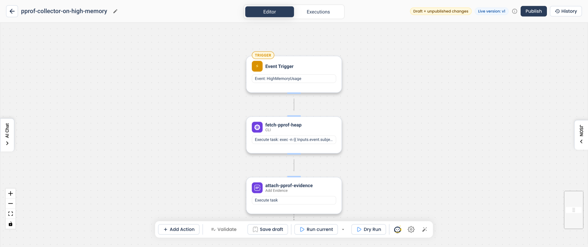

**Header bar:**
- **Back arrow** - Returns to the workflow listing page
- **Workflow title** - Click the pencil icon to rename your workflow inline
- **Editor / Executions tabs** - Switch between designing and viewing run history (available after saving)
- **Publish** and **History** - In the top-right state strip: publish the draft as a version, and open the version history. Status (Active, Inactive, Paused) is set per version here. See [Workflow Versioning](./workflow-versioning.md).

**Canvas:**
- A drag-and-drop visual editor with a dot grid background
- Drag nodes to reposition them on the canvas
- Use the scroll wheel to zoom in and out
- Click and drag the background to pan
- Use the **MiniMap** (bottom-right) for an overview of large workflows
- Use the **zoom controls** (bottom-left) to zoom in, zoom out, or fit the view

**Toolbar** (appears once you have nodes on the canvas):
- **Add Action** - Add a new task to the workflow
- **Validate** - Check the definition for errors
- **Save draft** - Save your edits without changing the live version (on a new automation this button is **Publish**)
- **Run current** - Execute your current edits; the button's menu adds **Run live version** (the published live version)
- **Dry Run** - Execute with a task-specific dry-run flag; external effects are possible
- **Ask NuBi AI** - Open the NuBi AI sidebar for conversational editing
- **Automation Settings** - Open workflow settings
- **Prettify Layout** - Tidy the canvas layout

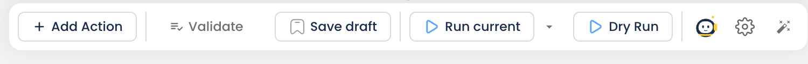

**JSON panel:**
- Click the **JSON** toggle on the right edge of the canvas to view and edit the workflow definition as raw JSON
- Click **Apply** to sync your JSON changes back to the visual editor

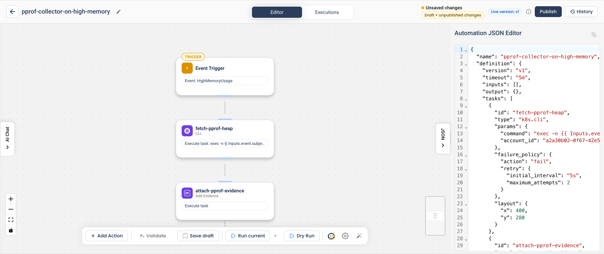

### Adding Tasks

1. Click **Add Action** in the bottom toolbar
2. The task browser opens with searchable categories
3. Browse a category or type in the **Search actions** bar to find a task
4. Click a task to add it to the canvas

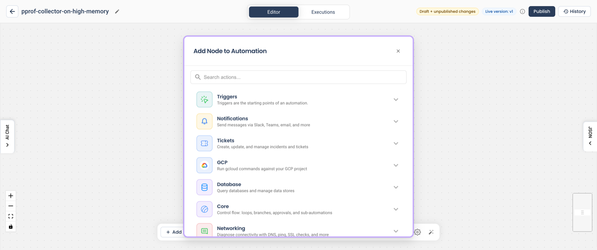

Tasks are organized into the following categories:

| Category | Description |
|----------|-------------|
| AWS, GCP, Azure | Cloud provider CLI and operations |
| Kubernetes | Kubernetes cluster operations |
| Slack, Google Chat | Channel and message operations for that platform |
| Database | Database operations (Redis, etc.) |
| Scripting | Custom script execution |
| Integrations | HTTP requests and external integrations |
| Notifications | Slack, MS Teams, and Google Chat messages |
| Observability | Log and metric queries |
| Tickets | Ticket creation and management |
| AI/LLM | AI summaries, investigations, and routing |
| Data | Data transformation and processing |
| Core | Workflow control flow (conditions, loops, sub-workflows, approvals) |
| CI/CD | CI/CD pipeline operations (ArgoCD) |
| Source Control | Source control operations (GitHub) |
| Message Queue | Message queue operations (RabbitMQ) |
| Networking | Network operations |
| Cryptography | Cryptographic operations |
| Events | Event handling operations |

### Configuring a Task

1. Click a task node on the canvas to open the **Action Details** sidebar
2. In the **Parameters** tab, fill in the required fields. Form fields are generated automatically based on the task type and include dropdowns, text fields, code editors, JSON editors, and more
3. Use the **Condition** tab for conditional execution, and the **Settings** tab (groups **Execution**, **Data**, **Parallel**, **Errors**) for timeouts, retry and failure policy, hooks, variables and matrix
4. Task configuration saves automatically as you type - there is no separate save button for individual task settings

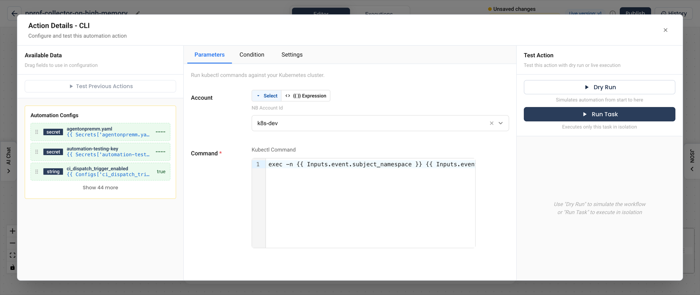

:::tip
You can reference outputs from earlier tasks in any text field using template expressions. The sidebar shows available outputs from previous tasks on the left, and you can drag them directly into fields.
:::

### Connecting Tasks

Connections define the order in which tasks execute.

1. Hover over a node's output port (the small circle at the bottom or right of the node) - it highlights when ready
2. Click and drag from the output port toward the target node
3. Drop on the target node's input port (the small circle at the top or left) to create the connection
4. The connection appears as a line between the two nodes

To delete a connection, hover over the edge and click the delete button that appears.

:::note
The Workflow Builder prevents circular dependencies. If you try to create a connection that would form a loop, both nodes flash briefly and the connection is rejected.
:::

### Using Conditions and Branching

You can make tasks run conditionally or branch your workflow using special task types.

**Conditional execution on any task:**
1. Click a task node and open the **Condition** tab
2. Enter a template expression
3. The task runs only when the expression renders `true` (in any letter case); anything else — including `1` or `yes` — skips it

**Switch (Conditional) node:**
1. Add a **Switch** task from the **Core** category
2. Define a switch variable and case values
3. Connect different downstream tasks to each case branch
4. Conditional connections appear as colored, thicker lines with a condition label

### Using Template Expressions & Variables

Template expressions allow you to dynamically pass data between workflow steps, evaluate conditional branching, and reference global configurations. They use double curly braces `{{ }}`.

#### Variable Reference Cheatsheet

| Expression | What it gives you |
|---|---|
| `{{ Inputs.param_name }}` | An input parameter of the run (manual run inputs, or trigger data) |
| `{{ Inputs.event.subject_namespace }}` | A field of the event that triggered the run (event and optimization triggers) |
| `{{ Inputs.webhook_json.field }}` | A field of a webhook request's parsed JSON body (`Inputs.webhook_payload` is the raw body) |
| `{{ Tasks['fetch_logs'].output }}` | The full output of an earlier task, by task ID |
| `{{ Tasks['fetch_logs'].output.logs }}` | One field of an earlier task's output |
| `{{ Configs.slack_channel }}` | A shared config of type **Config** |
| `{{ Secrets.api_token }}` | A shared config of type **Secret** (masked in logs, task inputs and errors — not in task outputs) |
| `{{ Vars.name }}` | A variable set with **Set Variables** on an earlier task |
| `{{ State.key }}` | Persistent state saved with **Set State** |
| `{{ Matrix.key }}` | The current combination when a task runs as a matrix |
| `{{ LoopItem.item }}` | The current item inside a **For Each** loop (`{{ LoopItem.<name> }}` when the loop sets a custom item name) |

Date and time helpers (UTC): `{{ date_iso }}` (2026-01-31), `{{ date }}` (31012026), `{{ date_us }}` (01/31/2026), `{{ time }}` (1504), `{{ time_hms }}` (15:04:05), `{{ datetime }}` (31012026_1504), `{{ timestamp_iso }}` (RFC 3339), and `now()`.

:::note Trigger filters are different
Inside a trigger's **filter expression**, the event is `event` (for example `{{ event.priority == "HIGH" }}`) and a webhook body is `webhook_payload`. Inside task parameters, use `Inputs.event` and `Inputs.webhook_json` as above.
:::

---

## Cookbook: 3 Ready-to-Use Workflow Blueprints

Below are 3 popular workflow patterns you can import or assemble in minutes:

### 1. Automated Node Drain on Spot Termination Notice
**Trigger**: Event (Source `AWS_EventBridge` — the value is case-sensitive — and Event Type set to the type of the EC2 Spot Instance Interruption Warning event; copy it from a real event)
- **Step 1 (`Kubectl`)**: Cordon the node: `kubectl cordon {{ Inputs.event.subject_name }}`
- **Step 2 (`Kubectl`)**: Safely evict workloads: `kubectl drain {{ Inputs.event.subject_name }} --ignore-daemonsets --delete-emptydir-data --grace-period=120`
- **Step 3 (`Send IM`)**: Send Slack message: `⚠️ Node {{ Inputs.event.subject_name }} drained ahead of spot termination.`

Check a real run's input first — which event field holds the node name depends on the event source.

### 2. Slack Alert Enrichment with Pod Logs & RCA
**Trigger**: Event (`source == "prometheus"`, `priority == "HIGH"`)
- **Step 1 (`Query Logs`)**: Fetch the last 100 log lines from the affected workload: `{{ Inputs.event.subject_name }}`
- **Step 2 (`AI Investigation`)**: Feed the logs to NuBi for diagnosis: `Investigate root cause for {{ Tasks['query_logs'].output.logs }}`
- **Step 3 (`Send IM`)**: Post an interactive Slack card with the pod status, root cause summary, and one-click remediation button.

### 3. Automated Cleanup of Orphaned PVs & Stale Namespaces
**Trigger**: Schedule (Cron: `0 2 * * 0` — every Sunday at 2 AM)
- **Step 1 (`Kubectl`)**: List unattached PersistentVolumes in `Released` state: `kubectl get pv -o json`
- **Step 2 (`Approval`)**: Send summary to SRE team with approval button before deletion.
- **Step 3 (`Kubectl`)**: Delete approved released PVs and reclaim cloud storage costs.

---

## Managing Workflows

### Editing a Workflow

1. On the workflow listing page, click the workflow row
2. The Workflow Editor opens with the saved nodes and connections
3. Modify triggers, add or remove tasks, update connections, or reconfigure settings
4. Click **Save draft**, then **Publish** when you want the change to go live — see [Workflow Versioning](./workflow-versioning.md)

### Changing Workflow Status

**From the editor:** status (**Active**, **Inactive** or **Paused**) is set per version — choose it when you **Publish**, or change it for a version in **History**. See [Workflow Versioning](./workflow-versioning.md).

**From the listing page (Pause/Activate):**
- Click the three-dots menu on a workflow row and select **Pause** to suspend its triggers
- Click the three-dots menu on a paused workflow and select **Activate** to turn them back on

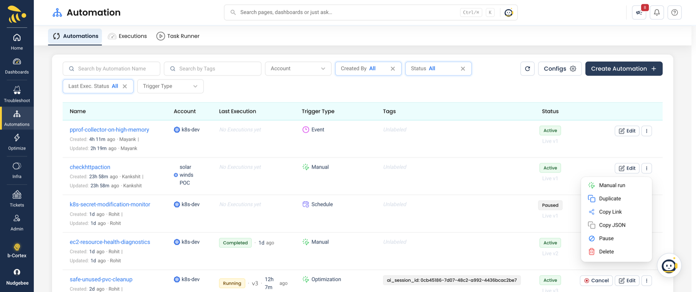

:::note
Pause and Activate depend only on the automation's status, not on its trigger types. They need write access to the automation's account.
:::

### Deleting a Workflow

1. On the workflow listing page, click the three-dots menu on the workflow row
2. Select **Delete**
3. NudgeBee first checks whether other automations call this one, then asks you to confirm

:::warning
Deleting a workflow cannot be undone. All execution history for the workflow will be lost.
:::

### Filtering and Searching Workflows

The list shows **Name**, **Account**, **Last Execution**, **Trigger Type**, **Tags** and **Status**. Click a row to open it. Filters:

- **Search by Automation Name** and **Search by Tags**
- **Account** (multi-select) and, for some users, **Created By**
- **Status** - All, Active, Inactive or Paused
- **Last Exec. Status** - Filter by last execution result (Running, Completed, Failed, Continued As New, Unspecified and others)
- **Trigger Type** - Manual, Schedule, Webhook, Event or Optimization

The row menu has **Manual run**, **Duplicate**, **Copy Link**, **Copy JSON**, **Pause** / **Activate** and **Delete**. Copy Link and Copy JSON work with read access; the others need write access to the account. **Create Automation** is disabled when you can't write to any account.

### Managing Configurations

Configurations are shared values you can reference across workflows.

1. On the workflow listing page, click **Configs**
2. The Configuration Manager opens, showing all existing configs
3. Click **Add** to create a config with a key, value, **Type** and labels:
   - **Config** for regular values — read with `{{ Configs.key_name }}`
   - **Secret** for sensitive data — read with `{{ Secrets.key_name }}`. Secret values are masked in run logs, task inputs and errors — but not in task outputs, so don't echo a secret into an output — and values derived from a secret can't be saved with Set State.
4. Choose the **Scope**: **This Account**, or **Tenant (shared)** to share it with every account (shown to users who can manage the whole tenant)
5. Edit or delete existing configs from the actions column

## Running and Monitoring

### Running a Workflow Manually

**From the editor:**
1. Click **Run current** to run your current edits, or pick **Run live version** from its menu
2. Execution starts
3. The button shows "Running..." and nodes update with real-time status colors
4. A status message appears when execution completes

**From the listing page:**
1. Click the three-dots menu on a workflow row
2. Select **Manual run**
3. Review or edit the input parameters JSON in the modal
4. Click **Trigger Workflow**

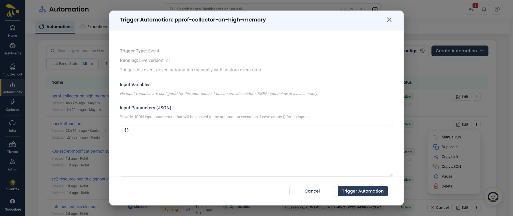

### Using Dry Run

1. Click **Dry Run** in the toolbar
2. Tasks execute with a dry-run flag; use test resources because tasks without dry-run support can make real changes
3. A result modal shows per-task status and outputs
4. Inspect the outputs and any external effects before publishing; see [Dry Run & Validation](./workflow-dry-run-validation.md)

### Viewing Execution History

1. In the editor, click the **Executions** tab in the header
2. The view switches to a three-panel layout:
   - **Left panel** - List of executions with status, time, and duration
   - **Center panel** - Read-only canvas showing nodes colored by their execution status
   - **Right panel** - Detailed information about the selected execution or task
3. Click an execution in the left panel to view it
4. Click a node on the canvas to see that specific task's input, output, and error details

You can filter executions by status and by version at the top of the execution list. Use **Retry** and **Cancel** on a selected execution.

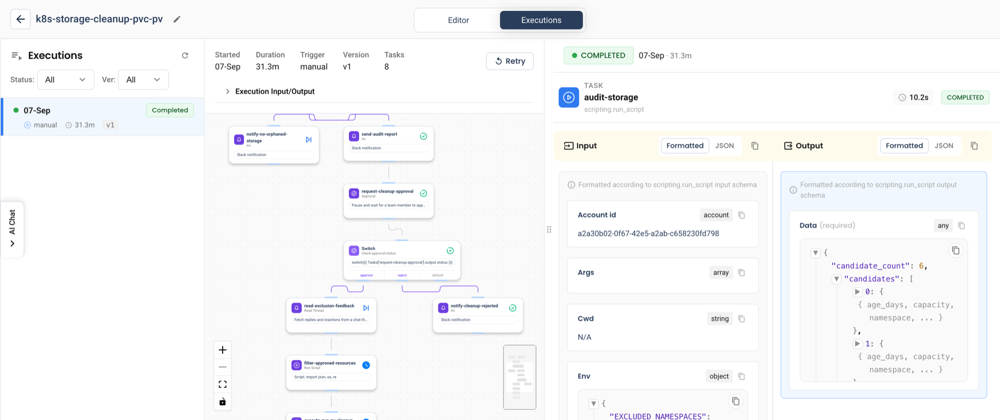

### Understanding Execution Status

| Status | Meaning |
|--------|---------|
| **Running** | Execution is currently in progress |
| **Completed** | All tasks finished successfully |
| **Failed** | One or more tasks encountered an error |
| **Canceled** | Execution was manually canceled |
| **Terminated** | Execution was forcefully terminated |
| **Timed Out** | Execution exceeded the configured timeout |
| **Continued As New** | The run continued in a new execution |

A completed run in which some steps set to **Continue automation** on failure did fail shows a **N steps failed** mark (tooltip *Run completed with failed steps*). There is no separate "completed with errors" status.

Node colors on the execution canvas match these statuses: green for completed, red for failed, blue for running, orange for timed out, and grey for canceled or skipped.

### Debugging Failed Executions

1. Open the **Executions** tab and select the failed execution
2. Look for nodes colored red (failed) on the canvas
3. Click the failed node to see its details in the right panel
4. Expand the **Error** section to see the error message
5. Expand the **Input** and **Output** sections to inspect the data that was passed to and from the task
6. Check the **Logs** section for additional diagnostic information

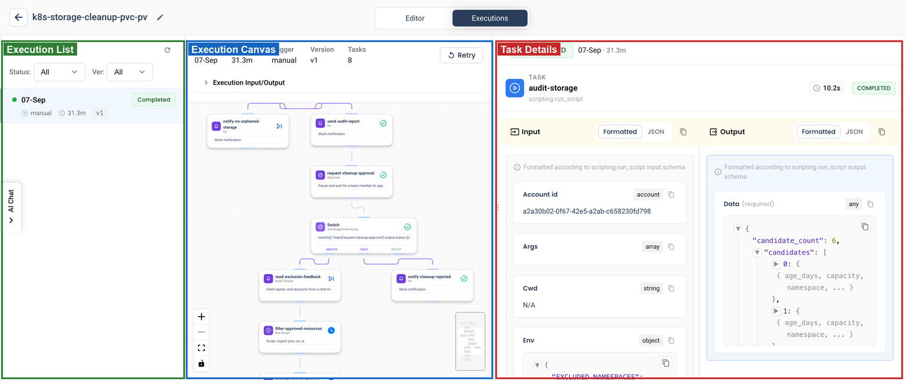

### Executions dashboard

**Automations → Executions** shows runs across all automations. Filter by **Account**, **Automation**, **User** and **Status**. Summary cards count **Failed**, **Successful**, **Timed out**, **Terminated** and **Cancelled** runs, with a list of the automations that fail most. The table shows **Date/Time**, **Automation**, **Account**, **Status**, **User** (with the trigger underneath), **Duration** and **Error**; click a row for the **Execution details** drawer.

### Retrying an Execution

1. In the **Executions** tab, select the execution you want to retry
2. Click the **Retry** button in the execution list header
3. A new execution is created with the same inputs and is automatically selected

## Advanced Features

### Workflow Settings

Access workflow-level settings with **Automation Settings** in the toolbar.

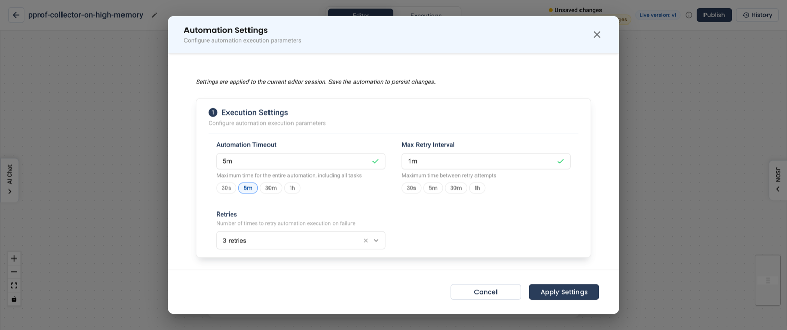

**Execution Settings:**

| Setting | Pre-filled value | Description |
|---------|---------|-------------|
| Automation Timeout | 5 min | Maximum time a run can take. It is also each step's default timeout. |
| Max Retry Interval | 1 min | Maximum time between retry attempts |
| Retries | 3 | Number of retry attempts on failure (0–5) |

Both fields offer quick presets: 30s, 5m, 30m and 1h. See [Limits](#limits) for what applies when a definition sets no value.

**AI Assistant** (shown when the tenant feature **Assistant can run automations** is on):
- **Allow the AI assistant to run this automation** — offer it to NuBi as a tool. It needs a **manual trigger** and a description: *"Add a manual trigger to this automation before the assistant can run it."* / *"Write a description for the AI below before turning this on."*
- **Run without asking the user to confirm** — otherwise NuBi asks before each run.
- **Description for the AI** (up to 2,000 characters) — tells NuBi what the automation does and when to use it.

NuBi only ever runs the **live** version. See [Tools & MCP → Automations](../ai/tools-and-mcp.md#automations) for the list of automations offered to NuBi and why one might not be.

**Workflow Parameters:**
- **Input Parameters** - Define parameters that users provide when triggering the workflow. Each parameter has an ID, type, description, and optional default value
- **Output Parameters** - Define output values using template expressions (e.g., `{"final_message": "Processed {{ Tasks['count_items'].output.count }} items"}`)
- **Tags** - Add labels to categorize and organize workflows. Tags support plain strings or `key:value` format

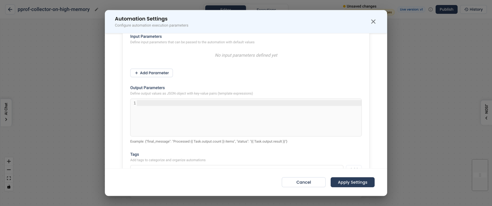

### Input Parameter Types

| Type | Description |
|------|-------------|
| String | Text value |
| Integer | Whole number |
| Boolean | True or false |
| JSON | Arbitrary JSON data |
| Array | Ordered list of items |

### Task-Level Advanced Settings

Each task has additional settings available in the **Settings** tab of the task configuration sidebar:

| Setting | Description |
|---------|-------------|
| Condition (Condition tab) | Template expression — the task runs only when it renders `true` (any letter case) |
| Disable task | Skip the task without deleting it |
| Timeout | Task-specific timeout that overrides the workflow default |
| Set State | Persistent JSON state that survives workflow retries |
| Set Variables | Key-value pairs available to subsequent tasks |
| Matrix | Execute the task multiple times with different parameter combinations |
| Hooks | Actions to run **On Success**, **On Failure** or **On Complete** |
| Failure Policy | **Action on Failure** (**Fail automation** or **Continue automation**) and retries: **Max Attempts**, **Backoff Coefficient**, **Initial Interval**, **Maximum Interval**, and which error types to retry |

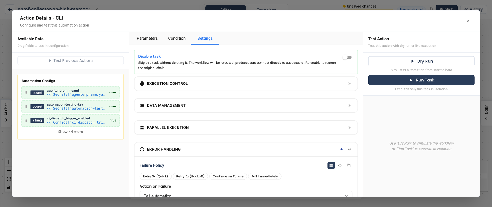

### Testing Individual Tasks

You can test a single task without running the entire workflow:

- **Run Task** - Execute just this task in isolation to verify its configuration
- **Test Previous Actions** - Execute the earlier tasks and this one with the dry-run flag; side effects depend on each task

To run one task outside any automation, use the **Task Runner** tab on the Automations page.

Results appear inline in the task configuration sidebar with a toggle between JSON and formatted views.

:::note
Some task types cannot be tested individually, including Group, Switch, For Each, Call Workflow, Approval and Wait.
:::

### Sub-Workflows and Loops

- **Group** (Core → Group) - Group multiple tasks into a single collapsible node for better organization
- **For Each** (Core → For Each) - Loop over a list of items, executing contained tasks for each item
- **Call Workflow** (Core → Call Workflow) - Invoke another saved workflow as a step in the current one
- **Wait** (Core → Wait) - Pause execution for a specified duration before continuing
- **Approval** (Core → Approval) - Pause execution until a user approves — see [Approvals](./workflow-operations-approvals.md)

### AI-Assisted Features

**Generate a workflow with AI:**
1. Click **Create Automation** on the listing page
2. Choose **Generate with NuBi** (Beta)
3. Describe what you want in natural language
4. Review the AI's plan and approve it, or request changes
5. The generated workflow loads in the editor ready for you to review and customize

**Edit a workflow with AI Chat:**
1. In the editor, click **Ask NuBi AI** in the toolbar
2. The NuBi AI sidebar opens on the left
3. Describe the changes you want conversationally
4. The AI modifies the workflow definition based on your instructions

**Continue with AI:**
- If a workflow was generated by AI, a **Continue with AI** button appears in the header, allowing you to resume the AI conversation

## Whose permissions a run uses

Every step checks permissions against the account it acts on, as a specific user:

| Run started by | Acts as |
|---|---|
| Manual run, retry, dry run, Task Runner, NuBi | The person who started it |
| Schedule, event, webhook or optimization trigger | The automation's **owner** — its creator, or whoever last published a version as live or made a version live |

A step the user isn't allowed to do fails with a permission error. If the owner's user is deleted, every step that makes changes fails until someone else publishes or makes a version live. Schedules use the **live** version's cron.

## Limits

| Limit | Value |
|---|---|
| Run timeout when the definition sets none | 1 hour (dry run: 30 minutes) |
| Step timeout when neither the step nor the automation sets one | 10 minutes, one attempt (no retry) |
| Hook actions | 5 seconds per attempt, up to 5 attempts |
| Matrix | Up to 1,000 combinations |
| Webhook request body | 5 MB |

The Automation Settings form pre-fills 5 minutes, 1 minute and 3 retries; those apply once saved.

## Task Types Reference

| Task Type | Category | Description |
|-----------|----------|-------------|
| Run Script | Scripting | Run custom scripts (Bash, JavaScript, Python, and more) |
| HTTP request | Integrations | Make HTTP requests to external services |
| Send IM | Notifications | Send messages via Slack, MS Teams, or Google Chat |
| Create ticket | Tickets | Create tickets in configured ticket management systems |
| Data Transform | Data | Transform and process data |
| AWS CLI | AWS | Execute AWS CLI commands |
| Azure CLI | Azure | Execute Azure CLI commands |
| GCP CLI | GCP | Execute Google Cloud CLI commands |
| Kubectl | Kubernetes | Execute kubectl commands |
| Pod Profile | Kubernetes | Profile a pod (see [Kubernetes Tasks](./kubernetes-tasks.md#k8sprofile)) |
| ArgoCD CLI | CI/CD | Execute ArgoCD CLI operations |
| Query logs | Observability | Query and analyze logs |
| Query metrics | Observability | Query metrics data |
| AI Summary | AI/LLM | Generate AI-powered summaries |
| AI Investigation | AI/LLM | AI-powered investigation and analysis |
| AI Router | AI/LLM | Route decisions using AI (deprecated — use classify plus Switch) |
| AI Event Investigation | AI/LLM | AI investigation of an event |
| Group | Core | Group of nested tasks |
| Approval | Core | Pause execution until approved |
| Switch | Core | Branch execution based on a value |
| For Each | Core | Loop over a list of items |
| Call Workflow | Core | Invoke another workflow |
| Wait | Core | Pause execution for a duration |
| rabbitmqadmin | Message Queue | Execute RabbitMQ operations |
| Redis CLI | Database | Execute Redis operations |
| GitHub CLI | Source Control | Execute GitHub operations |

## Trigger Types Reference

See [Configuring Triggers](./triggers.md) for full details on each trigger type, including field constraints and the [Event Payload Schema](./triggers.md#event-payload-schema).

| Trigger Type | Description | Key Configuration |
|-------------|-------------|-------------------|
| [Manual Trigger](./triggers.md#manual-trigger) | Start workflow on demand by clicking Run | Input parameters (JSON object, optional) |
| [Schedule](./triggers.md#schedule-trigger) | Run workflow on a recurring time-based schedule | Cron expression, overlap policy, catchup window |
| [Webhook](./triggers.md#webhook-trigger) | Run workflow when an HTTP request hits a generated URL | Webhook integration, optional filter expression |
| [Event Trigger](./triggers.md#event-trigger) | Run workflow when a matching event is detected | At least one of: event type, namespace, source, priority, advanced expression, or another account |
| [Optimization Trigger](./triggers.md#optimization-trigger) | Run workflow when a new optimization recommendation matches | At least one of: cluster, category, rule name |

## Troubleshooting

| Problem | Cause | Solution |
|---------|-------|----------|
| "Automation name is required" when saving | Workflow has no name | Click the pencil icon in the header and enter a name |
| "At least one task is required" when saving | No action nodes on the canvas | Add at least one task using the **Add Action** button |
| Tasks have validation errors on save | Required fields are missing in task configuration | Click each flagged task and fill in the required parameters |
| "Cannot save: JSON is invalid" | The JSON panel has syntax errors | Switch to the JSON panel, fix the errors, and click **Apply** |
| "Cannot save: You have unapplied JSON changes" | JSON was edited but not applied | Click **Apply** in the JSON panel before saving |
| Connection rejected (nodes flash) | The connection would create a circular dependency | Reorganize your workflow so tasks flow in one direction without loops |
| "Integration name is required for webhook triggers" | Webhook trigger has no integration | Pick a **Webhook Integration** in the trigger configuration |
| "Filter expression has unmatched template braces" | Event filter has malformed template syntax | Ensure your filter uses balanced `{{ }}` braces |
| "Invalid JSON format" when triggering | Input parameters are not valid JSON | Check your JSON syntax - ensure proper quoting and structure |
| `Duration must be in Go format (e.g., "10m", "1h", "24h")` | A duration field uses an invalid format | Use a duration such as `10m`, `1h` or `24h`. |
| Workflow execution timed out | Execution exceeded the configured timeout | Increase the timeout in **Automation Settings** or optimize long-running tasks |
| A step fails with a permission error | The user the run acts as can't do that on the account | See [Whose permissions a run uses](#whose-permissions-a-run-uses) |
| Workflow execution failed | One or more tasks encountered errors | Open the **Executions** tab, select the execution, and click the failed node to see error details |
| "Failed to load AI-generated workflow" | AI generation encountered an issue | An empty workflow is created instead - try generating again or build manually |
| Config key already exists | Duplicate key in Configuration Manager | Use a unique key name for each configuration |

## FAQ

**Can a workflow have multiple triggers?**
Yes. You can add multiple trigger nodes to a single workflow. For example, a workflow can run on a schedule and also be triggered manually.

**What happens if I edit a workflow while it's running?**
Editing and saving a workflow does not affect executions that are already in progress. Draft edits affect production triggers only after publishing and making the version live.

**Can I use outputs from one task in another task's configuration?**
Yes. Use template expressions like `{{ Tasks['task_id'].output.value }}` in any text field. The task configuration sidebar shows available outputs from previous tasks that you can drag into fields.

**What is the difference between Run current and Dry Run?**
**Run current** executes the workflow and performs all real actions (sending notifications, running scripts, etc.). **Dry Run** executes tasks with a flag that only dry-run-aware tasks honor. Other tasks can still change external systems. Use isolated targets and follow [Dry Run & Validation](./workflow-dry-run-validation.md).

**How do I share configuration values across multiple workflows?**
Use the **Configuration Manager** (click **Configs** on the listing page). Reference configs with `{{ Configs.key_name }}` and secrets with `{{ Secrets.key_name }}`.

**Can I pause a manually-triggered workflow?**
Yes. Pause and Activate depend on the automation's status, not its triggers.

**What does "N steps failed" on a completed run mean?**
The run finished, but some steps whose failure policy is **Continue automation** failed. Open the run to see which ones.

---

## Task-Oriented Automation Guides

- **[Create an Automation When an Event Occurs](./create-event-automation.md)** — Step-by-step walkthrough for building incident-driven automations and auto-remediation.
- **[Create an Automation from an Optimization Recommendation](./create-optimization-automation.md)** — Automatically rightsize workloads and eliminate cloud waste.
- **[Test and Validate an Automation (Dry Run & Validation)](./workflow-dry-run-validation.md)** — Validate inputs and task-specific dry-run behavior before publishing.
- **[Troubleshooting: Why Didn't My Workflow Trigger?](./workflow-did-not-trigger.md)** — Pinpoint trigger mismatches, versions that aren't live, and timezone issues.
- **[Workflow Operations: Approvals, Replays, Cancellations & Auditing](./workflow-operations-approvals.md)** — Manage human approval gates, retry whole executions, and inspect audit logs.
- **[Choosing Between Event Playbooks, Workflows, and AutoOptimize](./automation-architecture-guide.md)** — Architectural decision guide across NudgeBee's automation engines.

## Related

- [Configuring Triggers](./triggers.md)
- [Workflow Versioning](./workflow-versioning.md)
- [Tools & MCP → Automations](../ai/tools-and-mcp.md#automations)
