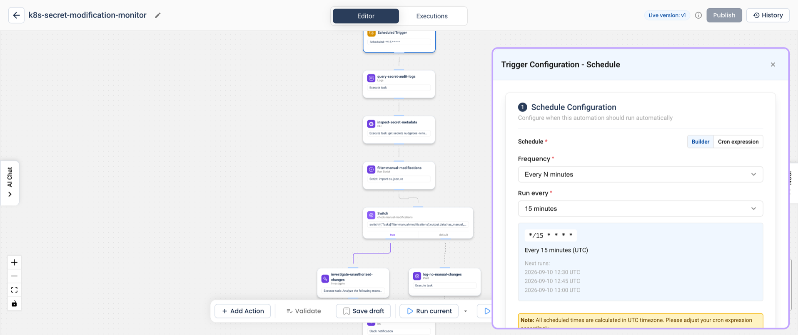
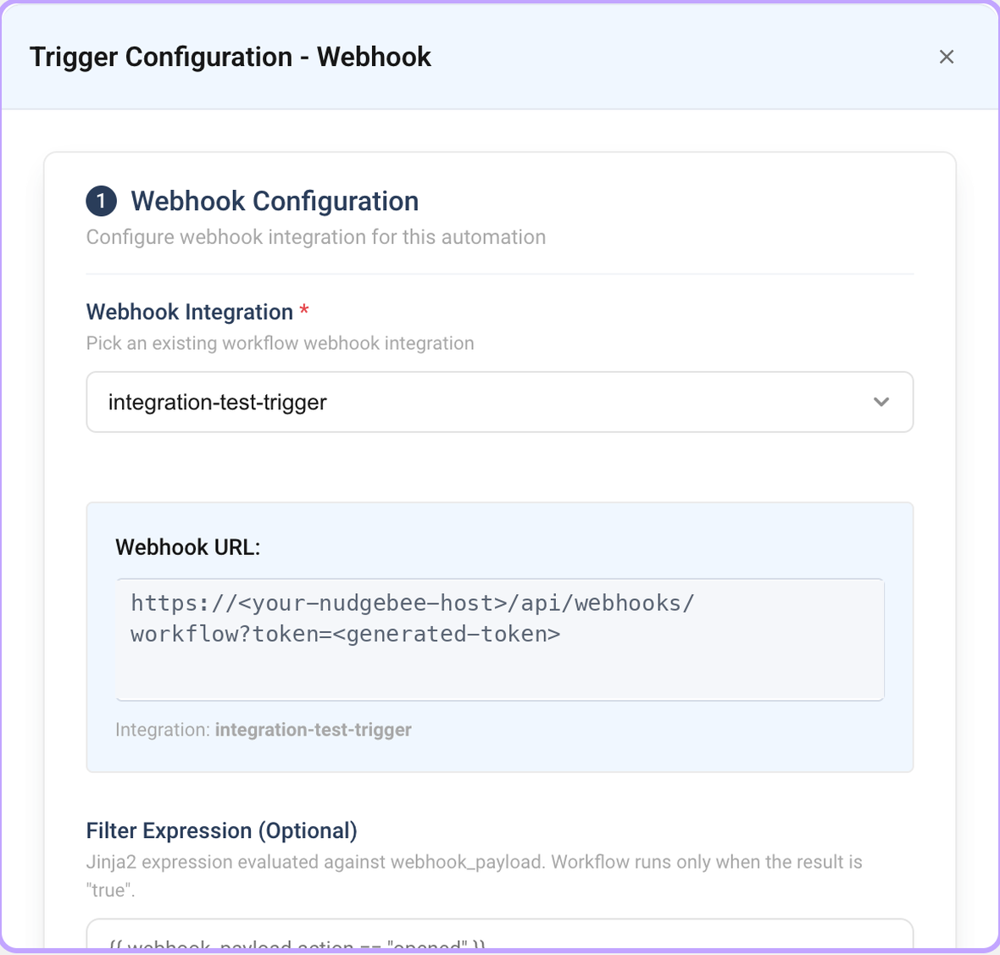
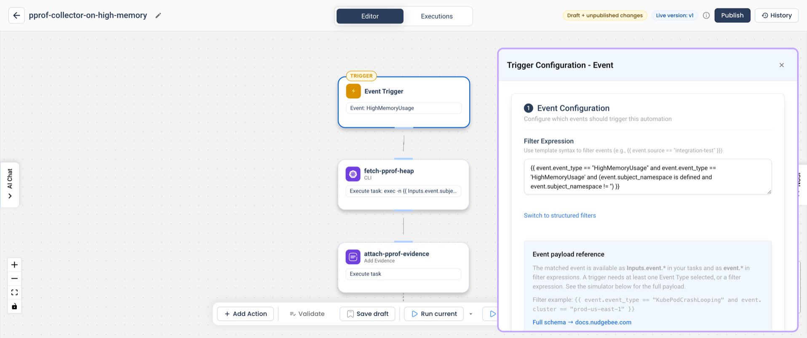
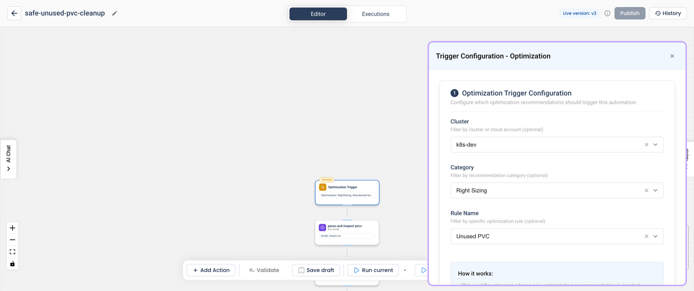

# Configuring Triggers

Triggers define **how and when** a workflow starts. A workflow can have one or more trigger nodes, and the workflow runs whenever any of them fire.

Click a trigger node on the canvas to open the **Trigger Configuration** sidebar. The fields you see depend on the trigger type. Trigger nodes with invalid configuration display a yellow alert icon — hover over the node to see which rule failed. A workflow cannot be activated while any of its trigger nodes is invalid.

## Trigger Types Reference

| Trigger Type | Description | Key Configuration |
|-------------|-------------|-------------------|
| [Manual Trigger](#manual-trigger) | Start workflow on demand by clicking Run | Input parameters (JSON, optional) |
| [Schedule](#schedule-trigger) | Run workflow on a recurring time-based schedule | Cron expression, overlap policy, catchup window |
| [Webhook](#webhook-trigger) | Run workflow when an HTTP request hits a generated URL | Webhook integration, optional filter expression |
| [Event Trigger](#event-trigger) | Run workflow when a matching platform event is detected | At least one of: event type, namespace, source, priority, advanced expression, or another account in **Listen to accounts** |
| [Optimization Trigger](#optimization-trigger) | Run workflow when a new optimization recommendation matches | At least one of: cluster, category, rule name |

## Manual Trigger

Runs the workflow when you click **Run** in the editor or select **Manual run** from the listing page.

- **Input Parameters (JSON)** (optional) - A JSON **object** of parameters made available to tasks at runtime as `Inputs.<key>`. Arrays and other non-object JSON values are rejected.
- Maximum length: 2000 characters.
- Leave the field as `{}` if no inputs are needed.

## Schedule Trigger

Runs the workflow automatically on a recurring schedule.

- **Cron Expression** (required) - Standard 5-field cron format (`minute hour day month weekday`). Maximum 100 characters.
- **Overlap Policy** - What happens when a new run is due while the previous run is still active. The UI label is shown to users; the **stored value** is what appears in the saved workflow JSON:

  | UI Label | Stored Value | Behavior |
  |----------|--------------|----------|
  | Skip *(default)* | `Skip` | Skip the new run |
  | Buffer One | `BufferOne` | Queue one pending run |
  | Buffer All | `BufferAll` | Queue all pending runs |
  | Allow All | `AllowAll` | Run all concurrently |
  | Cancel Other | `CancelOther` | Cancel the previous run |
  | Terminate Other | `TerminateOther` | Terminate the previous run |

- **Catchup Window** - How far back to look for missed runs after an outage. Use a **single-unit** duration matching the regex `^\d+[smhd]$` — e.g. `60s`, `10m`, `1h`, `7d`. Default: `60s`. Compound durations like `1h30m` are **not** accepted.

:::note
All scheduled times use the UTC timezone.
:::



**Common cron examples:**

| Expression | Schedule |
|-----------|----------|
| `0 9 * * 1-5` | Every weekday at 9:00 AM |
| `*/15 * * * *` | Every 15 minutes |
| `0 0 * * 0` | Every Sunday at midnight |
| `0 12 1 * *` | First day of every month at noon |

## Webhook Trigger

Runs the workflow when an HTTP request is sent to a generated webhook URL.

- **Webhook Integration** (required) - Pick an existing automation webhook integration. It authenticates and routes incoming requests.
- **Filter Expression** (optional) - A template expression evaluated against the incoming request body, available here as the parsed object `webhook_payload`. The workflow runs only if the expression renders to exactly `true` (any letter case) — `1` does **not** match. Maximum 500 characters.

**Setup:**

1. Pick the **Webhook Integration**.
2. The webhook URL is displayed (it ends in `/api/webhooks/workflow?token=…`) - click the copy icon to copy it.
3. Send HTTP requests to this URL to trigger the workflow. The `token` in the URL authenticates the request — no extra header is needed.

**Reading the request in tasks:** in task parameters, the parsed JSON body is `Inputs.webhook_json` and the raw body is the string `Inputs.webhook_payload`. For example, `{{ Inputs.webhook_json.repository.name }}`.

**Filter expression examples:**

| Expression | Behavior |
|-----------|----------|
| `{{ webhook_payload.action == "opened" }}` | Only trigger when the payload's `action` is `opened` |
| `{{ webhook_payload.repository.name == "my-repo" }}` | Only trigger for a specific repository |

:::warning
A webhook trigger requires a `workflow_webhook` integration configured in **Settings → Integrations**. If you haven't set one up, the sidebar will guide you to create one. The integration must be linked to the workflow before the webhook URL is generated.
:::



## Event Trigger

Runs the workflow when a matching platform event is published - for example a recommendation, an alert, or a finding. See [Event Payload Schema](#event-payload-schema) for the fields available on every event.

### Filters

You configure an Event Trigger using **structured filters**. **At least one** filter must be set, otherwise saving fails with:

> Set at least one filter (event type, namespace, source, priority, or advanced expression), or listen to another account

Available structured filters (all optional individually, but at least one is required overall):

- **Event Type / Aggregation Key** - The class of event to listen for, selected from the dropdown.
- **Listen to accounts** - Events from these clusters and cloud accounts trigger this automation. Leave it empty to listen to the automation's own account only.
- **Namespace** - Restrict to events from a specific Kubernetes namespace.
- **Source** - Restrict to events from a specific source system (e.g. `prometheus`).
- **Priority** - Restrict by severity level. One of: `HIGH`, `MEDIUM`, `LOW`, `INFO`, `DEBUG`.

When you listen to more than one account, set each infrastructure step's account to `{{ Inputs.event.cloud_account_id }}` so the step runs against the account the event came from.

When multiple structured filters are set, they are combined with logical **AND** when compiled to the saved Jinja `params.filter`. For example, setting Priority=`HIGH` and Source=`prometheus` produces:

```
{{ event.priority == "HIGH" and event.source == "prometheus" }}
```

:::note Auto-save
The Event Trigger sidebar auto-saves your changes, but **only after the "at least one filter" rule passes**. Until then your edits are kept in the form but not persisted to the workflow.
:::

### Switching to advanced mode

Click **Switch to advanced filter expression** to replace the structured fields with a raw template expression over the full event payload. Use advanced mode when you need conditions the structured fields can't express - OR-logic, nested labels, non-equality comparisons, or string matching.

- The expression must render to `true` or `1` for the workflow to run.
- The event is available as `event`.
- Maximum 500 characters.
- Switching back to structured mode works only if the parser can decompose the expression into the supported fields. Free-form expressions stay in advanced mode.

**Advanced filter examples:**

| Expression | Behavior |
|-----------|----------|
| `{{ event.priority == "HIGH" }}` | Only high-priority events |
| `{{ event.source == "prometheus" }}` | Only events from Prometheus |
| `{{ event.labels.env == "prod" }}` | Only events labeled `env=prod` |

### Legacy migration

Workflows created before structured filters used a single `params.event_type` field. When you re-open such a trigger, the old value is automatically migrated to a structured **Event Type** filter — no manual action is required.



## Optimization Trigger

Runs the workflow when a new **optimization recommendation** is created and matches the configured filters. Pick **at least one** of Cluster, Category or Rule Name — a trigger with none is rejected when you save.

- **Cluster** (optional) - Filter by Kubernetes cluster. Dropdown grouped by cloud provider.
- **Category** (optional) - Filter by recommendation category: **Right Sizing**, **Infra Upgrade**, **Config** or **Spot Instance**.
- **Rule Name** (optional) - Filter by optimization rule. The options load from your recommendation data, narrowed to the selected category.

If you write the trigger in JSON, a filter expression also satisfies the at-least-one-filter rule.

The recommendation payload is exposed in the workflow as `event` — use `{{ event.cluster }}`, `{{ event.category }}`, etc. in trigger expressions, and `{{ Inputs.event.cluster }}` inside downstream task params (see [Event Payload Schema](#event-payload-schema)).



## Event Payload Schema

The fields below describe platform event payloads; availability depends on the event source. Optimization recommendations use a different payload, documented in [Optimization-Triggered Automation](./create-optimization-automation.md#use-the-actual-recommendation-payload). Inspect the actual execution input before referencing optional fields.

| Field | Type | Notes |
|-------|------|-------|
| `id` | string | Event ID — needed by the AI Event Investigation task |
| `cloud_account_id` | string | Account the event came from — use it as the step account when listening to several accounts |
| `event_type` | string | Event class / aggregation key |
| `source` | string | Source system (e.g. `prometheus`) |
| `cluster` | string | Kubernetes cluster |
| `subject_namespace` | string | Kubernetes namespace |
| `subject_name` | string | Kubernetes object name |
| `priority` | enum | `HIGH`, `MEDIUM`, `LOW`, `INFO`, `DEBUG` |
| `status` | string | Event status |
| `labels` | object | Arbitrary key/value labels |

**Access patterns:**

- **In trigger filter expressions** - access fields directly on `event`:
  ```
  {{ event.priority == "HIGH" }}
  {{ event.labels.env == "prod" }}
  ```
- **In downstream task parameters** - the same payload is exposed as `Inputs.event`:
  ```
  {{ Inputs.event.cluster }}
  {{ Inputs.event.subject_name }}
  ```

## Related

- [Workflow Builder](./index.md)
- [Create an Automation When an Event Occurs](./create-event-automation.md)
- [Why Didn't My Workflow Trigger?](./workflow-did-not-trigger.md)
- [Automation Webhook](../../integrations/Webhooks/automation_webhook.md)
