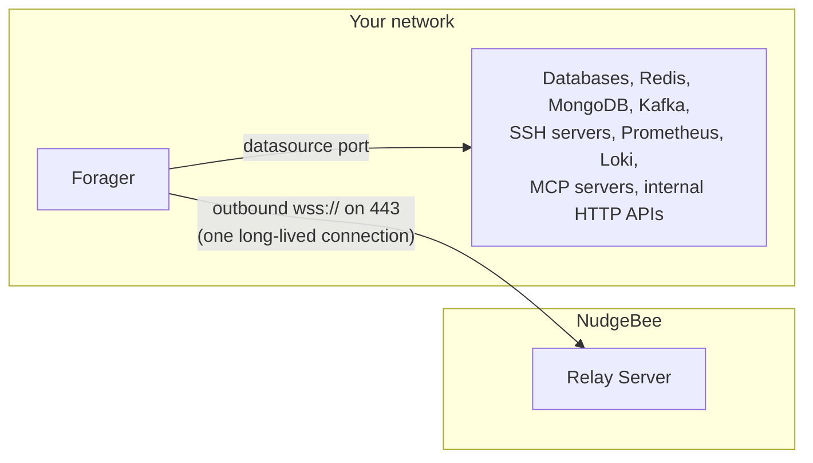

# Network Requirements

Forager needs one outbound connection: TLS WebSocket (`wss://`) on port 443 to the NudgeBee Relay Server. It also needs a route to each datasource you connect. **No inbound ports are needed.** NudgeBee never connects into your network.

## How Connectivity Works



1. **Connect** — Forager opens one WebSocket to the Relay Server and authenticates with its access key and secret.
2. **Receive config** — The relay pushes the datasources you set to the **Proxy Agent** connection mode in the UI.
3. **Proxy** — Every NudgeBee request for data (a SQL query, a PromQL query, an SSH command) travels down that same connection. Forager runs it against the datasource and returns the result.
4. **Keep alive** — Forager pings every 30 seconds and sends a health report every 60 seconds. If the connection drops, it reconnects automatically, backing off from 3 seconds up to 30 seconds.

What protects the channel:

- **Outbound only.** All traffic rides the connection Forager opened.
- **Signed requests.** When a signing public key is configured (`signing_public_key`), Forager rejects any request that is not signed by NudgeBee (Ed25519).
- **Sealed credentials.** Credentials entered in the UI are encrypted to a key that only your Forager holds, so the relay carries them as an opaque blob. On disk they are stored encrypted. See [Credential Sources](./credential-sources.md).
- **Credentials pinned to their host.** A stored credential is bound to the host, or URL origin, it was entered for. A config change that points it at another host, port or scheme is refused.
- **Cloud metadata blocked.** HTTP and MCP datasources cannot reach link-local or cloud-metadata addresses such as `169.254.169.254`, so no datasource URL can read the host's own cloud credentials.

## Egress Allowlist

| From | To | Port | Purpose | When |
|------|----|------|---------|------|
| Forager host | Relay Server host (from the relay URL in the UI) | 443 TCP, `wss://` | Control channel | Always |
| Forager host | Each datasource `host:port` | Datasource port (see below) | Queries and health checks | Per datasource |
| Forager host or cluster nodes | `registry.nudgebee.com` | 443 | Installer, binary, container image and Helm chart | Installs and upgrades that use the commands shown in the UI |
| Forager host | `github.com`, `objects.githubusercontent.com`, `release-assets.githubusercontent.com` | 443 | Installer and binary download | Script installs and upgrades that use the GitHub commands in [Installation](./installation.md) |
| Forager host or cluster nodes | `ghcr.io`, `pkg-containers.githubusercontent.com` | 443 | Container image and Helm chart | Docker and Kubernetes installs that use GHCR |
| Forager host | AWS Secrets Manager, GCP Secret Manager or Azure Key Vault endpoints | 443 | Read datasource credentials | Only with a cloud [credential source](./credential-sources.md) |

Typical datasource ports to open from the Forager host:

| Datasource | Default port | Setup guide |
|------------|--------------|-------------|
| PostgreSQL | 5432 | [PostgreSQL](../../integrations/Databases/postgresql.md) |
| MySQL / MariaDB | 3306 | [MySQL](../../integrations/Databases/mysql.md) |
| Microsoft SQL Server | 1433 | [SQL Server](../../integrations/Databases/sqlserver.md) |
| ClickHouse | 9000 (native), 8123 (HTTP) | [ClickHouse](../../integrations/Databases/clickhouse.md) |
| Oracle | 1521 | [Oracle](../../integrations/Databases/oracle.md) |
| Redis | 6379 | [Redis](../../integrations/In-Memory/redis.md) |
| MongoDB | 27017 | [Configuration Reference](./configuration.md) |
| Kafka | 9092 (or your SASL/TLS listener) | [Configuration Reference](./configuration.md) |
| SSH servers | 22 | [SSH](../../integrations/Servers/ssh.md) |
| Prometheus, Loki, SigNoz, other HTTP APIs | The endpoint's port | [Configuration Reference](./configuration.md) |
| MCP servers (HTTP) | The server's port | [MCP](../../integrations/MCP/index.md) |

Place Forager where it can reach every datasource you want to connect, such as a VM in the same VPC, VNet or subnet. For datasources in separate networks, run one Forager per network.

## Firewalls and Proxies

- **Allowlist by hostname.** Use the relay hostname from the UI rather than an IP address.
- **Allow WebSocket upgrades.** Some proxies and next-generation firewalls block the WebSocket `Upgrade` on port 443. This is the most common reason an agent stays "Not Connected".
- **Idle timeout above 60 seconds.** Forager pings every 30 seconds. A device that drops idle connections faster causes reconnect loops.
- **TLS inspection.** If a proxy re-signs TLS, add its CA certificate to the Forager host's OS trust store (or the container image), or exempt the relay hostname from inspection.
- **Corporate HTTP proxy.** Forager honours `HTTPS_PROXY`, `HTTP_PROXY` and `NO_PROXY` for its relay connection. List your internal ranges and hostnames in `NO_PROXY` so datasource traffic goes direct.

Setting the proxy variables:

**Linux (systemd)**: run `sudo systemctl edit nudgebee-forager`, then add:

```ini
[Service]
Environment=HTTPS_PROXY=http://proxy.example.com:3128
Environment=NO_PROXY=10.0.0.0/8,.internal.example.com
```

Then run `sudo systemctl restart nudgebee-forager`.

**Docker**: pass `-e HTTPS_PROXY=... -e NO_PROXY=...` to `docker run`.

**Kubernetes**: add `HTTPS_PROXY` and `NO_PROXY` as environment variables on the Forager deployment.

## Before You Install

Check these before installing. Each one changes what you do in [Installation](./installation.md).

| If… | Then |
|-----|------|
| You will connect **Oracle** | Use the Docker image or Helm chart. Only the container build includes the Oracle client. |
| You install with the **Linux or macOS script** | By default the script sets up VM discovery for the host's local subnet (/22 or narrower), so NudgeBee can find SSH hosts there. Network sweeps can trigger intrusion detection, so tell your security team first. Set `NB_DISCOVERY=false` to skip it, or `NB_DISCOVERY_CIDR` to choose the range. See [Discovery Datasource](./discovery.md) and [Set up self-hosted VMs](../../features/VM/setup.md). |
| You run **more than one replica** | All replicas must share one encryption key. A normal `helm install` handles this for you. |
| You deploy with **GitOps** (Argo CD, Flux, `helm template`) | Set `forager.encPrivateKey` yourself (generate one with `head -c 32 /dev/urandom \| base64`). Otherwise every sync generates a new key and NudgeBee re-sends all credentials. |
| The host has **no internet access for downloads** | Mirror the release files and point the installer at the mirror with `NB_DOWNLOAD_URL`. For containers, mirror `ghcr.io/nudgebee/forager` to your registry. The relay connection on 443 is still required. |
| You use **cloud secret managers** | Give Forager's host identity read access to those secrets only. For HTTP datasources, also set `secret_ref_allowlist` to the secret prefixes Forager may read. |

For least privilege, give NudgeBee a read-only database user and a dedicated key-based SSH user. Pin SSH host keys with `host_key` or `known_hosts` (see [SSH Datasource Notes](./configuration.md#ssh-datasource-notes)).

## Sizing

Forager is lightweight. The Helm chart defaults to a request of 50m CPU and 128 MiB of memory, with a 256 MiB memory limit. A small VM is enough for typical use.

## Verify Connectivity

From the Forager host:

```bash
# Relay reachable over TLS: any HTTP response means the network path is open
curl -sv https://<RELAY_HOST>/ -o /dev/null

# A datasource reachable from the agent
nc -zv <HOST> <PORT>
```

On Windows: `Test-NetConnection -ComputerName <HOST> -Port <PORT>`.

If the agent still does not connect, see [Troubleshooting](./troubleshooting.md).
