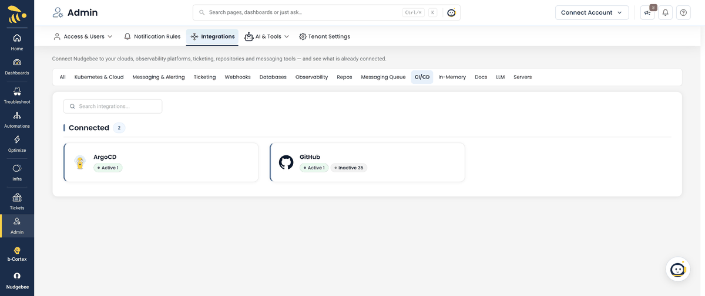

# ArgoCD Integration Guide

## Table of Contents
1. [Introduction](#introduction)
2. [Prerequisites](#prerequisites)
3. [Configuration Setup](#configuration-setup)
4. [Features & Capabilities](#features--capabilities)

---

## Introduction

The ArgoCD integration allows NudgeBee to connect with your ArgoCD GitOps platform, enabling intelligent monitoring, automated incident response, and seamless deployment management. This integration brings the power of AI-driven troubleshooting to your GitOps workflows.

### What is ArgoCD Integration?

ArgoCD is a declarative, GitOps continuous delivery tool for Kubernetes. NudgeBee's ArgoCD integration provides:

- **Real-time application health monitoring** - Track sync status, deployment health, and configuration drift
- **Automated incident correlation** - Connect application issues with recent deployments
- **AI-powered troubleshooting** - Natural language queries to investigate and fix deployment problems
- **Workflow automation** - Incorporate ArgoCD operations into automated remediation workflows

### Key Benefits

- **Faster incident resolution** - Automatically correlate application issues with recent deployments
- **Intelligent troubleshooting** - AI agent provides root cause analysis and actionable fixes
- **Natural language control** - Manage ArgoCD applications using conversational queries
- **Automated deployment tracking** - Every incident includes deployment history context
- **GitOps visibility** - Complete view of your deployment pipeline in NudgeBee

---

## Prerequisites

Before configuring the ArgoCD integration, ensure you have:

### Required Components

1. **ArgoCD Server**
   - ArgoCD server installed and accessible
   - Server URL (e.g., `https://argocd.example.com`)
   - Version: Compatible with ArgoCD CLI

2. **Kubernetes Cluster Access**
   - NudgeBee deployed with access to Kubernetes cluster
   - Ability to create Kubernetes secrets

3. **Authentication Credentials**

   Choose one authentication method:

   **Option A: Auth Token (Recommended)**
   - ArgoCD authentication token
   - Generate via: `argocd account generate-token`

   **Option B: Username/Password**
   - ArgoCD username
   - ArgoCD password

4. **Permissions**
   - ArgoCD user must have read access to applications
   - For automation workflows: write permissions for sync/rollback operations

---

## Configuration Setup

### Step 1: Create Kubernetes Secret

First, create a Kubernetes secret containing your ArgoCD credentials. This secret will be referenced by NudgeBee to authenticate with ArgoCD.

#### Using Auth Token (Recommended)

```bash
kubectl create secret generic argocd-credentials \
  --from-literal=ARGOCD_SERVER=https://argocd.example.com \
  --from-literal=ARGOCD_AUTH_TOKEN=your-auth-token-here \
  -n nudgebee-agent
```

#### Using Username/Password

```bash
kubectl create secret generic argocd-credentials \
  --from-literal=ARGOCD_SERVER=https://argocd.example.com \
  --from-literal=ARGOCD_USERNAME=admin \
  --from-literal=ARGOCD_PASSWORD=your-password-here \
  -n nudgebee-agent
```

**Note:** Create the secret in the NudgeBee agent's namespace on the linked cluster (for example `nudgebee-agent`), and enter just the secret name in the **K8s Secret** field.

### Step 2: Configure Integration in NudgeBee UI

The walkthrough below shows the full flow — opening the **CI/CD** category, selecting **ArgoCD**, clicking **Add ArgoCD Account**, and filling in the configuration form.



1. **Navigate to Integrations**
   - Go to **Admin** → **Integrations**
   - Click on **CI/CD** category
   - Select **ArgoCD**

2. **Add ArgoCD Account**
   - Click **"Add ArgoCD Account"** button
   - Fill in the configuration form:

   | Field | Description | Required | Example |
   |-------|-------------|----------|---------|
   | **Name** | Friendly name for this integration | Yes | `Production ArgoCD` |
   | **K8s Secret** | Name of the Kubernetes secret created in Step 1 | Yes | `argocd-credentials` |
   | **Select Accounts** | Cluster accounts this integration is linked to | Yes | Select from dropdown |
   | **Authentication method** | `token` or `password` | No (default: `token`) | `token` |
   | **Insecure** | Skip TLS certificate verification | No (default: `false`) | `false` |
   | **gRPC-Web** | Use the gRPC-Web protocol. Needed when ArgoCD is reached through an HTTP/1.1 ingress or proxy (the usual case). Set `false` only for a direct gRPC endpoint | No (default: `true`) | `true` |
   | **Timeout** | Command timeout in seconds | No (default: 30) | `30` |

   The secret's key names are fixed: `ARGOCD_SERVER` (the server URL) plus either `ARGOCD_AUTH_TOKEN` (token auth) or `ARGOCD_USERNAME` and `ARGOCD_PASSWORD` (password auth).

3. **Test Connection**
   - Click **Test Connection**
   - NudgeBee runs `argocd account get-user-info` against `ARGOCD_SERVER` (after `argocd login` when you use password auth) and expects the response to report you as logged in
   - Click **Save** once the test succeeds

4. **Verify Integration**
   - The integration should appear in the ArgoCD integrations list
   - Status should show as `enabled`

### Step 3: Link to Cloud Accounts

Select which NudgeBee cloud accounts should use this ArgoCD integration. This allows deployment history to be automatically correlated with incidents in those accounts.

---

## Features & Capabilities

### 1. AI-Powered ArgoCD Agent

The ArgoCD Agent is an intelligent GitOps incident responder that provides:

- **Natural language queries** - Ask questions like "Check health of my-app" or "Why is my-app failing?"
- **Automated troubleshooting** - Follows systematic investigation protocols for common issues
- **Multi-tool correlation** - Combines data from ArgoCD, Kubernetes, GitHub, logs, and metrics
- **Actionable fixes** - Provides specific commands to resolve issues
- **Emergency response** - Quick rollback and recovery procedures

**Access the Agent:**
- Via chat interface: Ask questions about ArgoCD applications
- Via incidents: Automatically triggered during investigations
- Via workflows: Use as a tool in automated workflows

### 2. Automated Deployment History

For every incident in NudgeBee, deployment history is automatically retrieved if:
- The affected service has an `argocd.argoproj.io/instance` label
- ArgoCD integration is configured for the account
- The service is not from AWS CloudWatch alarms

**What's Included:**
- Current application sync and health status
- Recent deployment history with timestamps
- Git commit information (repo, branch, revision)
- Deployment correlation with incident timeline
- Insights about deployment timing relative to the incident

### 3. Playbook Actions

The ArgoCD integration includes playbook actions that can be executed:

**Available Actions:**
- **Get ArgoCD Application History** - Retrieves deployment details and status
  - Inputs: `application_name`, `account_id` (optional), `integration_name` (optional)
  - Outputs: Sync status, health status, deployment history, insights

**Auto-Execution:**
- Automatically runs for Kubernetes incidents when ArgoCD labels are detected
- Adds deployment context to incident investigation
- Skips for AWS CloudWatch alarms (infrastructure-only alerts)

### 4. LLM Tool Integration

Execute ArgoCD CLI commands via the AI agent:

**Supported Commands:**
- `argocd app list` - List all applications
- `argocd app get <name>` - Get application details
- `argocd app sync <name>` - Sync an application
- `argocd app diff <name>` - Show differences between Git and cluster
- `argocd app history <name>` - View deployment history
- `argocd app logs <name>` - View application logs
- `argocd app rollback <name>` - Rollback to previous version
- `argocd proj list` - List projects
- `argocd cluster list` - List clusters
- `argocd repo list` - List repositories

**Enhanced Error Handling:**
The tool provides user-friendly error messages for common issues:
- Authentication failures → Check credentials
- Authorization errors → Verify permissions
- Connection issues → Check server URL and network
- TLS errors → Consider using `--insecure` flag
- Application not found → Verify application name

### 5. Workflow Integration

ArgoCD operations can be incorporated into automated workflows:

**Task Type:** `cicd.argocd.cli`

**Use Cases:**
- Automated deployment on event triggers
- Rollback automation on health degradation
- Sync applications on schedule
- Multi-environment promotion workflows

## Related

- [Integrations](../index.md)
