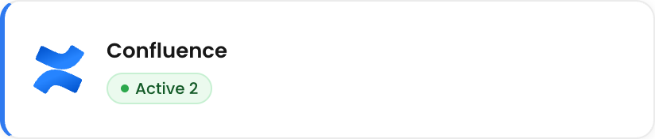
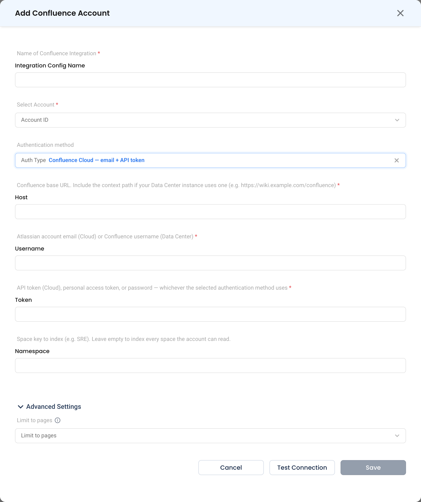

# Confluence

Connect a Confluence space so your runbooks, architecture notes and internal procedures become searchable context for NuBi and AI troubleshooting. Confluence is listed under **Docs** in the integrations catalog.

Works with Confluence Cloud and Confluence Data Center / Server.

---

## When Do You Need This?

This integration is **optional**. Connect Confluence when the knowledge your team needs during an incident lives there rather than in NudgeBee — service ownership, escalation procedures, environment quirks, and the runbooks people actually follow. Once indexed, that content is retrieved alongside telemetry when NuBi answers a question.

---

## Prerequisites

- A Confluence account NudgeBee can authenticate as, with read access to the spaces you want indexed. A dedicated service account is preferable to a personal one — indexing follows that account's permissions, so a personal account's access changes when the person's does.
- A token appropriate to your deployment:
  - **Cloud** — an [API token](https://id.atlassian.com/manage-profile/security/api-tokens) created against the account's Atlassian ID.
  - **Data Center / Server** — a personal access token, or the account password.

---

## Step 1: Open the Configuration Form

Navigate to **Admin** > **Integrations** > **Docs** and select **Confluence**, then click **Add Confluence Account**.

## Step 2: Fill In the Connection

* **Name of Confluence Integration \*** (Required) — e.g. `sre-runbooks`.
* **Select Account \*** (Required) — The NudgeBee account or accounts this integration serves.
* **Auth Type** — Which authentication method to use:

| Option | Use for |
|--------|---------|
| Confluence Cloud — email + API token | Atlassian-hosted Confluence. Username is the Atlassian account email. |
| Data Center / Server — personal access token | Self-hosted, using a PAT. |
| Data Center / Server — username + password | Self-hosted, where PATs are unavailable. |

* **Host \*** (Required) — The Confluence base URL, e.g. `https://yourcompany.atlassian.net`. For Data Center, include the context path if your instance uses one, e.g. `https://wiki.example.com/confluence`.
* **Username** — Atlassian account email (Cloud) or Confluence username (Data Center). Required for the email + API token and username + password methods; hidden for **Data Center / Server — personal access token**.
* **Token \*** (Required) — The API token, personal access token, or password, matching the authentication method selected above.
* **Namespace** — The space key to index, e.g. `SRE`. Leave empty to index every space the account can read.

### Advanced Settings

* **Limit to pages** — Restrict indexing to specific pages (and their child pages) instead of a whole space. Use this when a space is large but only a handful of pages are operationally relevant.

## Step 3: Test and Save

Click **Test Connection**, then **Save**. The test signs in, and also checks that the **Namespace** space exists and that the pages in **Limit to pages** can be found.

:::note Network access
NudgeBee connects to Confluence directly from its own servers, not through your cluster agent. A Confluence Data Center instance must be reachable from NudgeBee over HTTPS, with a certificate from a public certificate authority.
:::

:::tip
Start narrow. Index one space — or a handful of pages — that your team genuinely uses during incidents, and widen later. Indexing everything an account can read pulls in meeting notes and drafts, which makes retrieval noisier rather than better.
:::

---

## Verify the Integration

1. Click **Test Connection** on the form — it should succeed before you save.
2. Ask NuBi a question whose answer only exists in the indexed space — for example *"what is the escalation path for the payments service?"* — and confirm the answer reflects your Confluence content.

---

## Troubleshooting

| Symptom | Likely Cause | Fix |
|---------|-------------|-----|
| `401 Unauthorized` on Cloud | Password used instead of an API token | Cloud requires an API token, not the account password. |
| `401` or `403` on Data Center | Token type does not match **Auth Type** | Select the authentication method that matches the credential you are supplying. |
| `404` on the base URL | Missing context path | Data Center instances behind a path need it included, e.g. `https://wiki.example.com/confluence`. |
| Connection succeeds, nothing is retrieved | The account cannot read the space, or the space key is wrong | Space keys are case-sensitive; confirm the account can open the space in a browser. |
| Only some pages are found | **Limit to pages** is set | Clear it to index the whole space. |
| Answers cite stale content | The page changed after the last sync | Confluence content is re-synced automatically, every 30 minutes by default. To sync now, use **Retrigger** on its knowledge base in **b-Cortex → Knowledge → Knowledge Base**. |

---

## Helpful Links

- [Atlassian: Manage API tokens](https://support.atlassian.com/atlassian-account/docs/manage-api-tokens-for-your-atlassian-account/)
- [Confluence Data Center: Personal access tokens](https://confluence.atlassian.com/enterprise/using-personal-access-tokens-1026032365.html)
- [NudgeBee AI overview](../../features/ai/index.md)

## Related

- [b-Cortex knowledge](../../features/ai/b-cortex.md)
- [Integrations](../index.md)
