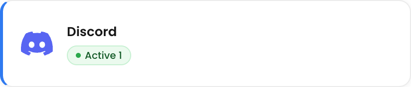
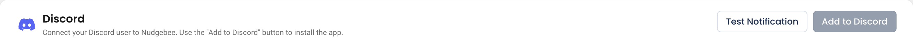

# Discord

Send NudgeBee notifications to a Discord channel — Kubernetes events, optimization recommendations, SLO breaches and Autopilot results, routed by your [notification rules](../../features/notifications.md).

---

## How Discord Connects

Discord connects through **your own Discord bot**: you paste the bot's token into NudgeBee, then invite the bot to your server. Creating the bot needs a Discord application in the [Discord Developer Portal](https://discord.com/developers/applications); inviting it needs **Manage Server** permission on the target server.

## Step 1: Install the Bot Token

1. In the Discord Developer Portal, create an application, add a bot to it, and copy the bot's token.
2. In NudgeBee, navigate to **Admin** > **Integrations** > **Messaging & Alerting** and select **Discord**.
3. Click **Connect Discord**, paste the token into **Discord Bot Token**, and click **Install**.
4. If the bot isn't in any server yet, NudgeBee shows **Invite the Bot to Your Server**. Click **Open Discord Invite Page**, pick your server and authorize the bot. It asks only for **View Channels** and **Send Messages**. Click **Done**.

:::note
To invite the bot to another server later, use the bot's invite link from the Discord Developer Portal. To replace the token, use **Update Token** in the integration's row menu.
:::

## Step 2: Route Notifications to a Channel

Once the bot is in your server, choose what gets sent where using [Notification Rules](../../features/notifications.md) — for example routing production alerts to a dedicated incident channel while suppressing development namespaces.

---

## Verify the Integration

1. Confirm the bot appears in your Discord server's member list.
2. Trigger a notification — the simplest is to run an automation with a [notification task](../../features/workflow-builder/notification-tasks.md) targeting Discord.
3. Confirm the message arrives in the expected channel.

---

## Troubleshooting

| Symptom | Likely Cause | Fix |
|---------|-------------|-----|
| **Install** fails | The bot token is wrong or was reset | Copy a fresh token from the Discord Developer Portal and try again. |
| The server is not listed on the invite page | You lack **Manage Server** on that Discord server | Ask a server administrator to invite the bot. |
| No channels to choose from | The bot is not in any server yet | Click **Open Discord Invite Page** and invite the bot. |
| Integration is connected but no messages arrive | The bot cannot post in the target channel | Check the channel's permission overrides — the bot's role needs **View Channel** and **Send Messages**. |
| Messages arrive in the wrong channel | Notification rules point elsewhere | Adjust the routing in [Notification Rules](../../features/notifications.md). |
| Notifications stopped after a server change | The bot was removed or its role was edited | Invite the bot again, or use **Update Token** if the token was reset. |

---

## Helpful Links

- [Notification Rules](../../features/notifications.md)
- [Notifications overview](./index.md)
