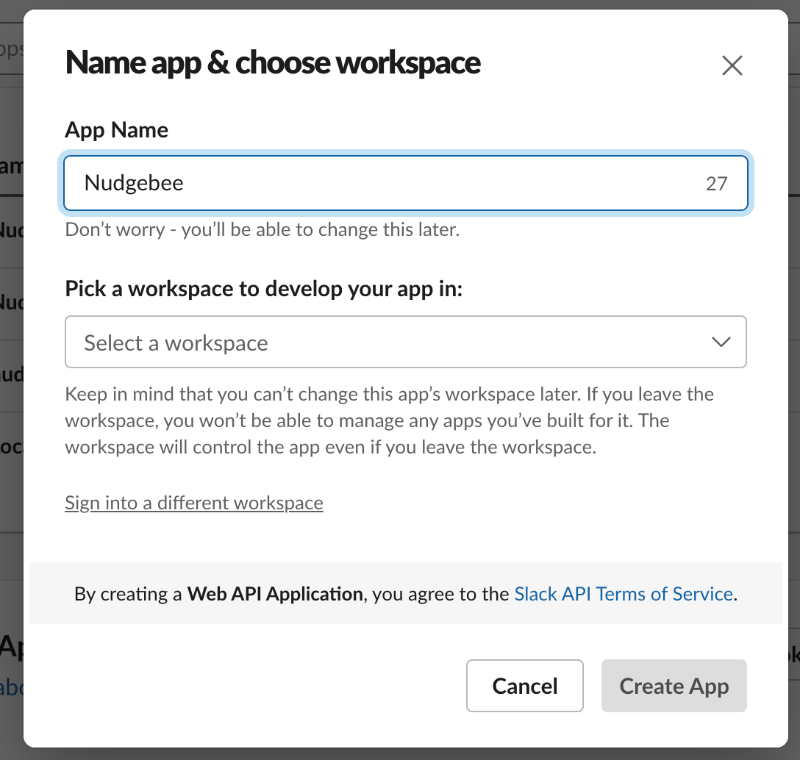
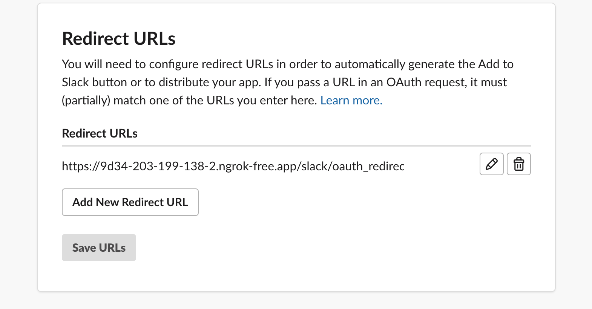
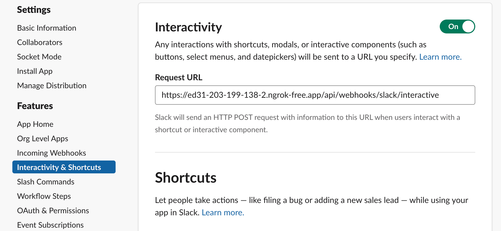
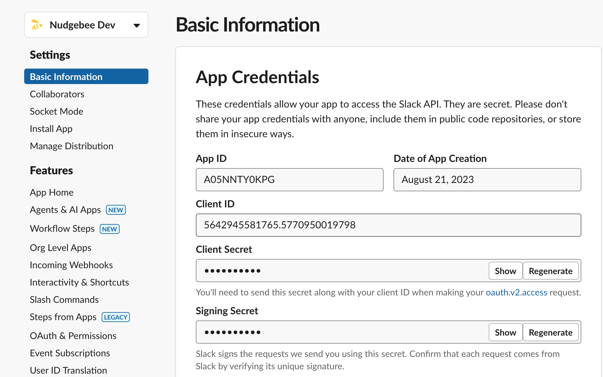

# Slack

:::tip Only need alerts in one Slack channel?
A [webhook target](./webhook_targets.md) posts notifications through the channel's incoming webhook. It needs no app install or admin approval, but it is one-way.
:::

## How to configure Slack in your NudgeBee Account

- This loom below shows how to configure Slack in your account for notifications.

<div style={{position: "relative", paddingBottom: "55.93750000000001%", height: 0}}>
    <iframe src="https://www.loom.com/embed/60bc60343e574abc879ee67ba0795bda?sid=1dc122fc-6d91-447b-bae2-cee012dd6e41" frameborder="0" allowfullscreen style={{position: "absolute", top: 0, left: 0, width: "100%", height: "100%"}}></iframe>
</div>

## Using Nubi in Slack

- **Ask a question.** Mention `@Nubi` in a channel or thread, or send it a direct message (no mention needed). Nubi always replies in a thread. In a channel, **mention Nubi again in the thread** to continue — a plain reply is ignored. In a direct message you can just reply.
- **Which account.** In a channel mapped to an account (**Channel-Account Mappings**), or in an alert's thread, Nubi uses that account. Otherwise, if you can use more than one, it asks you to **Select an account...**.
- **Images.** Attach up to 4 images (1.5 MB each) to a message.
- **Alert cards** have **View Details**, **Ask Nubi to Analyse!** and **Suppress…**. **Ask Nubi to Analyse!** posts the analysis in the card's thread — a quick summary first, then the likely root cause, then the full write-up — and the card shows *Analyzing… · see thread* and then *Analyzed · see thread*. An existing analysis is reused. Mention Nubi in that thread to ask follow-ups.
- **Approvals.** An automation's approval message has one button per option (a dropdown when there are more than three). *Your decision will resume the automation immediately.* You need edit access to the account to approve, and your Slack email must match a NudgeBee user.
- **Remediation steps** (with *Alert remediation loop* on) have **Run** and **Decline** — see [Automatic Event Analysis](../../features/ai/event-analysis.md#alert-remediation-loop-slack).
- **Watches** started from Slack report back in the same thread — see [Watches](../../features/ai/watches.md).

Nubi's button and name follow your tenant's assistant name.

### Watched Channels

With **Follow chat channels** on ([Tenant Settings → Features](../../features/tenant-settings.md#features)), **Admin → Integrations → Slack → Watched Channels** lets Nubi read chosen channels so it already has the context when someone mentions it.

- **Watch channels** adds channels; the list shows **Channel**, **Retention** (default 30 days) and a **Watching** switch. For a private channel, invite `@Nubi` in Slack first.
- Watching a channel posts a public notice there. Nubi still only acts when it is explicitly mentioned, and anyone with write access can turn watching off.
- Nubi stores up to 500 messages per channel per hour. When mentioned in a thread it reads that thread; in a channel it uses the most relevant recent messages from the last 15 minutes (up to 15, and decisions are always kept).

## How to configure Slack in your on-prem NudgeBee

To use Slack integration in your on-prem NudgeBee, you’ll need to create a Slack app.

**Step 1.** To create a new Slack app, navigate to Your Apps on https://api.slack.com/apps and click Create new App.



After naming your app and connecting your workspace, navigate to Basic Information. Here you’ll find your Client ID, Client Secret, and Signing Secret that lets your app access the Slack API.

Here’s where you’ll connect your on-premise NudgeBee instance to your newly created Slack app. Copy your Client ID, Client Secret, and Signing Secret to your secrets in your nudgebee server.

**Step 2.** Now that you’ve created your app and updated your NudgeBee config, you’ll need to set up the OAuth Redirect URL.

Navigate to OAuth & Permissions under Features to configure the Redirect URLs.

Click Add New Redirect URL, enter the URL, and click Add. The URL will look like:

```Callback URL: https://www.your-nudgebee-server.com/api/slack/oauth_redirect```



**Step 3.** On the same page under Scopes in the Bot Token Scopes, click on Add an OAuth Scope and select the following from the dropdown menu:

```
chat:write
chat:write.public
reactions:write
files:write
files:read
app_mentions:read
channels:history
groups:history
im:history
im:write
mpim:history
channels:read
groups:read
users:read
users:read.email
groups:write
channels:join
channels:manage
```

Under **User Token Scopes**, add `team.billing:read`.

**Step 4.** Also, to enable interaction with bot, navigate to Interactivity & Components under Features. (**This step can be skipped if you don’t want to use interactive features in Slack.**)

Click Enable Interactive Components, and you’ll be able to enter your Request URL (this is the location of your on-premise NudgeBee) and Options Load URL:

```Request URL: https://www.your-nudgebee-server.com/api/webhooks/slack/interactive```



Click Save Changes and Slack will confirm if the HTTP request to the URL you entered succeeds or fails.

**Step 4a.** To let people talk to Nubi, navigate to **Event Subscriptions**, turn **Enable Events** on and enter the Request URL:

```Request URL: https://www.your-nudgebee-server.com/api/webhooks/slack/events```

Under **Subscribe to bot events**, add `app_mention`, `message.channels`, `message.groups`, `message.im`, `message.mpim` and `member_joined_channel`, then save. Without this step alerts still arrive, but mentions and direct messages get no answer.

**Step 5.** Save changes and click on **Allow** to authorize and install the NudgeBee Slack app to your workspace.

**Step 6.** Once you’ve installed the app, you’ll need to add your Slack app's credentials (Client ID, Client Secret, and Signing Secret, typically found on its 'Basic Information' page) to your NudgeBee secrets.

Navigate to your NudgeBee secrets and add the following:

```
SLACK_CLIENT_SECRET: The Client Secret for the Slack application integration.
SLACK_SIGNING_SECRET: The Signing Secret for the Slack application.
SLACK_CLIENT_ID: The Client ID for the slack app.
```

You can see the in basic information of your Slack app.



---

## Troubleshooting Slack Integration

### 1. `channel_not_found` / Alerts Not Sent to Private Channels
* **Symptom**: Notifications send to `#general` or public channels, but fail for private incident channels with error `channel_not_found`.
* **Root Cause**: The NudgeBee Slack app (shown as `@Nubi`, or your on-prem app's name) has not been added as a member of the private channel.
* **Remediation**:
  1. Open the private Slack channel.
  2. Type `/invite @Nubi` and press Enter.
  3. Re-test with **Check where it goes** in **Admin → Notification Rules**.

---

### 2. `not_in_channel` / Missing Scopes
* **Symptom**: Slack API returns `not_in_channel` error when posting to public channels.
* **Root Cause**: The Slack app is missing the `chat:write.public` OAuth scope, or the bot token was revoked.
* **Remediation**:
  1. In the Slack App Dashboard $\rightarrow$ **OAuth & Permissions**, ensure `chat:write.public` and `chat:write` are listed under **Bot Token Scopes**.
  2. If adding scopes, click **Reinstall to Workspace** at the top of the page to apply the new permissions.

---

### 3. Interactive Buttons / Approvals Fail (`dispatch_failed`)
* **Symptom**: Clicking a button in a Slack message — **Ask Nubi to Analyse!**, **Suppress…** or an approval option returns a red `⚠️ We had trouble sending your response` warning.
* **Root Cause**: Slack cannot reach the **Interactivity Request URL** on your NudgeBee server (due to firewall, ingress mismatch, or invalid SSL certificate).
* **Remediation**:
  1. In Slack App Dashboard $\rightarrow$ **Interactivity & Shortcuts**, verify the **Request URL** is accessible from the internet:
     ```
     https://<your-public-nudgebee-domain>/api/webhooks/slack/interactive
     ```
  2. Ensure your reverse proxy / Ingress controller preserves the `X-Slack-Signature` and `X-Slack-Request-Timestamp` HTTP headers.
  3. Verify that `SLACK_SIGNING_SECRET` configured in NudgeBee exactly matches the Signing Secret in the Slack App Basic Information page.
---

### 4. Nubi doesn't answer mentions or direct messages
* **Symptom**: Alerts arrive, but `@Nubi` and direct messages get no reply.
* **Root Cause**: Event Subscriptions aren't set up (on-prem), the app lacks the history scopes, or you replied in a thread without mentioning Nubi.
* **Remediation**:
  1. On-prem: complete **Step 4a** and reinstall the app.
  2. In a channel thread, mention `@Nubi` in your reply.
  3. Check that your Slack email matches a NudgeBee user with access to the account.
