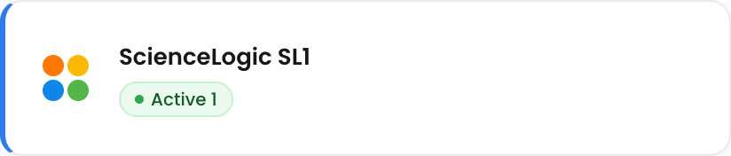
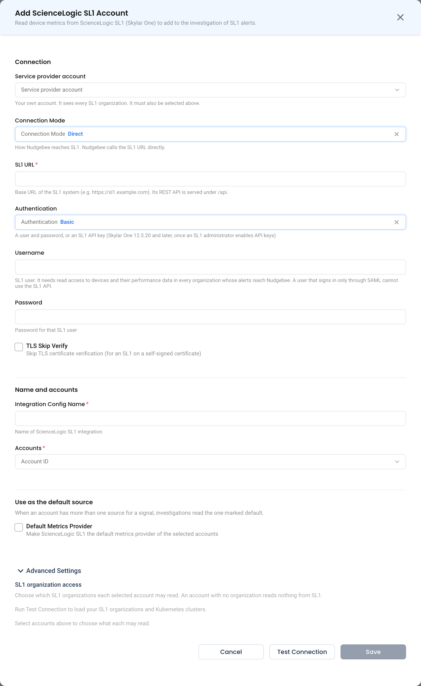
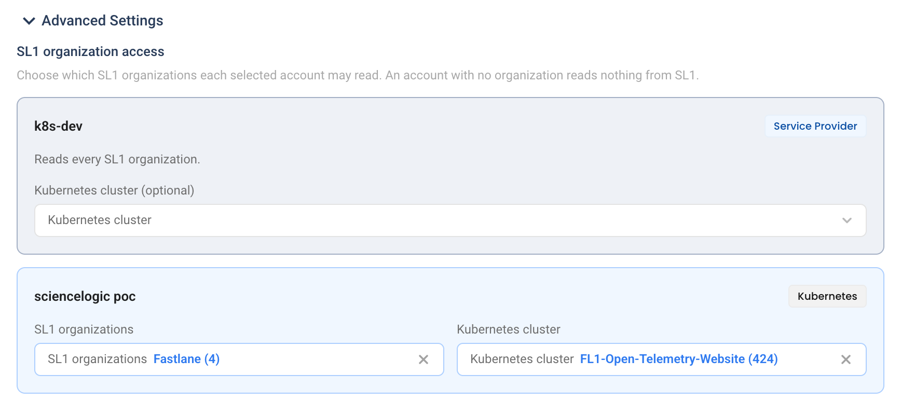

# ScienceLogic SL1

NudgeBee reads device metrics from **ScienceLogic SL1** (Skylar One) through its REST and GraphQL APIs. It uses them in four places: the metrics card on SL1 events, the AI investigation and **Ask Nubi**, the VM pages, and the Kubernetes pages. NudgeBee reads metrics only; it does not read logs or traces from SL1, and it never changes anything in SL1.

To receive SL1 events in NudgeBee, also set up the [ScienceLogic SL1 Webhook](../Webhooks/sciencelogic_webhook.md).

One SL1 often monitors many customers, each an SL1 **organization**. One integration serves all of them: you choose which organizations each NudgeBee account may read.

---

## Prerequisites

- The SL1 URL, reachable from NudgeBee over HTTP or HTTPS (HTTPS recommended).
- An SL1 user with read access to devices and their performance data in every organization NudgeBee should read, or an SL1 API key (Step 1).

---

## Step 1: Create an SL1 Login for NudgeBee

Use one of these:

- **A user and password.** The user needs read access to devices and their performance data in every organization NudgeBee should read. A user that signs in only through SAML cannot use the SL1 API.
- **An API key** (Skylar One 12.5.20 and later, once an SL1 administrator enables API keys). Give the key the **API Read-Only User** policy. Copy the JWT token SL1 shows once when the key is created (it starts with `eyJ`), not the Key ID. SL1 deletes a key when it expires, so choose an expiration that suits; NudgeBee warns 7 days before.

---

## Step 2: Configure the Integration in NudgeBee

Navigate to **Admin** > **Integrations** > **Observability** tab and click **ScienceLogic SL1**.





### Configuration Fields

* **Service provider account**
    * Your own NudgeBee account. It reads every SL1 organization. Select it under **Accounts** too.
* **Connection Mode**
    * `Direct`: NudgeBee calls the SL1 URL directly.
* **SL1 URL \*** *(Required)*
    * The base URL of SL1, e.g. `https://sl1.example.com`. NudgeBee calls its REST API under `/api` and its GraphQL API at `/gql`.
* **Authentication**
    * `Basic` (a user and password) or `API Key`.
* **Username** and **Password**, or **API key**
    * The login from Step 1.
* **TLS Skip Verify**
    * Skips TLS certificate verification, for an SL1 on a self-signed certificate.
* **Integration Config Name \*** *(Required)*
    * A descriptive name, e.g. `SL1 Production`.
* **Accounts \*** *(Required)*
    * Every NudgeBee account that reads SL1: your service provider account and each customer account.
* **Default Metrics Provider**
    * Makes SL1 the metrics provider of every account selected in the form when you save. An account's VM and Kubernetes pages, and its AI questions about metrics, then read SL1. NudgeBee never makes SL1 an account's provider unless you tick this box.

Click **Test Connection**. NudgeBee signs in to SL1 and lists one device. Then set the organization access below and click **Save**.

### SL1 Organization Access

Expand **Advanced Settings**. **SL1 organization access** shows one card per account selected under **Accounts**. After **Test Connection**, its lists show your SL1 organizations and Kubernetes clusters by name.



| Card | Choose |
|------|--------|
| Service provider account | Nothing: it reads every SL1 organization. Optionally, a **Kubernetes cluster**. |
| Customer account | The **SL1 organizations** it may read. |
| Kubernetes account | Its **SL1 organizations**, and the **Kubernetes cluster** in them that is this account's cluster in SL1. |

An account with no organization reads nothing from SL1, and its card says so. Removing an account from **Accounts** removes its access.

---

## How It Works

### Who Can See Which Device

Every read for an account's pages and AI questions is limited to the account's SL1 organizations. NudgeBee asks SL1 only for those organizations and then checks each device's own organization. A device in another organization is reported exactly like one that does not exist, so one customer cannot learn about another customer's devices.

One exception: the **SL1 device metrics** card on an SL1 event reads the device the event names, whatever the receiving account's organizations are. The webhook's account mapping decides which account receives the event, and so which account sees the card.

### Metrics on SL1 Events

An event from the [ScienceLogic SL1 Webhook](../Webhooks/sciencelogic_webhook.md) names its device. NudgeBee reads that device's metrics, from 60 minutes before the event started until now (at most 6 hours), and adds an **SL1 device metrics** card to the event. The card shows up to 8 of the device's metrics, such as CPU, memory, load, disk and network, depending on its platform (Linux, Windows Server, VMware VM, Net-SNMP, Kubernetes, AWS EC2). The AI investigation reads the card.

- Units SL1 does not report are converted only where they were verified. Other values are shown "as reported by SL1".
- A second event on the same device within 2 minutes reuses the card.
- With no SL1 integration, or for an event that is not about a device, there is no card. When SL1 cannot be reached, rejects the login, or has no data for the device, the card says which. For 5 minutes after SL1 cannot be reached or rejects the login, new events get no card.

### AI Investigations and Ask Nubi

For an account whose metrics provider is SL1, the AI reads SL1 with one query per device and metric, in this form:

```
sl1{device="web-01", app="Linux: CPU Performance", presentation="CPU Overall Usage %"}
```

| Label | Meaning |
|-------|---------|
| `device` | The SL1 device name, exactly (required) |
| `presentation` | The metric, by SL1's name for it (required) |
| `app` | The Dynamic Application, when several share a presentation name |

SL1 has no query language, so there are no functions such as `sum()` or `rate()`; NudgeBee averages or sums the raw values itself. A request reads at most 4 such queries, and at most the last 24 hours. Each platform names the same measure differently: Linux CPU is `CPU Overall Usage %`, Windows Server CPU is `CPU Utilization`, VMware CPU is `CPU Usage Average Percent`.

In **Query Metrics**, the metric name is SL1's presentation name and the labels are `device`, `app`, `parent_device`, `root_device` and `device_class`, e.g. `CPU Overall Usage %{device="web-01"}`.

### VM Pages

For a VM account whose metrics provider is SL1, the VM list, the VM metrics panel and the VM summary show each VM's **CPU and memory as a percentage**. SL1 reports a VM's CPU only as a percentage and knows no core count or memory total for most VMs, so there are no cores or GiB on these pages.

NudgeBee finds each VM's SL1 device by the first of these that matches exactly one device in the account's organizations:

1. The VM's IP address. When two organizations have a device with the same IP, as with private ranges on a shared SL1, the next rule decides.
2. Its AWS instance ID, matched to the EC2 device named `<zone> <name>: <type>: <instance id>`.
3. Its name, ignoring case.

| Platform | CPU % | Memory % |
|----------|-------|----------|
| Linux agent | `Linux: CPU Performance` / `CPU Overall Usage %` | `Linux: Memory Performance` / `Physical Memory Utilization` |
| Windows Server | `Microsoft: Windows Server CPU Performance` / `CPU Utilization` | `Microsoft: Windows Server Memory Performance` / `Memory Usage` |
| VMware VM | `VMware: VirtualMachine CPU Performance` / `CPU Usage Average Percent` | `VMware: VirtualMachine Memory Performance` / `Memory Usage Average` (active memory) |
| Net-SNMP host | `Net-SNMP: CPU` / `Overall CPU` | `Net-SNMP: Physical Memory` / `Physical Memory Utilization` |
| AWS EC2 | `AWS: EC2 Instance Performance` / `CPU Utilization` | Not available: EC2 reports no memory without an agent |

- The VM list shows the latest values from the last 15 minutes, for at most 50 VMs; the values are at most about 2 minutes old. A VM SL1 does not monitor shows "—".
- The **Metrics** tab shows that the store is connected when at least one VM has a value in the last 15 minutes.
- Disk space, disk I/O and per-service data are not shown for SL1 VMs.

### Kubernetes Pages

SL1's Kubernetes PowerPack models each object as an SL1 device: the cluster, its nodes, namespaces, and each Deployment, Stateful Set, Daemon Set and Job. A Kubernetes account whose metrics provider is SL1 reads its workload, node and cluster pages from the **Kubernetes cluster** chosen on its card. Without a cluster, those pages say so.

| Page | What SL1 gives |
|------|----------------|
| Workloads | CPU and memory used; CPU and memory requests and limits; replicas defined and ready (Deployments and Stateful Sets) |
| Nodes | CPU and memory used, per node and summed; CPU and memory percentages |
| Cluster overview | CPU and memory capacity and requests; usage as the sum of the nodes, with P50, P90 and maximum over the window |

Units, as SL1 reports them and NudgeBee converts them:

| SL1 presentation | SL1 unit |
|------------------|----------|
| `Kubernetes: Controller Pod Performance` / `CPU` | cores |
| `Kubernetes: Controller Pod Performance` / `Memory` | MiB |
| `Kubernetes: Controller Performance` / `Total CPU Resource Request`, `Limit` | millicores |
| `Kubernetes: Controller Performance` / `Total Memory Request`, `Limit` | MB |
| `Kubernetes: Node Performance` / `CPU Cores` | millicores |
| `Kubernetes: Node Performance` / `Memory Bytes` | MiB |
| `Kubernetes: Cluster Performance` / `Total CPU Capacity`, `Total CPU Requests` | cores |
| `Kubernetes: Cluster Performance` / `Total Memory Capacity`, `Total Memory Requests` | MB |

Nodes are matched by name, so SL1's node device names must be the Kubernetes node names.

### Health

SL1 is checked like every other metrics provider: every 10 minutes for each Kubernetes account that uses it. The result shows in the integration's **Health** column. A failure or recovery notice goes to the service provider account, never to a customer's account. With no **Service provider account** set, no notice is sent.

---

## Limits and Troubleshooting

- SL1 keeps about 24 hours of raw samples. A longer chart window is cut to the last 24 hours, with a note.
- SL1 has no pod or container devices. Pod-level metrics, per-pod breakdowns, rightsizing, KRR scans and volume analysis are not available for an account whose metrics provider is SL1.
- SL1's pod counts include ended pods, so NudgeBee does not show them. Namespaces carry no data in SL1, and clusters have no CPU or memory limits.
- NudgeBee sends at most 4 requests at a time to one SL1 from each NudgeBee server process, by default.
- One enabled SL1 integration per NudgeBee tenant is supported. With two, every SL1 read fails until one is disabled.
- When SL1 rejects the login, NudgeBee stops calling it for 5 minutes. When SL1 is unreachable or too slow, NudgeBee stops calling it for that account for 5 minutes.

| Issue | Resolution |
|-------|------------|
| **Test Connection** fails with `401` | The username and password, or the API key, were rejected. For an API key, paste the JWT token (it starts with `eyJ`), not the Key ID. |
| The SL1 user is locked | SL1 locks a user after repeated failed sign-ins. After a rejected password, NudgeBee waits 10 minutes before trying it again; fix the password in the integration, and have an SL1 administrator unlock the user. |
| An account's pages say it has no SL1 organizations | Expand **Advanced Settings** and choose its **SL1 organizations**. |
| The organization and cluster lists are empty | Run **Test Connection** first; the lists load after it succeeds. |
| Kubernetes pages say no SL1 cluster is set | Choose the account's **Kubernetes cluster** on its card. |
| A VM shows "—" on the VM list | No SL1 device in the account's organizations matches its IP, instance ID or name, or the device had no value in the last 15 minutes. |
| An AI query says `no SL1 device named …` | SL1 device names are exact. The answer lists similar device names in the account's organizations. |
| An AI query says several devices share a name | SL1 names are not unique across organizations. Restrict the account to the organization it needs. |
