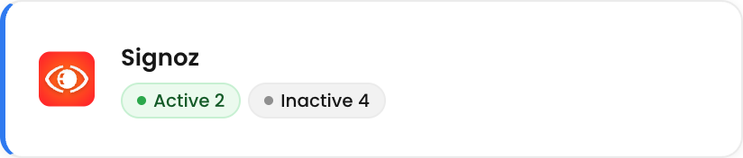
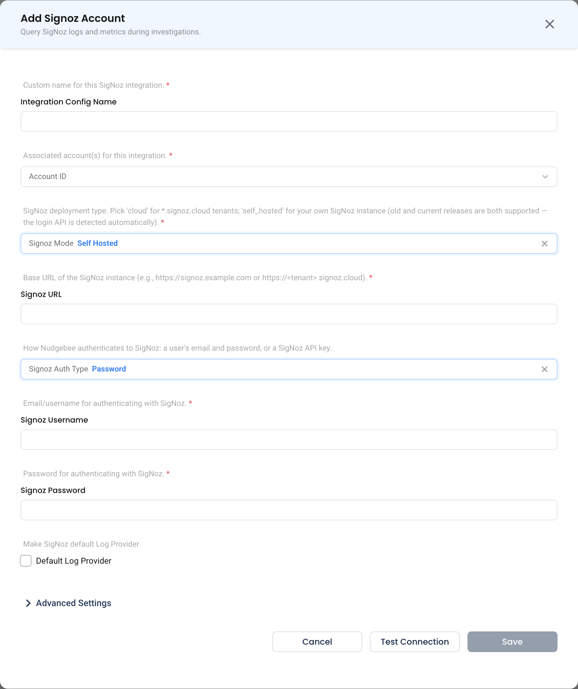

# SigNoz

NudgeBee reads **logs** and **metrics** from [SigNoz](https://signoz.io/) — SigNoz Cloud or your own self-hosted instance — and creates and syncs **alert rules** in it, by connecting to its API, either directly from NudgeBee or through a [Proxy Agent (Forager)](../../installation/proxy-agent/index.md) in your network. No Kubernetes agent is involved, so this works for a SigNoz that runs outside your Kubernetes clusters.

Both SigNoz generations are supported. NudgeBee detects which login API your instance exposes, so current releases and older self-hosted ones (the v0.51 era) both connect with the same settings.

:::note What this integration covers
Logs, metrics and alert rules. SigNoz alert notifications come in through the separate [SigNoz Webhook](../Webhooks/signoz_webhook.md). Traces are not read from SigNoz yet. See [Limitations](#limitations).
:::

:::tip Agent-based SigNoz is a separate path
If your SigNoz is in the same cluster as the NudgeBee Kubernetes Agent, you can connect it through the agent instead. See [Connect SigNoz via the agent](../../installation/agent/connect/logging/signoz.md). Use that page's Helm settings, not this one's form.
:::

---

## Prerequisites

Before configuring the integration, ensure you have:

- A **SigNoz** instance — a cloud tenant (`https://<tenant>.signoz.cloud`) or your own deployment
- **One** of these credentials:
  - a SigNoz **user email and password**, or
  - a SigNoz **API key** (required if your organization is SSO-only)
- For a self-hosted instance NudgeBee can't reach, a [Proxy Agent (Forager)](../../installation/proxy-agent/index.md) running in a network that can reach it

---

## Step 1: Configure the Integration in NudgeBee

Navigate to **Admin** > **Integrations** > **Observability** and select **SigNoz**. Click **Add Signoz Account** to open the configuration form.





### Configuration Fields

* **Integration Config Name**
    * A descriptive label for this integration, for example `Production SigNoz`.

* **Account ID**
    * The NudgeBee account or accounts whose workloads this SigNoz holds logs for.

* **Connection Mode**
    * `direct` — NudgeBee calls SigNoz itself. This is the default, and the only choice for SigNoz Cloud.
    * `vm_agent` — calls go through a Forager running in your network, for a self-hosted SigNoz NudgeBee cannot reach.

* **Signoz Mode \*** *(Required)*
    * `self_hosted` — your own SigNoz instance. This is the default, and the login API is detected automatically, so old and current releases both work.
    * `cloud` — a `*.signoz.cloud` tenant.

* **Signoz URL \*** *(Required)*
    * The base URL of your SigNoz instance, for example `https://signoz.example.com` or `https://<tenant>.signoz.cloud`.
    * For an in-cluster deployment, use the internal Service address. The Service name depends on the chart version:
        * Current charts expose a single Service named after the Helm release, for example `http://signoz.signoz.svc.cluster.local:8080`.
        * Older charts expose `<release>-query-service` on port `8080` and `<release>-frontend` on port `3301`. Either address works.
    * Paste the URL you have open in the browser if that is easier. Any path is stripped, so `https://tenant.signoz.cloud/settings/my-settings` is stored as `https://tenant.signoz.cloud`.

* **Signoz Auth Type \*** *(Required)*
    * `password` — authenticate as a SigNoz user. This is the default.
    * `api_key` — authenticate with a SigNoz API key.
    * The form shows only the fields the selected type needs.

* **Signoz Username** *(Required for `password`)*
    * The email address of a SigNoz user that can read logs.

* **Signoz Password** *(Required for `password`)*
    * That user's password. It is stored encrypted.

* **Signoz Api Key** *(Required for `api_key`)*
    * A SigNoz API key, sent as the `SIGNOZ-API-KEY` header. It is stored encrypted.
    * **Current SigNoz and SigNoz Cloud:** **Settings → Service Accounts**, then add a key. The **Viewer** role is enough to read logs and metrics; creating alert rules from NudgeBee needs **Editor**.
    * **Older self-hosted releases:** **Settings → Access Tokens**.

* **Make Signoz default Log Provider**
    * Turn this on so the account's Logs pages and Nubi read from SigNoz.

* **Make Signoz default Metrics Provider**
    * Turn this on so the account's metrics pages, workload charts and Nubi read metrics from SigNoz, and so alert rules created for the account go to SigNoz.
    * SigNoz serves metrics **only** when this is on. A SigNoz connected for logs is never picked for metrics on its own, so turning on the integration does not move an account's existing metrics source.

### Which authentication should I choose?

| Situation | Use |
|---|---|
| Your SigNoz organization allows email/password login | Either. A password is quickest to set up |
| Your organization is **SSO-only** | **API key.** A password login is refused |
| You would rather not store a user password | **API key** |
| Your SigNoz is older and has no Service Accounts page | API key from **Settings → Access Tokens**, or a password |

:::info How the password login works
NudgeBee signs in to SigNoz and caches the resulting token in memory, refreshing it before it expires. It does not log in on every query. Current releases use SigNoz's session API, older ones its legacy login endpoint, and for `self_hosted` NudgeBee detects which one your instance has.
:::

### Test and Save

1. Click **Test Connection**. With a password, NudgeBee performs a real sign-in, bypassing any cached token, so the test always proves the credentials. With an API key, it reads the log attribute list — the same call the Logs page makes first — so a key that cannot read logs fails the test rather than the first search.
2. *(Optional)* Expand **Advanced Settings** to set **Default Log Filters** and **Log Label Mapping**. See [Advanced Settings](./advanced-settings.md) for what each one does.
3. Click **Save**.

If the test fails, the message tells you what to fix:

| Message | Cause | Fix |
|---|---|---|
| `invalid SigNoz credentials for <email>` | Wrong email or password | Re-enter them. Check for trailing spaces |
| `SigNoz at <url> has no user <email>` | No such user in that SigNoz | Use an existing SigNoz user's email |
| `the SigNoz organization of <email> allows SSO login only …` | The organization disabled password login | Switch **Signoz Auth Type** to `api_key` |
| `invalid SigNoz API key` | The key is wrong, revoked or expired | Issue a new key in SigNoz |
| `the SigNoz API key is valid but not allowed to read logs …` | The key's role is too narrow | Give its service account at least the **Viewer** role |
| `SigNoz rejected the login request: <message>` | SigNoz refused the request itself | Read the quoted SigNoz message |
| A connection or timeout error naming the URL | NudgeBee cannot reach that URL | Check the host, port and any firewall or network policy |

---

## What Gets Connected

### Logs

Once SigNoz is the account's log provider, these read from it:

- **Monitoring → Logs → Query Log**, in **Builder**, **Code** and **AI** modes
- **Log Groups**, which cluster error-level records into patterns with counts
- A workload's **Logs** tab
- **Nubi**, for log questions
- Log evidence on events, through the SigNoz logs enricher

**Filters.** The builder offers 18 operators: `=`, `!=`, `in`, `not in`, `LIKE`, `NOT LIKE`, `ILIKE`, `contains`, `icontains`, `not icontains`, `=~` (regex), `!~` (not regex), `exists`, `is null`, `>`, `>=`, `<` and `<=`.

**OR and NOT** are supported. SigNoz's own query builder cannot express OR, so NudgeBee runs one query per branch in a single request and merges the results. A filter that would expand beyond 25 queries is refused with a message asking you to simplify it.

**Log field mappings.** NudgeBee's field names map onto SigNoz's OpenTelemetry attribute names. Override them per account in **Log Label Mapping**.

| NudgeBee Field | SigNoz Field |
|----------------|--------------|
| `message` | `body` |
| `namespace` | `k8s.namespace.name` |
| `pod` | `k8s.pod.name` |
| `container` | `k8s.container.name` |
| `node` | `k8s.node.name` |
| `workload`, `app` | `k8s.deployment.name`, `k8s.statefulset.name`, `k8s.daemonset.name`, `k8s.job.name`, `k8s.cronjob.name` |
| `cluster` | `k8s.cluster.name` |
| `host`, `hostname` | `host.name` |
| `service` | `service.name` |
| `severity`, `level` | `severity_text` |

A filter on `app` or `workload` matches a workload of **any** kind, so a StatefulSet, DaemonSet, Job or CronJob is found as readily as a Deployment. Filtering on the native attribute instead, for example `k8s.deployment.name`, still matches Deployments only.

**Log levels ignore case.** `level = error` matches records stored as `ERROR`, and `warn` also matches `WARNING`.

### Metrics

Once SigNoz is the account's **default metrics provider**, these read from it:

- **Monitoring → Metrics → Query Metrics**, in **Builder** and **Code** modes. The builder lists SigNoz's metric names, labels and label values.
- The cluster **Summary** utilization (CPU and memory usage, totals, p50/p90 and peak)
- A workload's CPU and memory columns and its **Utilization Trends** charts, against its requests and limits
- Node CPU and memory against allocatable capacity
- **Nubi**, for metric questions
- Metric evidence on events that uses the same charts

**Query language.** SigNoz runs PromQL. Metrics sent by SigNoz's OpenTelemetry collectors keep their dotted names, which PromQL writes in quoted form:

```
sum by ("k8s.deployment.name") ({"k8s.pod.memory.working_set", "k8s.namespace.name"="shop"})
```

You can also type the names bare, for example `sum by (k8s.deployment.name) (k8s.pod.memory.working_set{k8s.namespace.name="shop"})`. NudgeBee quotes dotted names before sending the query.

**Charts need SigNoz's Kubernetes collector.** The workload, node and cluster charts are built on the metrics that SigNoz's `k8s-infra` collector publishes, such as `container.cpu.usage`, `container.memory.working_set`, `k8s.container.cpu_request` and `k8s.node.allocatable_cpu`. These are gauges already in cores and bytes. If SigNoz holds none of them, the charts say so instead of drawing empty lines.

> **Reference:** [SigNoz Kubernetes infrastructure monitoring](https://signoz.io/docs/infrastructure-monitoring/k8s-metrics/)

### Alert rules

When SigNoz is the account's default metrics provider, an alert rule created in NudgeBee (for example from a workload's **Create Alert**) is created in SigNoz. NudgeBee can also update, disable and delete those rules, and sync the rules that already exist in SigNoz into NudgeBee.

- **PromQL rules.** Write the condition the Prometheus way, for example `max by ("k8s.pod.name") ({"k8s.container.restarts"}) > 5`. Every series the expression returns fires, as on Prometheus. A **duration** means the condition must hold for that whole window.
- **Log rules** (SigNoz v0.118 and later) count the log lines that match a filter expression.
- **Notifications go to NudgeBee.** Every rule NudgeBee creates is routed to the SigNoz channels that post to this account's [SigNoz Webhook](../Webhooks/signoz_webhook.md), so firing alerts come back as NudgeBee events. Set that webhook and channel up first; rule creation fails with a message naming the missing channel otherwise.
- **SigNoz versions.** NudgeBee reads your SigNoz release and writes the rule format it accepts: the current format from v0.118, the older one before.
- **Credentials.** Rule management uses the same login as logs and metrics. An API key must belong to a service account with the **Editor** role.

---

## Verify the Integration

1. Click **Test Connection** on the saved integration, from its row menu. Confirm it succeeds.
2. Go to **Monitoring** > **Logs** > **Query Log** and filter on `namespace`. Confirm records appear.
3. Open the **Log Groups** tab. Confirm error groups appear with counts and a recent **Last Time**.
4. Ask Nubi a log question, for example "show error logs from the last hour", and confirm the answer cites SigNoz records.
5. If SigNoz is the default metrics provider: open **Monitoring** > **Metrics** > **Query Metrics**, confirm the provider shows **SigNoz**, and run a query. Then open a workload's **Utilization Trends** and confirm CPU and memory charts render.

---

## Troubleshooting

| Symptom | Likely Cause | Fix |
|---------|-------------|-----|
| Test succeeds but no logs appear | The account's default log provider is still another integration | Turn on **Make Signoz default Log Provider**, or set the default on the Integrations grid |
| A filter on a NudgeBee field name returns nothing | Your pipeline names fields differently from the OpenTelemetry defaults | Map them in **Log Label Mapping**. See [Advanced Settings](./advanced-settings.md) |
| `this filter needs N SigNoz queries …` | An OR filter expands past the limit of 25 queries | Simplify the OR conditions, or split the search |
| `sorting by "<column>" is not supported with an OR filter` | A non-time sort cannot be applied across OR branches | Sort by time, or remove the OR |
| Logs from other clusters appear | One SigNoz holds several clusters | Add a **Default Log Filter** on `k8s.cluster.name`. See [Advanced Settings](./advanced-settings.md) |
| Password login worked before and now fails | The organization switched to SSO-only | Switch **Signoz Auth Type** to `api_key` |
| Metrics pages still show another provider | SigNoz is not the account's default metrics provider | Turn on **Make Signoz default Metrics Provider** |
| Charts say SigNoz has no Kubernetes metrics | SigNoz's `k8s-infra` collector is not installed on the cluster | Install it, or query the metrics you do have from **Query Metrics** |
| A query with a classic name such as `container_cpu_usage_seconds_total` returns nothing | Current SigNoz stores the dotted OpenTelemetry names | Use the dotted name, for example `container.cpu.usage` |
| Creating an alert rule fails with "no SigNoz notification channel posts to this account's Nudgebee SigNoz webhook" | No SigNoz channel carries this account's webhook URL | Set up the [SigNoz Webhook](../Webhooks/signoz_webhook.md) and add its URL as a channel in SigNoz |

---

## Limitations

- **No traces yet.** Traces are not read from SigNoz. Connect another trace provider; see the [Observability integrations overview](./index.md).
- **Some workload panels stay empty.** Network, disk I/O and HTTP panels are not built from SigNoz metrics yet.
- **Metrics only as the marked default.** SigNoz serves metrics only when **Make Signoz default Metrics Provider** is on.
- **The agent path is configured separately.** Connecting SigNoz here does not change an agent that has its own `runner.signoz` settings.

---

## Helpful Links

- [SigNoz documentation](https://signoz.io/docs/)
- [SigNoz Webhook](../Webhooks/signoz_webhook.md)
- [Connect SigNoz via the NudgeBee agent](../../installation/agent/connect/logging/signoz.md)
- [Default filters and field mapping](./advanced-settings.md)
- [Observability integrations overview](./index.md)
