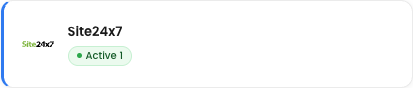
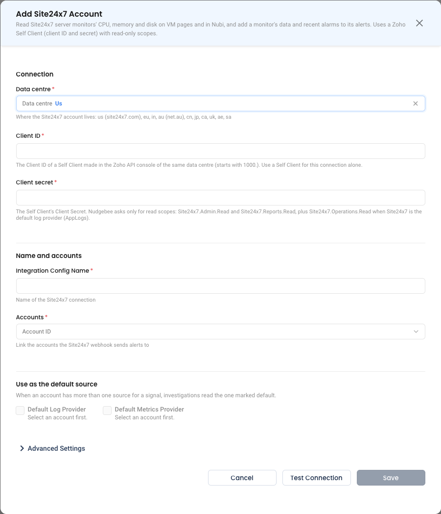

# Site24x7

NudgeBee reads metrics and logs from **Site24x7** through its REST API. It uses them on the Site24x7 alerts it receives, in the AI investigation and **Ask Nubi**, on the VM pages, and on the Kubernetes pages. NudgeBee only reads: it asks for read scopes and never changes anything in Site24x7.

To receive Site24x7 alerts in NudgeBee, also set up the [Site24x7 Webhook](../Webhooks/site24x7_webhook.md). Link this integration to the same NudgeBee accounts as the webhook, so each alert can read its monitor's data.

---

## Prerequisites

- A paid Site24x7 account. Free accounts have no API access.
- Its **data center**: the domain you sign in to (`site24x7.com` is `us`, `site24x7.in` is `in`, `site24x7.eu` is `eu`, and so on).
- A Zoho **Self Client** made in the Zoho API console of the same data center (Step 1).
- For Kubernetes clusters, the Site24x7 Kubernetes agent with its **cluster agent** on (see [Kubernetes Pages](#kubernetes-pages)).

---

## Step 1: Create a Zoho Self Client for NudgeBee

1. Sign in to the Zoho API console of your data center, for example `https://api-console.zoho.com` for `us` or `https://api-console.zoho.in` for `in`, with a Site24x7 user that can see the monitors NudgeBee should read.
2. Click **Add Client** > **Self Client** > **Create**.
3. Open the **Client Secret** tab and copy the **Client ID** (it starts with `1000.`) and the **Client Secret**.

NudgeBee asks Zoho for these read scopes itself; you do not generate a grant code:

| Scope | Used for |
|-------|----------|
| `Site24x7.Admin.Read` | The monitor list |
| `Site24x7.Reports.Read` | Monitor data, alarms and current status |
| `Site24x7.Operations.Read` | AppLogs, only when Site24x7 is a default log provider |

Use this Self Client for NudgeBee alone. Zoho issues at most 10 access tokens per 10 minutes for one client, and another tool sharing it can use them up.

---

## Step 2: Configure the Integration in NudgeBee

Navigate to **Admin** > **Integrations** > **Observability** tab and click **Site24x7**.





### Configuration Fields

* **Data centre \*** *(Required)*
    * Where the Site24x7 account lives: `us` (site24x7.com), `eu`, `in`, `au` (net.au), `cn`, `jp`, `ca`, `uk`, `ae` or `sa`. NudgeBee calls only that data center's Site24x7 and Zoho hosts.
* **Client ID \*** and **Client secret \*** *(Required)*
    * From Step 1.
* **Integration Config Name \*** *(Required)*
    * A descriptive name, e.g. `Site24x7 Production`.
* **Accounts \*** *(Required)*
    * The NudgeBee accounts that read this Site24x7 account. Select the same accounts as the Site24x7 webhook.
* **Use as the default source**
    * One row per selected account:
    * **Default Metrics Provider**: the account's VM or Kubernetes pages, and its AI questions about metrics, read Site24x7.
    * **Default Log Provider**: the account's Logs tab and AI questions about logs read Site24x7 AppLogs.
    * NudgeBee never makes Site24x7 an account's provider unless you tick its box. When you untick it, a Kubernetes account goes back to its agent's provider.

Click **Test Connection**. NudgeBee gets a token from Zoho, lists your monitors and reads their current status. With a log provider box ticked, it also lists your AppLogs log types. Then click **Save**.

### Advanced Settings

Expand **Advanced Settings** for Kubernetes accounts. Run **Test Connection** first: the lists load after it succeeds.

| Card | When you need it | Set |
|------|------------------|-----|
| **Default Metric Filters** | The Site24x7 account watches more than one cluster, or a monitor has no cluster tag yet | The Kubernetes account and its **cluster** (the API server address Site24x7 tags its monitors with) |
| **Default Log Filters** | The Site24x7 account watches more than one cluster and this account reads pod logs | `cluster` = the cluster's `clusterid` in the Kubernetes Pod Logs log type |
| **Log Label Mapping** | Rarely | Which AppLogs field holds a concept such as `pod`, when it differs from the default |

---

## How It Works

### Site24x7 Data on Alerts

Each alert from the [Site24x7 Webhook](../Webhooks/site24x7_webhook.md) names its monitor. NudgeBee adds two cards to the event, which the AI investigation reads:

- **Monitor data**: the monitor's CPU, memory and disk percentages around the alert, with request and limit for a Kubernetes workload or pod.
- **Recent alarms**: the monitor's down, trouble and critical periods.

A second alert on the same monitor and outage reuses the cards. With no Site24x7 integration linked to the event's account, there are no cards; when one exists in the tenant but is not linked to that account, the event says so.

### AI Investigations, Ask Nubi and Query Metrics

For an account whose metrics provider is Site24x7, the AI and **Query Metrics** read Site24x7 with selectors:

```
CPUUSEDPERCENT{ip="10.0.0.4"}
CPUUsageChart{namespace="shop", workload="checkout"}
```

| Monitors | Metric names | Labels |
|----------|--------------|--------|
| Servers | `CPUUSEDPERCENT`, `MEMUSEDPERCENT`, `DISKUSEDPERCENT`, `SYSTEMLOAD5`, `BLOCKEDPROCESS` | `ip`, `host`, `monitor` or `monitor_id` |
| Kubernetes workloads and pods | Site24x7's chart names, listed in **Query Metrics** (for example `CPUUsageChart`, `MemChart`, `PodCPUUsageChart`, `NWRxChart`, `ReceivedBytesChart`) | `namespace`, `workload` or `pod`, `cluster`, `monitor_id` |

Site24x7 has no query language: label values match exactly and there are no functions such as `sum()` or `rate()`. A Kubernetes query reads at most 24 hours.

### VM Pages

For a VM account whose metrics provider is Site24x7, the VM metrics, the utilization card and the fleet view show each VM's **CPU and memory as a percentage**. NudgeBee matches each VM to a Site24x7 server monitor by IP address, then host name, then name.

- Site24x7 reports disk as a percentage and gives no core count or memory total, so the disk, cores and bytes charts say so instead of showing data.
- The VM status shows Connected when the matched monitor has a sample in the last 15 minutes.

### Logs (AppLogs)

With **Default Log Provider** ticked, the **Logs** tab and the AI read Site24x7 AppLogs:

- **VM accounts** read your AppLogs log types, such as syslog.
- **Kubernetes accounts** read the built-in **Kubernetes Pod Logs** log type. Add it per cluster in Site24x7 under **AppLogs**. Filters by namespace, pod, container and workload work.

Each log profile's time zone must match the server's. Site24x7 files a line by the profile's time zone, so a profile set to IST on a server logging in UTC puts every line 5.5 hours early.

Site24x7's operators differ from other log stores: `=` is exact and case-sensitive, and contains matches whole words only.

### Kubernetes Pages

For a Kubernetes account whose metrics provider is Site24x7:

| Page | What Site24x7 gives |
|------|---------------------|
| Workload (Deployment, DaemonSet) | CPU and memory used, requests and limits; replicas defined and ready; network received and transmitted |
| Pod | CPU and memory used, requests and limits; network received and transmitted |
| Kubernetes alerts | The alert links to its workload or pod, and its card shows CPU and memory against request and limit |

**Turn on Site24x7's cluster agent.** Site24x7's Helm chart leaves it off by default (`site24x7ClusterAgent.create: false`). Without it, one of the node agents reports workload data, and when that role moves between nodes a workload's network can read several times too high.

```bash
# A new install (the device key is in Site24x7 under Admin > Developer > Device Key)
helm repo add site24x7 https://site24x7.github.io/helm-charts
helm install site24x7-agent site24x7/site24x7 -n site24x7 --create-namespace \
  --set deviceKey=<your-device-key> --set site24x7ClusterAgent.create=true

# An existing install
helm upgrade site24x7-agent site24x7/site24x7 -n site24x7 \
  --reuse-values --set site24x7ClusterAgent.create=true
```

- Site24x7 keeps 24 hours per read. A longer window, such as **Current Week**, shows the last 24 hours with a note.
- Site24x7 monitors only some pods; a pod it does not monitor says so.
- A workload's network is read only from monitors polled every 5 minutes, Site24x7's default.
- Site24x7 reports a StatefulSet's CPU and memory only as a percentage of its limit, and has no per-container, node, namespace or cluster totals in cores or bytes. Those charts, and features that need Prometheus metrics (rightsizing, HPA, overcommit, forecasts, PromQL dashboards), say so.

---

## Limits and Troubleshooting

| Issue | Resolution |
|-------|------------|
| **Test Connection** fails with `invalid_client` | The Client ID or secret is wrong, or the Self Client was made in another data center's API console. Check **Data centre**. |
| **Test Connection** fails with `invalid_client_secret` | The Client secret is wrong. |
| **Test Connection** fails reading the current status (401 or 403) | The Site24x7 account is on a free plan (no API access), or the Zoho user cannot read reports. |
| Logs fail with a missing-scope message | Zoho did not grant `Site24x7.Operations.Read` to the Self Client. Logs stop; metrics and cards keep working. |
| After a rejected secret, nothing is read for a while | NudgeBee stops calling Site24x7 for 10 minutes after Zoho refuses the credentials. Fix the secret; saving a new one clears the pause. |
| Kubernetes charts ask you to pick the cluster | The Site24x7 account watches several clusters, or a monitor has no cluster tag yet. Set the account's cluster under **Default Metric Filters**. |
| A workload's network looks several times too high | Site24x7's cluster agent is off. Turn it on (see [Kubernetes Pages](#kubernetes-pages)). |
| A pod says Site24x7 does not monitor it | Site24x7 has no monitor for that pod, for example a pod created after its last discovery. |
| Log lines appear hours early or late | The log profile's time zone does not match the server's. |
| A VM shows no data | No Site24x7 server monitor matches the VM's IP, host name or name, or the monitor had no sample in the window. |
