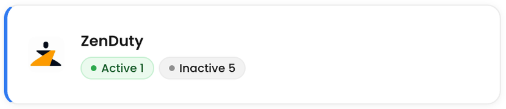
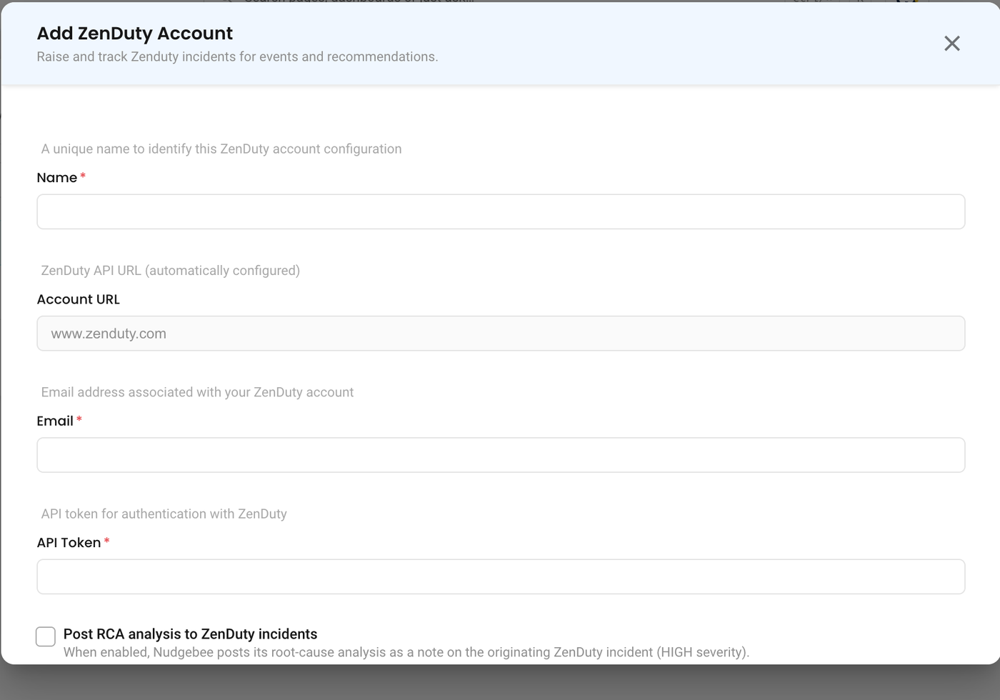

# ZenDuty

## Overview

NudgeBee integrates with ZenDuty for incident management. Events and alerts can automatically create ZenDuty incidents with full lifecycle support — including acknowledgment and resolution.

---

## Prerequisites

Before configuring the integration, ensure you have:

- A **ZenDuty** account
- A ZenDuty **API key**
- At least one **team** and **service** configured in ZenDuty

---

## Generate a ZenDuty API Key

1. In ZenDuty, navigate to your **profile icon** > **My Profile**.
2. Find the **API Key** section.
3. Copy your API key.

:::note
The API key must have permissions to create and manage incidents across your teams and services.
:::

---

## ZenDuty Integration Configuration

Navigate to **Admin** → **Integrations** → **Ticketing** tab and select **ZenDuty** to open the configuration form.



### Configuration Fields

| Field | What to enter |
|---|---|
| **Name \*** | A name for this connection |
| **Account URL** | ZenDuty host, default `www.zenduty.com`. NudgeBee adds `https://` and `/api` itself |
| **Email \*** | Your ZenDuty account email |
| **API Token \*** | Your ZenDuty API token. Stored encrypted |
| **Post RCA analysis to ZenDuty incidents** | When on, NudgeBee posts its root-cause analysis on the originating ZenDuty incident |



**Test Connection** fetches your ZenDuty teams to confirm the token works. If authentication fails, verify your API key is correct.

---

## Capabilities

ZenDuty is the most complete incident management integration, supporting the full incident lifecycle:

| Operation | Description |
|-----------|-------------|
| **Create Incident** | Create incidents with title, description, service, assignees, and urgency |
| **Add Comment** | Add notes to existing incidents |
| **Get Comments** | Retrieve comments from an incident |
| **Get Incident** | Retrieve incident details by ID |
| **Acknowledge** | Mark an incident as acknowledged |
| **Resolve** | Resolve an incident with an optional resolution note |
| **Query Metadata** | Fetch available services, users, and urgency levels |

### Supported Incident Fields

| Field | Description |
|-------|-------------|
| **Title** | Incident title |
| **Description** | Incident summary with event context |
| **Service** | Target ZenDuty service for the incident |
| **Assignees** | One or more ZenDuty users (supports multiple assignees) |
| **Urgency** | Mapped from NudgeBee priority |

### Priority Mapping

| NudgeBee Priority | ZenDuty Urgency |
|--------------------|------------------|
| High | High (2) |
| Medium | Medium (1) |
| Low | Low (0) |

---

## Incident Lifecycle

ZenDuty supports the full incident lifecycle from NudgeBee:

```text
Created → Acknowledged → Resolved
```

- **Created** — Incident is triggered and assigned to on-call users
- **Acknowledged** — Responder has seen and is working on the incident
- **Resolved** — Incident is closed, optionally with a resolution note

---

## Creating Incidents

Incidents can be created from NudgeBee in two ways:

- **Automatically** — from events, alerts, or autopilot runbook actions
- **Manually** — from the NudgeBee event detail view by clicking the ticket icon

---

## Verify the Integration

1. Save the configuration. If credentials are valid, the integration is created without errors.
2. Navigate to any event in NudgeBee.
3. Click the ticket creation option and select **ZenDuty**.
4. Verify the incident is created in your ZenDuty account under the selected service.

---

## Notes

- ZenDuty is the only ticket integration that supports **multiple assignees** per incident.
- ZenDuty supports the full incident lifecycle (create, acknowledge, resolve) directly from NudgeBee.
- ZenDuty also supports a separate **webhook integration** for receiving ZenDuty alerts into NudgeBee. See the webhook configuration in **Integrations** > **Webhooks**.

## Related

- [Ticket integrations](./index.md)
