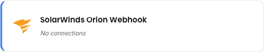
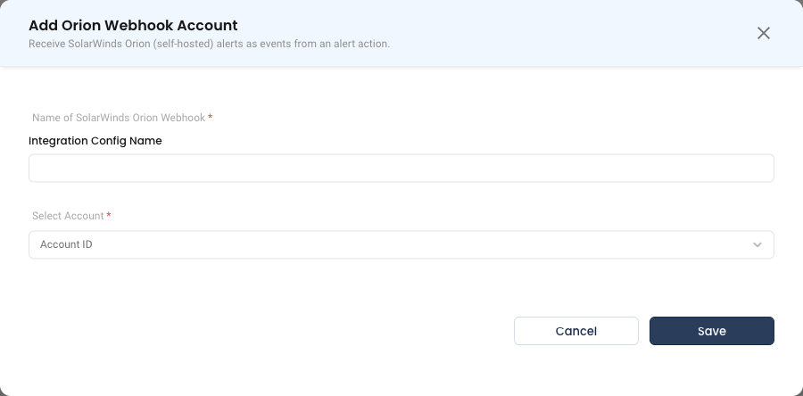

# SolarWinds Platform (Orion) Webhook

The SolarWinds Platform (Orion) webhook integration lets a self-hosted SolarWinds server push its alerts into NudgeBee.

SolarWinds has sold this product under several names: **Orion Platform** up to release 2022.1, **SolarWinds Platform** from 2022.2, and **SolarWinds Observability Self-Hosted** for the current bundle, with modules such as NPM and SAM. The alerting this integration uses is the same under all of them, so this guide calls the server Orion for short.

Each Orion alert on an object, such as a node, volume or interface, becomes one NudgeBee event that you can triage and use to trigger automations. When the alert resets in Orion, NudgeBee closes the event.

Orion sends alerts with its built-in **Send a GET or POST Request to a Web Server** alert action. You paste one fixed request body into that action. The body is the same for every alert, because every value in it is an Orion variable.

:::note SolarWinds Observability is a different product
This page is for the self-hosted product. For the SolarWinds Observability SaaS product, see [SolarWinds Webhook](./solarwinds_webhook.md).
:::

---

## Before You Start

- The Orion server must be able to make outbound HTTPS requests to your NudgeBee domain. Orion usually runs inside your network, so check the firewall and proxy rules for traffic leaving the Orion server.
- You need an Orion account that can edit alerts.
- Orion Platform 2020.2 or later. Earlier releases cannot set the request's content type. NudgeBee has been tested with SolarWinds Platform 2026.4.

---

## Step 1: Create the Webhook in NudgeBee

1. Navigate to **Admin** > **Integrations** > **Webhooks**.
2. Select **SolarWinds Platform (Orion) Webhook** and click **Add Orion Webhook Account**.
3. Fill in the form:
   * **Integration Config Name \*** (Required): a descriptive name, for example `orion-datacenter-1`.
   * **Account ID \*** (Required): the NudgeBee account that should receive these events.
4. Click **Save**.
5. The confirmation screen shows the webhook URL and the request body for Orion. Copy both. You can find the URL again later in the **URL** column of the SolarWinds Platform (Orion) Webhook list.





The URL has this form:

```
https://<your-nudgebee-domain>/api/webhooks/orion?token=<generated-token>
```

:::caution
The `token` query parameter authenticates the sender. Treat the full URL as a secret: anyone who holds it can create events in your tenant. If it leaks, delete the integration and create a new one to rotate the token.
:::

:::tip Connect more than one Orion server
Create one integration per Orion server. Orion numbers its objects from 1 on every server, so node `N:4` on one server and node `N:4` on another are different machines. Separate integrations keep their alerts apart.
:::

---

## Step 2: Add the Alert Action in Orion

### The request body

This is the body NudgeBee shows on the confirmation screen:

```json
{
  "status": "firing",
  "alert_def_id": "${N=Alerting;M=AlertDefID}",
  "alert_active_id": "${N=Alerting;M=AlertActiveID}",
  "alert_name": "${N=Alerting;M=AlertName}",
  "object": "${N=SwisEntity;M=Caption}",
  "object_type": "${N=Alerting;M=ObjectType}",
  "object_url": "${N=SwisEntity;M=DetailsUrl}",
  "ip": "${N=SwisEntity;M=IP_Address}",
  "severity": "${N=Alerting;M=Severity}",
  "message": "${N=Alerting;M=AlertMessage}",
  "url": "${N=Alerting;M=AlertDetailsUrl}"
}
```

Use it unchanged, apart from `status`. Orion escapes the values it inserts, so object names that contain quotes or backslashes, such as a `C:\` volume, still produce valid JSON.

### Configure the alert

1. In the Orion web console (the SolarWinds Platform web console), go to **Alerts & Activity** > **Alerts** > **Manage Alerts**.
2. Select an alert and click **Edit Alert**.
3. On **Trigger Actions**, click **Add Action**, select **Send a GET or POST Request to a Web Server**, and click **Configure Action**. Under the HTTP request settings:
   * **URL**: the NudgeBee webhook URL from Step 1, token included.
   * Select **Use HTTP POST**.
   * **Body to POST**: the request body above, with `"status": "firing"`.
   * **ContentType**: `application/json`.
   * **Authentication**: None. The token in the URL authenticates the request.
4. Click **Add Action**.
5. On **Reset Actions**, add a second action of the same type, with the same URL and the same body, but with `"status": "resolved"`.
6. Click through to **Summary** and submit the alert.
7. Repeat for each alert you want in NudgeBee. To reuse the two actions you already built, assign them to other alerts from the **Action Manager** tab on **Manage Alerts**.

> **Reference:** [Send a GET or POST request through HTTP or HTTPS in the SolarWinds Platform](https://documentation.solarwinds.com/en/success_center/orionplatform/content/core-using-get-or-post-url-functions-sw1058.htm)

---

## How Alerts Are Mapped

One NudgeBee event stands for one Orion alert on one object. The trigger action opens it, and the reset action closes it.

| NudgeBee Event Field | Taken From |
|----------------------|-----------|
| Title | `<alert_name> on <object>`, for example `Node is down on db-01` |
| Description | `message` |
| Rule name | `alert_name` |
| Subject | `object`. A node appears as a host. |
| Priority | `severity`. See the table below. |
| Status | `status`: `firing` or `resolved` |
| Link | `url`, the alert's details page in Orion |

| Orion Severity | NudgeBee Priority |
|----------------|-------------------|
| Critical, Serious | High |
| Warning | Medium |
| Notice | Low |
| Informational | Info |
| anything else | Medium |

**How NudgeBee tells alerts apart.** NudgeBee identifies an alert by the Orion alert definition and the object's ID in Orion, which it reads from `object_url`, for example `N:4` for a node. It does not rely on display names or IP addresses. As a result:

- Renaming a node, or a change of IP address between the trigger and the reset, does not break the link between them.
- Two objects with the same name, such as the `C:\` volume on two servers, get two separate events.
- Each time the alert fires again later, NudgeBee records a new occurrence. Orion's `alert_active_id` tells the occurrences apart.

**Labels.** Each event carries these labels:

| Label | Taken From |
|-------|-----------|
| `ip` | `ip`, as Orion read it when the action ran |
| `object_type` | `object_type` |
| `orion_object` | `object` |
| `orion_netobject` | The object ID inside `object_url`, for example `N:4` |
| `orion_alert_def_id` | `alert_def_id` |
| `orion_alert_active_id` | `alert_active_id` |
| `orion_severity` | `severity` |
| `orion_identity` | Set to `caption_fallback` when `object_url` has no object ID. NudgeBee then identifies the alert by the object's name instead. |

:::tip Add context with query parameters
Any extra query parameter you append to the URL becomes a label on every event it delivers, for example `&site=datacenter-1`. Labels that the integration sets take precedence. The `token` parameter is never copied into a label.
:::

**Alert rules.** Every Orion alert NudgeBee receives is also registered as an event rule, with the source `orion_webhook`. Orion alerts therefore appear in rule management next to your other alert sources, and you can mute them there.

**Workload linking.** Orion objects are servers and network devices, not Kubernetes workloads, so NudgeBee does not try to link these events to a workload.

---

## Step 3: Verify

1. In Orion, run the NudgeBee trigger action with the **Simulate** button on the alert's **Trigger Actions** page, or with **Test** on the **Action Manager** tab. Pick an object to test against.
2. In NudgeBee, open **Troubleshoot** > **Events**. An event titled `<alert_name> on <object>` should appear within a few seconds.
3. Run the reset action the same way, against the same object. The event closes.
4. If nothing appears, open the integration's row menu in **Admin** > **Integrations** > **Webhooks** > **SolarWinds Platform (Orion) Webhook** and choose **Activity Log**. It lists every delivery the webhook received.

A test delivery is not a real firing, so Orion leaves `alert_active_id` and `url` empty. NudgeBee accepts it all the same. Every test for the same alert and object updates one event, and the event has no link back to Orion.

---

## Known Limitation: Alerts That End Without a Reset

Orion does not run reset actions in some cases:

- The object is deleted or unmanaged in Orion.
- The alert definition is edited and saved while it has active alerts.

In these cases the alert disappears from Orion, but NudgeBee is never told, so the event stays open. Close such events by hand in NudgeBee.

---

## Troubleshooting

| Symptom | Likely Cause | Fix |
|---------|-------------|-----|
| No event appears, and the Activity Log is empty | The Orion server cannot reach the NudgeBee URL | Allow outbound HTTPS from the Orion server to your NudgeBee domain, including through any proxy |
| HTTP `400` with `webhook validation failed` | The `token` is missing or wrong, or the integration is disabled | Re-copy the full URL from the **URL** column. The token is part of the query string and is easy to drop when pasting. |
| HTTP `400` with `invalid payload` | A required field is missing or wrong. The response lists each field and the reason. | Paste the body again unchanged. `status` must be `firing` or `resolved`, and `alert_def_id`, `alert_name` and `object_url` (or `object`) must be present. |
| Events never close | The alert has no reset action, or the reset body still says `"status": "firing"` | Add the reset action from Step 2, with `"status": "resolved"` |
| An event stays open after the alert is gone from Orion | The object was deleted, or the alert was edited while active | See [Known Limitation](#known-limitation-alerts-that-end-without-a-reset). Close the event by hand. |
| Events carry the label `orion_identity=caption_fallback` | `object_url` did not contain an object ID | Keep `"object_url": "${N=SwisEntity;M=DetailsUrl}"` exactly as given |

---

## Helpful Links

- [Webhooks overview](./index.md)
- [SolarWinds Webhook (SolarWinds Observability SaaS)](./solarwinds_webhook.md)
- [Workflow triggers](../../features/workflow-builder/triggers.md)
- [Send a GET or POST request in the SolarWinds Platform](https://documentation.solarwinds.com/en/success_center/orionplatform/content/core-using-get-or-post-url-functions-sw1058.htm)
- [Manage alert actions in the SolarWinds Platform](https://documentation.solarwinds.com/en/success_center/orionplatform/content/core-manage-alert-actions.htm)
