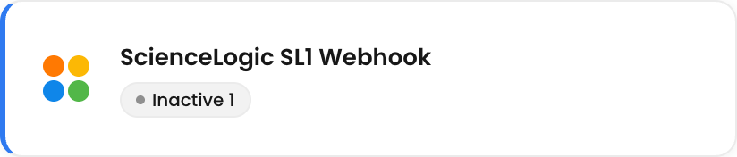
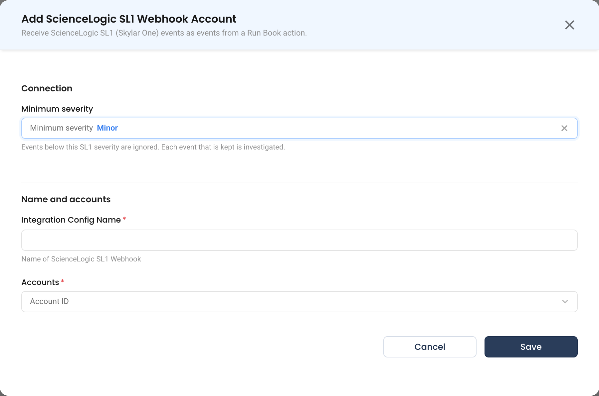

# ScienceLogic SL1 Webhook

Receive events from **ScienceLogic SL1** (Skylar One) directly into NudgeBee. When an SL1 event becomes active, NudgeBee creates an event and investigates it; when the SL1 event clears, NudgeBee resolves it. Each event carries its SL1 organization, so one SL1 that monitors many customers can send each customer's events to that customer's NudgeBee account.

To add the alerting device's metrics to each event, and to read SL1 metrics on the VM and Kubernetes pages, also set up the [ScienceLogic SL1](../Observability/sciencelogic.md) integration.

---

## How SL1 Sends Events

SL1 has no built-in webhook. It sends an event to another system from a **Run Book action** of type **Snippet**: a short Python script that SL1 runs when an automation policy matches the event. NudgeBee gives you that Snippet. You use it twice:

| Run Book action | Aligned to an automation policy for | Sends |
|-----------------|-------------------------------------|-------|
| The Snippet as NudgeBee gives it | **Active Events** | `"status": "firing"` |
| A copy with `STATUS = "resolved"` | **Cleared Events** (runs once, when the event clears) | `"status": "resolved"` |

---

## Step 1: Create the Webhook in NudgeBee

1. Navigate to **Admin** > **Integrations** > **Webhooks** tab.
2. Click the **ScienceLogic SL1 Webhook** card.



3. Fill in the configuration:
   - **Minimum severity** — SL1 events below this severity are ignored: `Notice`, `Minor` (default), `Major` or `Critical`. Every event NudgeBee keeps starts an investigation, so set this to the lowest severity you want investigated.
   - **Integration Config Name** — a descriptive name (e.g., `SL1 Production`).
   - **Accounts** — the NudgeBee account that receives events. To send each SL1 organization to its own account, see [Route Each Customer to Their Account](#route-each-customer-to-their-account).



4. Click **Save**. NudgeBee shows the webhook URL, with the token as `?token=`, and a ready-to-paste Snippet. The Snippet uses the same URL without the token:

```
https://<your-nudgebee-domain>/api/webhooks/sciencelogic
```

and sends the token in the `Authorization: Bearer` header instead. The token is a credential; treat it like a password.

---

## Step 2: Add the Run Book Actions in SL1

Menu names below are from the SL1 classic user interface.

1. In SL1, go to **Registry** > **Run Book** > **Actions** and create an action:
   - **Action Type**: **Snippet**.
   - **Execution Environment**: one that provides the Python `requests` library.
   - **Snippet Code**: paste the Snippet from Step 1, unchanged.
2. Create a second action the same way, with `STATUS = "resolved"` on the `STATUS` line of the Snippet.
3. Go to **Registry** > **Run Book** > **Automation** and create two automation policies:
   - one for **Active Events**, with the first action aligned;
   - one for **Cleared Events**, with the second action aligned.

   On both, set the minimum severity to the same level as the integration's **Minimum severity**, and align the organizations and event policies whose events you want in NudgeBee.

The Snippet NudgeBee gives you looks like this, with your own URL and token:

```python
import requests

STATUS = "firing"  # "resolved" in the action on the Cleared Events policy
URL = "https://<your-nudgebee-domain>/api/webhooks/sciencelogic"
TOKEN = "<your-webhook-token>"


def v(key):
    value = EM7_VALUES.get(key)
    return "" if value is None else str(value).strip()


body = {
    "status": STATUS,
    "event_id": v("%e"),
    "policy_id": v("%3"),
    "policy_name": v("%_event_policy_name"),
    "policy_external_id": v("%E"),
    "organization_id": v("%o"),
    "organization": v("%O"),
    "entity_type": v("%1"),
    "entity_id": v("%x"),
    "entity_name": v("%X"),
    "sub_entity_id": v("%y"),
    "sub_entity_name": v("%Y"),
    "ip": v("%a"),
    "severity": v("%s"),
    "severity_text": v("%S"),
    "message": v("%M"),
    "url": v("%H"),
    "counter": v("%c"),
    "first_seen": v("%D"),
    "last_seen": v("%d"),
    "cleared_at": v("%5"),
    "cleared_by": v("%4"),
}
r = requests.post(URL, json=body, headers={"Authorization": "Bearer " + TOKEN}, timeout=15)
EM7_RESULT = "HTTP %s %s" % (r.status_code, r.text[:300])
```

Every value is an SL1 run-book variable, so the Snippet is the same for every event. NudgeBee's answer appears in the action's output (`EM7_RESULT`): `HTTP 200` when NudgeBee received the event, or `HTTP 400` with the reason. The **Minimum severity** filter runs after receipt, so an ignored event also gets `HTTP 200`.

---

## The Format NudgeBee Expects

If you send events from your own script instead of the Snippet, send the same request.

- **Request**: `POST https://<your-nudgebee-domain>/api/webhooks/sciencelogic`
- **Headers**: `Content-Type: application/json` and `Authorization: Bearer <your-webhook-token>`
- **Body**: one flat JSON object of strings, one event per request.

| Field | SL1 variable | Required | Meaning |
|-------|--------------|----------|---------|
| `status` | set in the Snippet | Yes | `firing` (Active Events action) or `resolved` (Cleared Events action) |
| `policy_id` | `%3` | Yes | The SL1 event policy |
| `organization_id` | `%o` | Yes | The SL1 organization; account mapping routes on it |
| `entity_id` | `%x` | Yes, or `entity_name` | The entity the event is about |
| `entity_name` | `%X` | Yes, or `entity_id` | The entity's name; becomes the event's resource |
| `event_id` | `%e` | Recommended | The SL1 event. SL1 keeps it on every repeat and on the clear; a new firing after a clear gets a new one |
| `policy_name` | `%_event_policy_name` | No | The event's title; `SL1 event policy <policy_id>` when empty |
| `entity_type` | `%1` | No | `1` means a device; anything else is another kind of entity |
| `sub_entity_id`, `sub_entity_name` | `%y`, `%Y` | No | The part of the entity, such as a disk, interface or process. `0` means none |
| `severity` | `%s` | No | `0` Healthy, `1` Notice, `2` Minor, `3` Major, `4` Critical |
| `severity_text` | `%S` | No | Used when `severity` is not a number: `Healthy`, `Notice`, `Minor`, `Major`, `Critical` |
| `message` | `%M` | No | The event's description |
| `url` | `%H` | No | A link back to SL1; must be `http` or `https` |
| `organization` | `%O` | No | The organization's name |
| `ip` | `%a` | No | The entity's IP address |
| `policy_external_id` | `%E` | No | The event policy's external ID |
| `counter`, `first_seen`, `last_seen`, `cleared_at`, `cleared_by` | `%c`, `%D`, `%d`, `%5`, `%4` | No | `first_seen` sets the event's start time when it is a Unix time in seconds |

A value SL1 could not fill in arrives as its literal variable (for example `%x`), `None`, `null` or an empty string. NudgeBee treats all of these as missing.

Example body:

```json
{
  "status": "firing",
  "event_id": "941756",
  "policy_id": "1229",
  "policy_name": "Linux SSH: CPU utilization has Exceeded Threshold",
  "organization_id": "4",
  "entity_type": "1",
  "entity_id": "1294",
  "entity_name": "FL1-Linux-02",
  "sub_entity_id": "0",
  "severity": "4",
  "message": "Linux SSH: CPU usage has exceeded the threshold 70%. Current value is 93.77%."
}
```

---

## How It Works

Each request creates or updates **one** event.

### Validation

NudgeBee validates the body before accepting it. An invalid request is rejected with HTTP `400` and the reasons, each naming the SL1 variable the field expects:

```json
{
  "message": "invalid payload",
  "errors": [
    { "index": -1, "field": "organization_id", "reason": "is required: %o" }
  ]
}
```

### Which Events Are Kept

| Event | Result |
|-------|--------|
| `firing` with severity `0` (Healthy) | Ignored |
| `firing` below the integration's **Minimum severity** | Ignored |
| `firing` at or above **Minimum severity** | Event created and investigated |
| `firing` with no readable `severity` or `severity_text` | Event created and investigated, priority Medium |
| `resolved` | Always processed, so a kept event can close |

### State Mapping

| `status` | NudgeBee Status |
|----------|-----------------|
| `firing` | **Firing** |
| `resolved` | **Resolved** |

### Priority Mapping

| SL1 severity | NudgeBee Priority |
|--------------|-------------------|
| `4` Critical, `3` Major | High |
| `2` Minor, or unreadable | Medium |
| `1` Notice | Low |
| `0` Healthy (only on `resolved`) | Info |

### Event Fields

| NudgeBee field | Taken from |
|----------------|------------|
| Title | `<policy_name> on <entity_name>`, plus ` / <sub_entity_name>` when there is one; just `<policy_name>` when there is no `entity_name` |
| Description | `message` (the title when there is no message) |
| Link | `url` |
| Resource | `entity_name` — kind **host** when `entity_type` is `1`, otherwise **other** |

### Labels

| Label | Source |
|-------|--------|
| `source_tool` | always `ScienceLogic SL1` |
| `sl1_organization_id` | `organization_id` |
| `sl1_organization` | `organization` |
| `sl1_device_id` | `entity_id`, when `entity_type` is `1` |
| `sl1_entity_type`, `sl1_entity_id` | `entity_type`, `entity_id` |
| `sl1_sub_entity`, `sl1_sub_entity_id` | `sub_entity_name`, `sub_entity_id` |
| `sl1_event_id` | `event_id` |
| `sl1_event_policy_id`, `sl1_event_policy_external_id` | `policy_id`, `policy_external_id` |
| `sl1_severity` | `severity` as 0–4; when `severity` is not a number, `severity_text` converted to 0–4 |
| `ip` | `ip` |
| `sl1_identity` | `name_fallback` when the event was identified by a name instead of an ID |
| `nb_skip_workload_match` | `true` whenever `entity_name` is set, so NudgeBee does not match the entity's name to a Kubernetes workload |

### Event Deduplication

An alert is identified by its event policy (`policy_id`), its entity (`entity_type` and `entity_id`) and its sub-entity (`sub_entity_id`). A repeat of the same SL1 event updates the open event, and the clear resolves it. Each firing is keyed on `event_id`, so after the clear, a new firing of the same alert opens a new event under the same alert.

When `entity_id` is missing, the entity's name is used instead, and the event is labeled `sl1_identity=name_fallback`. Renaming the entity in SL1 then starts a new alert history. The same applies to a sub-entity without an ID.

### Route Each Customer to Their Account

In SL1, each customer is an **organization**. To send each organization's events to that customer's NudgeBee account, add account mapping rules to the webhook on the label `sl1_organization_id`. Use the organization ID, not its name, so renaming an organization in SL1 does not break the rule. One rule can list several organization IDs. An organization no rule matches goes to the integration's own account, so use that account as the catch-all.

### Device Metrics on Events

When the [ScienceLogic SL1](../Observability/sciencelogic.md) integration is also set up, each event about a device gets an **SL1 device metrics** card: the device's CPU, memory and other metrics from around the time the event started, read from SL1. The investigation reads this card.

---

## Verify the Integration

1. Send a test event from any machine that can reach NudgeBee. Use the example body above and your token:

```bash
curl -X POST "https://<your-nudgebee-domain>/api/webhooks/sciencelogic" \
  -H "Authorization: Bearer <your-webhook-token>" \
  -H "Content-Type: application/json" \
  -d @body.json
```

2. In NudgeBee, navigate to **Troubleshoot** > **All Events** and verify the event appears, titled `<policy name> on <entity name>`.
3. Send the same body with `"status": "resolved"` and confirm the event changes to **Resolved**.
4. In SL1, after the next matching event, check the Run Book action's output. It shows `HTTP 200` when NudgeBee received the event.

---

## Limits and Troubleshooting

- Two active SL1 events on the same event policy, entity and sub-entity become one NudgeBee event. The first clear resolves it while the other SL1 event is still active; the other's next repeat opens a new event.
- A clear closes the open event for the same event policy, entity and sub-entity, so a late, retried clear for an earlier event can close a later one.

| Issue | Resolution |
|-------|------------|
| HTTP `400` with `"message": "invalid payload"` | The body failed validation. The `errors` list names each field and the SL1 variable it expects. Check the Snippet matches Step 2. With `field: integration`, no account is linked to the webhook: select one under **Accounts**. |
| HTTP `400` with `webhook validation failed` | The token is wrong or missing. The Snippet sends it as `Authorization: Bearer <token>`; copy the Snippet again from the integration. |
| Webhook URL returns `404` | The path is wrong. The correct path is `/api/webhooks/sciencelogic`. |
| No events, and no output in the action | The automation policy did not match. Check its organizations, event policies and minimum severity. |
| Events arrive but none appear in NudgeBee | They are below the integration's **Minimum severity**, or have severity `0` (Healthy). |
| The action fails with `ModuleNotFoundError: requests` | Choose an execution environment that provides the Python `requests` library. |
| Events never resolve | Add the second action, with `STATUS = "resolved"`, on a **Cleared Events** automation policy. |
| Events land in the wrong account | Add an account mapping rule on `sl1_organization_id` for that organization. |
| Events show `sl1_identity=name_fallback` | `entity_id` (`%x`) or `sub_entity_id` (`%y`) was empty, so the event was identified by name. |
