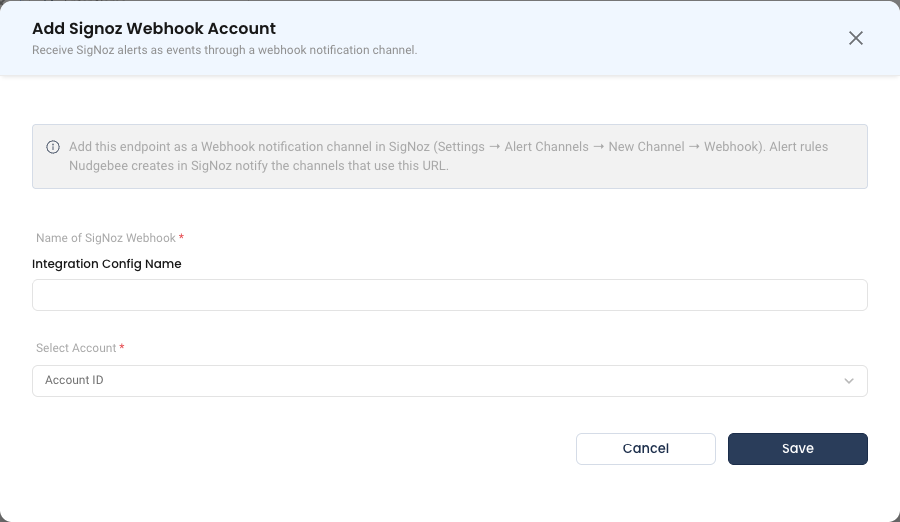

# SigNoz Webhook

The SigNoz webhook integration lets [SigNoz](https://signoz.io/) send its alert notifications into NudgeBee. Each firing alert becomes a NudgeBee event on the workload the alert names, ready to be triaged, investigated by Nubi and used to trigger automations.

It is also the channel NudgeBee routes its own SigNoz alert rules to. When NudgeBee creates an alert rule in SigNoz (see [SigNoz alert rules](../Observability/signoz.md#alert-rules)), the rule notifies the SigNoz channels that post to this webhook.

---

## Step 1: Create the Webhook in NudgeBee

1. Navigate to **Admin** > **Integrations** > **Webhooks**.
2. Select **Signoz Webhook** and click **Add Signoz Webhook Account**.
3. Fill in the form:
   * **Name of SigNoz Webhook \*** (Required): a descriptive name, for example `signoz-prod`.
   * **Select Account \*** (Required): the NudgeBee account that should receive these events.
4. Click **Save**.



NudgeBee generates a unique webhook URL for the integration:

```
https://<your-nudgebee-domain>/api/webhooks/signoz?token=<generated-token>
```

5. **Copy the webhook URL** exactly as the integration shows it. You will paste it into SigNoz in the next step.

:::caution
The `token` query parameter authenticates the sender and identifies the NudgeBee account. Treat the full URL as a secret: anyone holding it can create events in your tenant. If it leaks, delete the integration and create a new one to rotate the token.
:::

---

## Step 2: Add the URL as a Webhook Channel in SigNoz

1. In SigNoz, go to **Settings** > **Alert Channels** and click **New Channel**.
2. Set **Type** to **Webhook**.
3. Paste the NudgeBee webhook URL, token included, into **Webhook URL**.
4. Turn on **Send resolved alerts** so NudgeBee can close events when the alert clears.
5. Save the channel, then add it to the SigNoz alert rules whose notifications you want in NudgeBee.

Leave the payload as SigNoz sends it. SigNoz's webhook body is Alertmanager-compatible, which is what this integration reads.

:::info One channel per NudgeBee account
NudgeBee recognizes a channel by the token in its URL. If one SigNoz serves several NudgeBee accounts or environments, create one SigNoz Webhook integration per account and one channel per integration. Rules NudgeBee creates for an account are routed only to that account's channels.
:::

> **Reference:** [SigNoz alert channels documentation](https://signoz.io/docs/alerts-management/notification-channel/webhook/)

---

## What NudgeBee Reads From a Notification

| From SigNoz | In NudgeBee |
|---|---|
| `labels.alertname` | The event type and title (the `summary` annotation wins for the title when present) |
| `labels.severity` | The event priority |
| `k8s.namespace.name`, `k8s.deployment.name`, `k8s.statefulset.name`, `k8s.daemonset.name`, `k8s.job.name`, `k8s.cronjob.name`, `k8s.pod.name`, `service.name` | The workload the event is attached to. These arrive as labels when the alert rule groups by them |
| `labels.ruleId`, `labels.ruleSource` | The SigNoz rule, linked from the event |
| `annotations.description`, `related_logs`, `related_traces` | Shown in the event's SigNoz alert evidence |
| `startsAt`, `endsAt`, `status` | When the alert fired and resolved |

:::tip Group your alert rules by Kubernetes attributes
NudgeBee can only attach an event to a workload the notification names. In the SigNoz rule, group by `k8s.namespace.name` and `k8s.deployment.name` (or `k8s.pod.name`) so those labels are in every notification.
:::

---

## Step 3: Verify

1. Use **Test** on the channel in SigNoz, or wait for a real alert to fire.
2. In NudgeBee, open **Troubleshoot** > **All Events**. The event should appear within a few seconds.
3. Open it and confirm the alert name, severity and workload carried across.

---

## Troubleshooting

| Symptom | Likely Cause | Fix |
|---------|-------------|-----|
| No event appears | SigNoz cannot reach the NudgeBee URL | Confirm the NudgeBee endpoint is reachable from your SigNoz instance. Check egress rules on both sides |
| `400` from the endpoint | The `token` parameter is missing or wrong | Re-copy the full URL from the integration. The token is part of the query string and is easy to drop when pasting |
| Event appears with no workload linked | The alert rule does not group by Kubernetes attributes | Group the rule by `k8s.namespace.name` and `k8s.deployment.name` or `k8s.pod.name` |
| Alerts never resolve in NudgeBee | **Send resolved alerts** is off | Turn it on in the SigNoz channel |
| Creating an alert rule from NudgeBee fails with "no SigNoz notification channel posts to this account's Nudgebee SigNoz webhook" | No SigNoz channel carries this integration's URL | Add the URL as a Webhook channel (Step 2) |

---

## Helpful Links

- [SigNoz integration: logs, metrics and alert rules](../Observability/signoz.md)
- [SigNoz alert channels](https://signoz.io/docs/alerts-management/notification-channel/webhook/)
- [Webhook integrations overview](./index.md)
