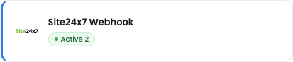
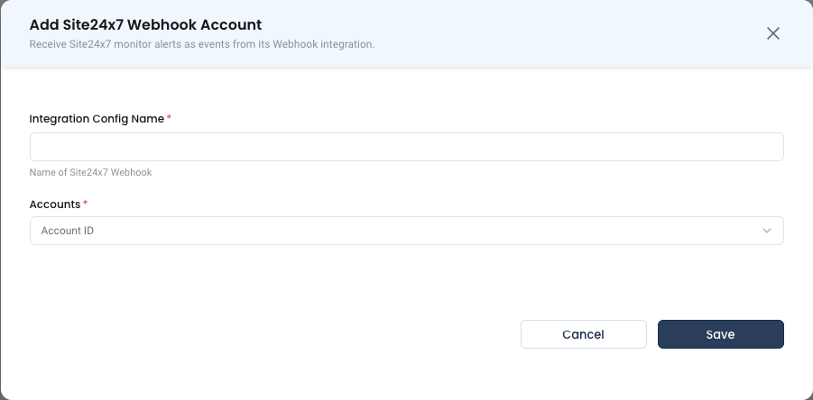

# Site24x7 Webhook

Receive alerts from **Site24x7** directly into NudgeBee. When a monitor goes **Down**, **Trouble** or **Critical**, NudgeBee creates an event and investigates it; when the monitor is **Up** again, NudgeBee resolves it. Server alerts link to their VM, and Kubernetes alerts to their workload or pod.

To add the monitor's data and recent alarms to each event, and to read Site24x7 on the VM and Kubernetes pages, also set up the [Site24x7](../Observability/site24x7.md) integration and link it to the same accounts.

---

## Step 1: Create the Webhook in NudgeBee

1. Navigate to **Admin** > **Integrations** > **Webhooks** tab.
2. Click the **Site24x7 Webhook** card.



3. Fill in the configuration:
   - **Integration Config Name**: a descriptive name (e.g., `Site24x7 Production`).
   - **Accounts**: the NudgeBee account that receives alerts. Select one account; to send each customer or cluster to its own account, see [Route Alerts to Accounts](#route-alerts-to-accounts).



4. Click **Save**. NudgeBee shows the webhook URL with its token:

```
https://<your-nudgebee-domain>/api/webhooks/site24x7?token=<your-webhook-token>
```

The token is a credential; treat it like a password.

---

## Step 2: Add the Webhook in Site24x7

1. In Site24x7, go to **Admin** > **Third-Party Integrations**, click **Add** and choose **Webhooks**.
2. Set:
   - **Hook URL**: the URL from Step 1. To keep the token out of the URL, use the URL without `?token=…` and add a custom header **Authorization** with the value `Bearer <your-webhook-token>`.
   - **HTTP Method**: `POST`.
   - **Post as JSON**: on.
   - **Send Incident Parameters**: on.
   - **Trouble** and **Critical** alerts: on, if you want them in NudgeBee as well as **Down**.
   - **Resources**: all monitors, or the monitors, groups or tags you want in NudgeBee.
3. Save the integration.

Site24x7 sends one post when a monitor's status changes and one when it is Up again. You do not write a body template: NudgeBee reads Site24x7's own incident parameters.

---

## How It Works

### Two Alerts per Monitor

Each monitor has two alerts in NudgeBee, so a host going down is never hidden inside an open CPU event:

| Site24x7 status | **Down** alert (monitor unreachable or agent stopped) | **Threshold** alert (up but breaching a threshold) |
|-----------------|-------------------------------------|----------------------------------|
| Down | Fires | Resolves |
| Trouble, Critical | Resolves | Fires |
| Up | Resolves | Resolves |

A new outage after a resolve opens a new event, linked to the alert's history. Down and Critical get priority **High**; Trouble gets **Medium**.

### Event Fields

| NudgeBee field | Taken from |
|----------------|------------|
| Title | The incident reason (without ` (Resolved)`) `on <monitor name>` |
| Description | The reason, each failed attribute with its value and unit, and for agent servers the top processes by CPU and memory (name, PID, CPU %, memory MB; never the command line) |
| Start | The outage time Site24x7 sends, not the time the post arrived |
| Resource | The monitor name: a VM (by its first IPv4 address) for server monitors; the workload or pod for Kubernetes monitors |

### Labels

| Label | Source |
|-------|--------|
| `source_tool` | always `Site24x7` |
| `s247_monitor_id` | the monitor's ID |
| `s247_monitor_type` | `SERVER`, `URL`, `KUBERNETES_DEPLOYMENTS`, … |
| `s247_status` | `DOWN`, `TROUBLE`, `CRITICAL` or `UP` |
| `s247_condition` | the attribute that alerted, e.g. `CPUUSEDPERCENT` |
| `s247_tags` | the monitor's tags, comma-separated |
| `s247_cluster` | Kubernetes monitors: the cluster's API server address from the `cluster:` tag |
| `instance`, `ip` | the first IPv4 address (server monitors) |
| `node`, `pod_ip` | Kubernetes pods |

### Kubernetes Alerts

Site24x7's Kubernetes agent sends its alerts through the same webhook. An alert about a Deployment, StatefulSet, DaemonSet or pod links to that workload in the receiving account, by its name and namespace. A renamed monitor still links, because NudgeBee uses the object's own name. Other Kubernetes monitors (nodes, jobs, services) keep the monitor name and are not linked.

A failing pod often produces two Site24x7 alerts, the pod's and its Deployment's; both link to the same workload.

### Route Alerts to Accounts

The webhook's own account receives every alert no rule matches. Add account mapping rules to the webhook to send alerts elsewhere:

- **Customers**, by monitor tags: a rule on `s247_tags`. It compares the whole label, so it matches a monitor whose full tag list is exactly the listed value, e.g. `customer:finance`.
- **Kubernetes clusters**, when one Site24x7 account watches several: a rule on `s247_cluster` with the cluster's API server address, sending it to that cluster's NudgeBee account. Without it, every cluster's alerts go to one account and link to nothing there.

Link the webhook to one account and route the rest with rules: a webhook linked to several accounts sends every alert to the first of them.

### Moving Off Email Alerts

If you already send Site24x7 alerts to NudgeBee by email, stop the email path for Site24x7 when you turn the webhook on. Otherwise each incident opens two events and two investigations.

---

## Verify the Integration

1. Make a monitor go Trouble in Site24x7, for example by lowering one of its thresholds below the current value.
2. In NudgeBee, navigate to **Troubleshoot** > **All Events** and check that the event appears, titled `<reason> on <monitor name>`.
3. Put the threshold back. When Site24x7 marks the monitor Up, the event changes to **Resolved**.

---

## Limits and Troubleshooting

- Site24x7 posts when its agent uploads, 17 seconds to about 3 minutes after the poll. The event's start time comes from Site24x7, so it is right even when the post is late.
- Site24x7 signs nothing; the token is the authentication.
- Top processes are not in every post. The [Site24x7](../Observability/site24x7.md) integration's monitor data card is the reliable view of the monitor's data.
- A website monitor has no IP address, so its event links to no VM.

| Issue | Resolution |
|-------|------------|
| HTTP `401` | The token is missing or wrong. Copy the URL again from the integration, or check the `Authorization: Bearer <token>` header. |
| HTTP `400` naming a field | The post had no status, monitor ID or monitor name. Turn on **Send Incident Parameters** and **Post as JSON**. |
| Events never resolve | Site24x7 did not post the monitor's Up. Check that the webhook's **Resources** include the monitor. |
| Trouble alerts are missing | Turn on **Trouble** (and **Critical**) in the Site24x7 webhook. |
| Two events per incident | The email path still forwards Site24x7 alerts. See [Moving Off Email Alerts](#moving-off-email-alerts). |
| Kubernetes alerts link to nothing | The alert went to an account that is not its cluster's. Add an account mapping rule on `s247_cluster`. |
| Alerts land in the wrong account | Add an account mapping rule on `s247_tags` or `s247_cluster`. |
